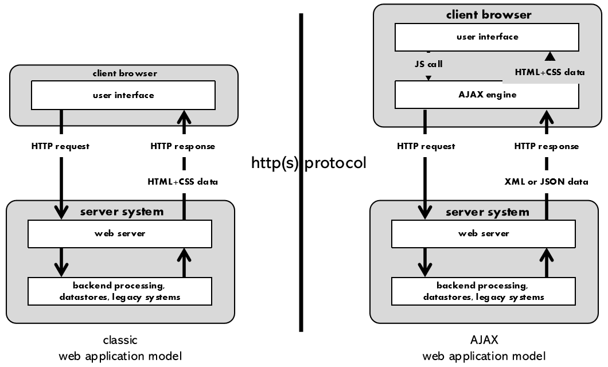

Appunti del corso di **Applicazioni Web: Progettazione e Sviluppo** della magistrale in Informatica all'UNIMIB, A.A. 2026/2027. Docenti: **Flavio De Paoli** e **Giuseppe Vizzari** (laboratorio).

:::tip
Naviga le lezioni dalla **sidebar**.
:::

## Contenuti del Corso

Il corso studia i principi delle tecnologie software distribuite (TCP/IP e HTTP) e le architetture delle applicazioni, con particolare attenzione alla parte rivolta all'utente. Comprende una parte pratica su JavaScript, Ajax e React. Si articola su tre aspetti: **concetti**, **modelli** e **pratica**.

| Obiettivo | Contenuti |
| --- | --- |
| **Architettura delle applicazioni Web** | Client/server, HTTP, TCP/IP, modello API/REST |
| **Architettura di app dinamiche** | Modello AJAX, pattern MVC |
| **Progettare e realizzare client** | JavaScript ES6, React 18 |
| **Realizzare semplici server** | Node.js |

Il **programma dettagliato** è questo:

| # | Argomento | Stato negli appunti |
| --- | --- | --- |
| I | Concetti base di programmazione con JavaScript | [Teoria 1-6](./teoria/01-fondamenti-di-javascript/) |
| II | Internet, TCP/IP, HTTP, architettura delle applicazioni Web | [Teoria 7](./teoria/07-reti-http-tcp-e-socket/) |
| III | Client: interfacce attive Ajax (HTML5, CSS3, JavaScript) | Non ancora trattato nel corso |
| IV | Server: REST, Node.js | Non ancora trattato nel corso |
| V | Scambio di informazioni: XML, JSON, Linked Data, RDF | Non ancora trattato nel corso |
| VI | Architetture smart: Web of Services, Data, Things | Non ancora trattato nel corso |
| VII | Laboratorio: interfacce con React | [Laboratorio 1-6](./laboratorio/01-pagine-web-dinamiche/) |

### Client Classico e AJAX

Nel modello **classico** ogni interazione ricarica una pagina HTML intera. Nel modello **AJAX** un motore JavaScript nel browser fa richieste HTTP in background, riceve dati in XML o JSON e aggiorna solo le parti che variano: sono le applicazioni **single-page**.

| | JavaScript | React |
| --- | --- | --- |
| **DOM** | Manipolato direttamente | Si lavora su un DOM **virtuale** |
| **Stile** | **Imperativo**: scrivi le azioni di modifica | **Dichiarativo**: descrivi cosa vuoi, e React orchestra |
| **Architettura** | A carico del progettista | **Componenti** innestati e riusabili |

In entrambi i casi il flusso parte da un evento: l'utente clicca, viene eseguito il gestore e il DOM cambia, direttamente con JavaScript, o tramite il DOM virtuale con React.

## Modalità d'Esame

- La **prova scritta** si svolge su piattaforma elettronica, con domande aperte e/o chiuse, per un massimo di **30 punti**.
- Può essere integrata da una **prova orale**, su richiesta del docente o dello studente, che può alzare o abbassare il voto.
- Chi ha frequentato i laboratori può ottenere fino a **5 punti supplementari** con un **progetto finale** concordato con il docente, da consegnare orientativamente entro febbraio 2027.

**Voto finale = prova scritta + progetto finale (se consegnato) + eventuale integrazione orale.**

Il **primo appello** si svolge con **prove in itinere**: una prima parte verso **metà novembre** e una seconda a **inizio gennaio**. Le date precise non sono nel materiale disponibile.

La frequenza è **fortemente auspicata**, per l'eterogeneità delle preparazioni e la mancanza di un libro di testo unico.

:::note[Uso dell'IA]
È consentita per lo studio e per il progetto. I punti del progetto vengono però assegnati dopo una discussione in presenza del codice: chi non sa motivare le scelte e spiegare il codice perde punti.
:::

## Testi di Riferimento

Non c'è un unico testo. Sono consigliati i primi due capitoli di *Reti di calcolatori e Internet* di Kurose e Ross, *REST in Practice*, oltre a tutorial online come [W3Schools](https://www.w3schools.com/js/), la documentazione [MDN](https://developer.mozilla.org/en-US/docs/Web/JavaScript) e [Eloquent JavaScript](https://eloquentjavascript.net/).

## Come Sono Organizzati gli Appunti

Ogni lezione segue le slide e si chiude con un **Autotest** con soluzioni e un **Glossario**. Gli esercizi guidati sono nella sezione **Esercizi**, mentre la sezione **Laboratorio** segue le lezioni su JavaScript e React.

- I riquadri **Complemento** contengono materiale non presente nelle slide.
- I riquadri di attenzione intitolati **Slide N** segnalano errori e imprecisioni.

| Appunti | Fonte |
| --- | --- |
| [Fondamenti di JavaScript](./teoria/01-fondamenti-di-javascript/) | JavaScript parte 1, esercizi, Protobject |
| [JavaScript nella Pagina Web](./teoria/02-javascript-nella-pagina/) | JavaScript parte 2 |
| [Funzioni ed Eventi](./teoria/03-funzioni-ed-eventi/) | JavaScript parte 3 |
| [Modifica Dinamica del DOM](./teoria/04-modifica-dinamica-del-dom/) | Esercizio DOM |
| [Stringhe, Array e Oggetti](./teoria/05-stringhe-array-e-oggetti/) | JavaScript parte 4 |
| [Lettura e Scrittura dei Dati](./teoria/06-lettura-e-scrittura-dati/) | Approfondimento |
| [Reti, HTTP, TCP e Socket](./teoria/07-reti-http-tcp-e-socket/) | Argomento 02 |
| [Pagine Web Dinamiche](./laboratorio/01-pagine-web-dinamiche/) | Pagine dinamiche, LabIntro |
| [Recap di JavaScript e jQuery](./laboratorio/02-recap-javascript-e-jquery/) | Lab JavaScript recap |
| [Esercizi Pullquote e ToDo List](./laboratorio/03-esercizi-pullquote-e-todo/) | Esercizio pullquote, boilerplate |
| [Introduzione a React](./laboratorio/04-introduzione-a-react/) | Introduzione a React, TicTacToeReact |
| [JSX, Componenti, Props e State](./laboratorio/05-jsx-componenti-props-state/) | JSX, Component, Props, State |
| [Lifecycle e useEffect](./laboratorio/06-lifecycle-e-useeffect/) | Lifecycle |
| [Calcolo del Minimo](./esercizi/01-calcolo-del-minimo/) | Esercizi 2022-24 |
| [Disegno su Canvas](./esercizi/02-disegno-su-canvas/) | Esercizio e soluzione |
| [Gioco del 15](./esercizi/03-gioco-del-15/) | Assegnamento |

## Materiale Non Incluso

Queste risorse sono elencate su e-learning, ma **non sono nella cartella fornita**:

- I **due video** del Laboratorio JavaScript React.
- Il **testo della consegna** della ToDo list: la pagina di partenza c'è, ma le funzioni richieste sono [ricostruite](./laboratorio/03-esercizi-pullquote-e-todo/#esercizio-todo-list).
- La dispensa **Introduzione alla programmazione**.
- Il **Materiale 2020** sui poligoni, segnalato come non conforme al programma attuale.
- L'**esempio di esame** con domande miste commentate.

## Correzioni Rispetto alle Slide

Il codice JavaScript delle slide è stato eseguito per verificarlo. Il codice React invece ha avuto solo un controllo di sintassi, senza essere eseguito.

| Dove | Cosa dice la slide | Correzione |
| --- | --- | --- |
| Parte 1, slide 11 | `(4 >== 6)` | Errore di sintassi: `>=` |
| Parte 2, slide 4 | `Console.log` | `console.log` |
| Parte 3, slide 4-5 | Ciclo su `birthYear.length` | L'array si chiama `birthDate` |
| Parte 4, slide 6-7 | Esempi di `pop`, `shift`, `splice` | Validi solo a partire dall'array originale |
| Parte 4, slide 9 | `car[model]` | `car["model"]` |
| Parte 4, slide 9 | La proprietà assume il valore della funzione | Contiene la funzione, va chiamata |
| Parte 4, slide 10 | `new Date()` usato come anno | `new Date().getFullYear()` |
| Parte 4, slide 13 | `x` è sempre il valore dell'indice | Valore con `of`, chiave con `in` |
| **Parte 4, slide 25** | **Minimo con `reduce`** | **Errato: salta il secondo elemento** |
| Parte 4, slide 27 | `> 18` | Esclude chi ha 18 anni: `>= 18` |
| HTTP, slide 18 | RFC 2056 | RFC 2046 |
| HTTP, slide 28 | UDP scompone uno stream | UDP lavora a messaggi |
| HTTP, slide 44-48 | La socket usa una nuova porta | In TCP la porta locale è la stessa |
| HTTP, slide 50 | Ritardo: "banda minima" | Ritardo contenuto |
| HTTP, slide 51 | Web tollerante alle perdite | HTTP usa TCP, affidabile |
| Recap, slide 14 | `authors[length]` | `authors[authors.length]` |
| Recap, slide 16 | `null` e `undefined` sono oggetti | Sono valori primitivi |
| Recap, slide 21 e 25 | `h2` senza classe nell'HTML | Il codice seleziona la classe `menu` |
| Recap, slide 27 | Commento "a block" nel ramo `else` | Il codice imposta `none` |
| Recap, slide 32 | La seconda funzione aggiunge `close` | La rimuove |
| Recap, slide 29-32 | `.toggle` con due funzioni | Rimosso da jQuery 1.9 |
| JSX, slide 15 | Un file `.js` per componente | Con Vite: `.jsx` |
| JSX, slide 32 | `index.html` in `public` | In Vite sta nella radice |
| Lifecycle, slide 6-15 | `ReactDOM.render` | Vecchia sintassi: `createRoot` |
| Lifecycle, slide 21 | `componentWillUnmount` sotto "Updating" | Fase di Unmounting |
