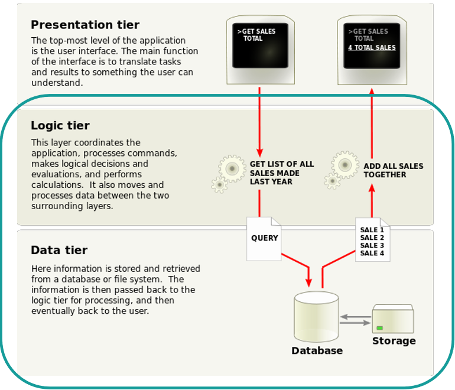
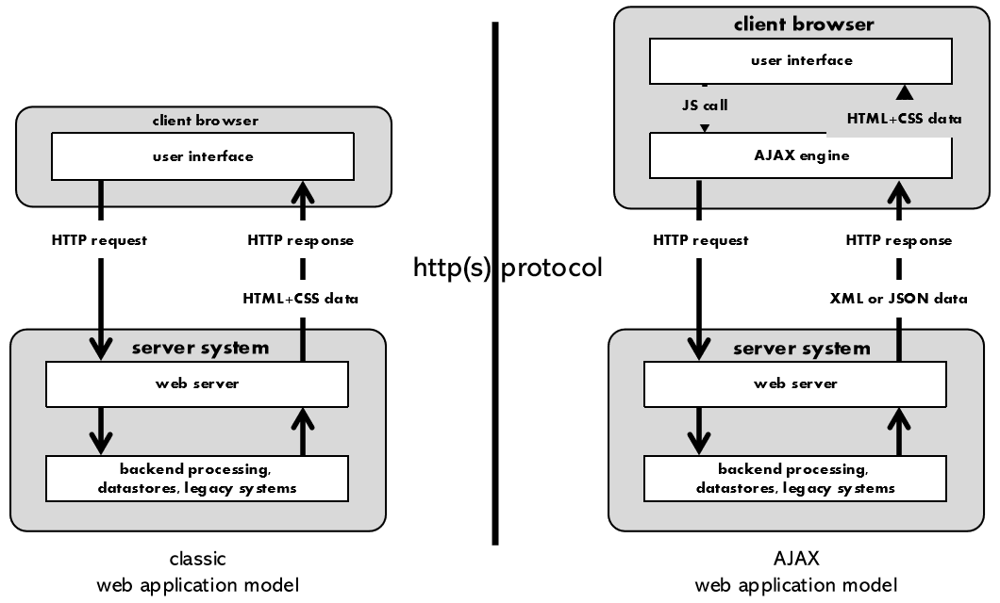

## Il Punto di Partenza: il Web Statico

Il Web nasce per condividere **articoli scientifici** e stimolare la ricerca. In questo scenario bastano pagine scritte una volta per tutte, ed è da qui che parte la definizione:

:::tip[Definizione]
Una **pagina statica** è una pagina HTML, scritta da un autore umano o automatico, che non cambia nei contenuti o nella visualizzazione, salvo modifiche manuali.
:::

Anche i primi siti molto popolari erano così: Yahoo nasce come *Jerry and David's Guide to the World Wide Web*, in pratica un elenco organizzato di siti, una sorta di "pagine gialle" del Web.

## Primo Livello: il Dinamismo Lato Server

Un **motore di ricerca**, per definizione, non può essere fatto di pagine statiche. Cosa è dinamico? Il **contenuto della pagina**: i risultati dipendono da una query che non si conosce fino a quando l'utente non la scrive.

Dove viene gestita questa dinamicità? **Non nel client**: negli anni '90 JavaScript era poco più di una curiosità. La pagina conteneva un form, ma quello serve solo a specificare la query. È il **server** che la riceve e compone la pagina dei risultati, usando le proprie informazioni, cioè l'indice delle pagine note.

:::tip[Da ricordare]
Il **primo livello di dinamicità** è gestito **lato server**.
:::

Questo schema corrisponde all'architettura **multi-tier**:



| Tier | Ruolo |
| --- | --- |
| **Presentation** | L'interfaccia utente: mostra attività e risultati in forma comprensibile |
| **Logic** | Coordina l'applicazione, elabora i comandi, prende decisioni, sposta i dati tra gli altri due livelli |
| **Data** | Conserva e recupera le informazioni in database o file system |

### Un Esempio di Form

```html
<form method="get" action="http://www.google.com/search">
    <input type="text" name="querystring">
    <input type="submit" name="button1" value="Google Search">
</form>
```

Inserendo `blah blah` e premendo il bottone, al server arriva:

```text
querystring=blah+blah&button1=Google+Search
```

Ogni campo con un `name` diventa una coppia `nome=valore`, e gli spazi diventano `+`. Con `method="get"` i dati finiscono nell'URL. Si può osservare la richiesta negli strumenti del browser, alla voce **Network**.

### Oltre i Motori di Ricerca

Il Web è presto diventato un luogo di **editori umani che non scrivono HTML**. I **Content Management System** e i sistemi per blog sono oggi la grande maggioranza dei siti:

- I siti comuni, dall'informazione all'e-commerce, si basano su dati inseriti da utenti e sistemi automatici in un **database**.
- Dei **template**, progettati con cura anche per aspetti come la SEO, compongono le pagine HTML trasmesse ai browser.
- WordPress, Drupal, Shopify e Moodle appartengono a questa categoria.

## Secondo Livello: il Dinamismo Lato Client

Oggi molte pagine non solo sono costruite da dati e template, ma **cambiano nei contenuti anche senza un intervento dell'utente**. L'esempio classico è la webmail, che mostra un nuovo messaggio appena arriva.

:::caution[Il server non spinge nulla]
Salvo l'accettazione di notifiche, non c'è un vero invio dal server al client. Di solito è il client a **chiedere al server**, ad esempio a intervalli regolari, se c'è qualcosa di nuovo.
:::

In un'applicazione moderna la dinamicità è gestita **su più livelli**:

- La pagina può essere generata la prima volta dal server, con i dati del data tier.
- Dopo, salvo interventi dell'utente, **non viene più ricostruita da zero**, ma soltanto cambiata: pezzi di DOM vengono cancellati, modificati o aggiunti.
- L'interazione tra client e server è **asincrona** rispetto alla richiesta della pagina, e molto più frequente.

### AJAX

**AJAX** (*Asynchronous JavaScript and XML*) è il modello che rende possibile tutto questo. Nel modello classico ogni richiesta restituisce una pagina intera, mentre in quello AJAX un motore nel browser fa richieste in background e riceve solo i dati.



Nonostante il nome, la stragrande maggioranza delle interazioni oggi non usa XML ma **JSON**.

### DOM e Codice Sorgente

Una domanda che chiarisce molto: l'albero DOM corrisponde al codice sorgente?

| Tipo di pagina | Il DOM rispecchia il sorgente? |
| --- | --- |
| **Statica** | Sì, fedelmente |
| **Generata lato server** | Sì, rispetto al sorgente ricevuto dal browser, che però non è un file scritto a mano |
| **Modificata lato client** | **No**: il DOM cambia dopo il caricamento, il sorgente resta quello ricevuto |

## La Definizione

:::tip[Definizione del docente]
Una **pagina web dinamica** è una pagina i cui contenuti non sono definiti staticamente, almeno perché stabiliti all'atto della sua generazione (**lato server**), e magari anche dopo che la pagina è stata trasmessa al client e visualizzata (**lato client**), grazie a forme di interazione asincrona tra client e server.
:::

I due tipi di dinamismo sono sempre più spesso presenti insieme.

## Strumenti del Browser

Tre strumenti collegano quello che si osserva alla teoria:

| Strumento | A cosa serve |
| --- | --- |
| **Visualizzatore del sorgente** | Mostra l'HTML ricevuto |
| **Inspector** | Mostra lo **stato attuale** della pagina, cioè il DOM |
| **Network** | Mostra le connessioni di rete |

Confrontare sorgente e Inspector fa vedere subito se una pagina è stata modificata lato client.

## Setup dell'Ambiente

Per il laboratorio servono tre cose:

| Strumento | Note |
| --- | --- |
| **Node.js** (ultima LTS) | Serve per usare l'app builder Vite |
| **WebStorm** (versione education) | Si può usare anche Visual Studio Code, ma a lezione si usa WebStorm |
| **Un browser** | A lezione si usa Firefox |

Dopo l'installazione, da riga di comando si verifica che funzionino:

```bash
node -v
npm -v
```

## Autotest

**1.** Che cos'è una pagina statica?

<details>
<summary>Soluzione</summary>

Una pagina HTML scritta da un autore, che non cambia nei contenuti o nella visualizzazione, salvo modifiche manuali.

</details>

**2.** Perché un motore di ricerca non può essere fatto di pagine statiche?

<details>
<summary>Soluzione</summary>

Perché i risultati dipendono da una query sconosciuta fino al momento in cui viene espressa: il contenuto va composto al momento.

</details>

**3.** Il form di un motore di ricerca rende dinamica la pagina?

<details>
<summary>Soluzione</summary>

No: permette solo di specificare la query. La dinamicità sta nella risposta, composta dal server.

</details>

**4.** Quali sono i tre livelli di un'architettura multi-tier?

<details>
<summary>Soluzione</summary>

Presentation, logic e data.

</details>

**5.** Una webmail mostra un nuovo messaggio senza ricaricare la pagina. Come fa, se il server non può spingere dati?

<details>
<summary>Soluzione</summary>

Il client chiede periodicamente al server se ci sono novità, in modo asincrono, e aggiorna solo la parte interessata del DOM.

</details>

**6.** In che modo Inspector e sorgente della pagina possono differire?

<details>
<summary>Soluzione</summary>

Il sorgente è l'HTML ricevuto, l'Inspector mostra il DOM corrente. Se JavaScript ha modificato la pagina, i due non coincidono.

</details>

## Glossario

- **Pagina statica** - Pagina che cambia solo con modifiche manuali.
- **Pagina dinamica** - Pagina con contenuti definiti alla generazione o dopo la visualizzazione.
- **Multi-tier** - Architettura divisa in livelli di presentazione, logica e dati.
- **CMS** - Sistema per gestire contenuti senza scrivere HTML.
- **Template** - Modello usato per comporre le pagine.
- **AJAX** - Richieste asincrone che aggiornano solo parti della pagina.
- **Inspector** - Strumento del browser che mostra il DOM corrente.
