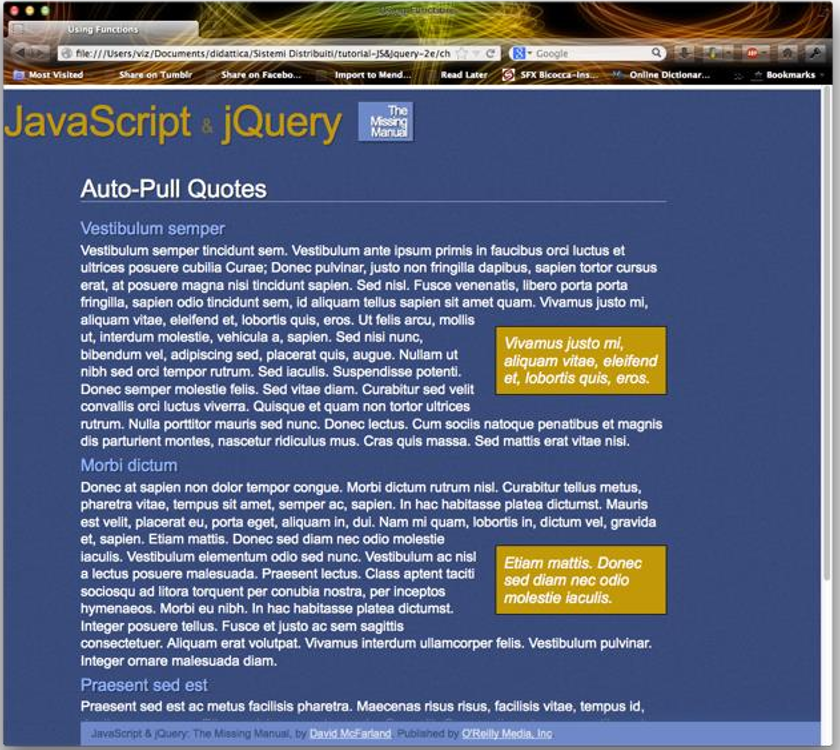

## Esercizio: Pullquote

**Obiettivo**: nella pagina fornita alcune frasi sono racchiuse in uno `span` di classe `pq`. Vanno riportate a lato in un box, lasciandole anche nel testo. È lo stesso esercizio visto in [Modifica Dinamica del DOM](../../teoria/04-modifica-dinamica-del-dom/), con la classe `pq` al posto di `highlight`.



```html
<p>... <span class="pq">Vivamus justo mi, aliquam vitae, eleifend et.</span> ...</p>
```

La regola CSS è già pronta:

```css
.pullquote {
    float: right;
    clear: right;
    width: 200px;
    border: 1px solid black;
    padding: 10px;
    font-size: 20px;
    background-color: rgb(195, 151, 51);
    margin: 20px 0 10px 10px;
    font-style: italic;
    color: rgb(255, 255, 255);
}
```

Le slide elencano i passi:

1. Selezionare ogni `span` di classe `pq`.
2. Clonarlo.
3. Cambiare la classe da `pq` a `pullquote`.
4. Inserirlo nell'albero DOM in un punto sensato, vicino al `pq`.

### Soluzione

Lo script nel materiale sta nell'`head`, quindi deve aspettare il caricamento del documento.

```javascript
document.addEventListener('DOMContentLoaded', function () {
    const collection = document.getElementsByClassName("pq");
    for (let i = 0; i < collection.length; i++) {
        const quote = collection[i].cloneNode(true);
        quote.classList.remove('pq');
        quote.classList.add('pullquote');
        collection[i].parentElement.insertBefore(quote, collection[i]);
    }
});
```

Inserendo il box **prima** dello `span`, con `float: right` il riquadro si allinea alla riga in cui inizia la frase.

:::caution[L'ordine conta]
`getElementsByClassName` restituisce una collezione **viva**, che si aggiorna con il DOM. Se inserissi il clone **prima di cambiargli la classe**, la collezione crescerebbe a ogni giro e il ciclo non finirebbe mai.
:::

### Estensione: la Selezione dell'Utente

Come suggerito a lezione, si permette prima di selezionare una porzione della pagina e di associarle la classe `pq`. Come forzare poi la creazione del box? Basta mettere la logica in una funzione, chiamata dal gestore di `mouseup`.

```javascript
function creaPullquote(span) {
    const quote = span.cloneNode(true);
    quote.classList.remove('pq');
    quote.classList.add('pullquote');
    span.parentElement.insertBefore(quote, span);
}

document.addEventListener('DOMContentLoaded', function () {
    const main = document.querySelector('.main');

    main.addEventListener('mouseup', function () {
        const selection = window.getSelection();
        if (selection.toString().length > 0) {
            const span = document.createElement('span');
            span.className = 'pq';
            selection.getRangeAt(0).surroundContents(span);
            creaPullquote(span);
            selection.removeAllRanges();
        }
    });
});
```

La funzione lavora sul **solo `span` nuovo**: rilanciare il ciclo su tutti i `pq` duplicherebbe i box già creati. `surroundContents` funziona se la selezione non attraversa i confini di un elemento, e in quel caso genera un errore.

### Opzionale: Persistenza con localStorage

Le modifiche si perdono ricaricando la pagina. **`localStorage`** è uno spazio chiave-valore del browser, che sopravvive alla chiusura e **conserva solo stringhe**.

```javascript
localStorage.setItem('chiave', 'valore');
localStorage.getItem('chiave');      // null se non esiste
localStorage.removeItem('chiave');
```

Un modo semplice è salvare l'HTML dell'area di testo e ripristinarlo all'avvio:

```javascript
document.addEventListener('DOMContentLoaded', function () {
    const main = document.querySelector('.main');

    const salvato = localStorage.getItem('pullquote-main');
    if (salvato !== null) {
        main.innerHTML = salvato;
    }

    main.addEventListener('mouseup', function () {
        const selection = window.getSelection();
        if (selection.toString().length > 0) {
            const span = document.createElement('span');
            span.className = 'pq';
            selection.getRangeAt(0).surroundContents(span);
            creaPullquote(span);
            selection.removeAllRanges();
            localStorage.setItem('pullquote-main', main.innerHTML);
        }
    });
});
```

Il gestore resta valido dopo il ripristino, perché è collegato a `main`, che non viene sostituito: cambia solo il suo contenuto.

## Esercizio: ToDo List

:::note[Consegna ricostruita]
Il materiale contiene solo la pagina di partenza `index-noscript.html` e il CSS, senza un testo della consegna, che è stata probabilmente spiegata a lezione. Le funzioni qui sotto sono dedotte dalla pagina: i bottoni, gli stili e la classe `done`.
:::

Il punto di partenza è una pagina **senza script**:

```html
<h1>ToDo List</h1>

<div class="actions">
    <button id="archive-completed" type="button" class="button outline">
        Archivia completati
    </button>
</div>

<ul id="todolist" class="checklist">
    <li class="done">Fare gli esercizi di Applicazioni Web</li>
    <li>Fare gli esercizi di Comunicazione Visiva</li>
</ul>

<div id="insert-new">
    <input type="text" />
    <button class="button" type="submit">Aggiungi</button>
</div>

<div id="archive">
    <h2>Archivio</h2>
    <div class="actions">
        <button id="remove-completed" type="button" class="button empty danger">
            Rimuovi archiviati
        </button>
    </div>
    <ul id="archived"></ul>
</div>
```

Il CSS suggerisce il comportamento: la classe `done` cambia la casella, e i `li` di `#todolist` hanno il cursore da elemento cliccabile.

| Azione | Effetto |
| --- | --- |
| Clic su un elemento | Attiva o disattiva la classe `done` |
| *Aggiungi* | Crea un nuovo elemento nella lista |
| *Archivia completati* | Sposta gli elementi `done` nell'archivio |
| *Rimuovi archiviati* | Svuota l'archivio |

### Soluzione

```javascript
document.addEventListener('DOMContentLoaded', function () {
    const todolist = document.getElementById('todolist');
    const archived = document.getElementById('archived');
    const input = document.querySelector('#insert-new input');
    const addButton = document.querySelector('#insert-new button');

    // un solo gestore sulla lista: vale anche per gli elementi aggiunti dopo
    todolist.addEventListener('click', function (event) {
        if (event.target.tagName === 'LI') {
            event.target.classList.toggle('done');
        }
    });

    addButton.addEventListener('click', function () {
        const testo = input.value.trim();
        if (testo !== '') {
            const li = document.createElement('li');
            li.textContent = testo;
            todolist.appendChild(li);
            input.value = '';
        }
    });

    document.getElementById('archive-completed').addEventListener('click', function () {
        for (const li of todolist.querySelectorAll('li.done')) {
            archived.appendChild(li);
        }
    });

    document.getElementById('remove-completed').addEventListener('click', function () {
        archived.innerHTML = '';
    });
});
```

:::tip[Tre idee da portarsi via]
- **Event delegation**: un solo gestore sul padre vale per tutti i figli, anche quelli futuri. Con un gestore su ogni `li`, gli elementi aggiunti dopo non risponderebbero.
- **`textContent` e non `innerHTML`** per il testo dell'utente: se scrivesse dell'HTML, verrebbe mostrato come testo e non eseguito.
- `appendChild` su un nodo già nel documento **lo sposta**, non lo copia.
:::

## Autotest

**1.** Perché lo script della pagina pullquote ha bisogno di `DOMContentLoaded`?

<details>
<summary>Soluzione</summary>

Perché sta nell'`head`: viene eseguito prima che gli elementi del `body` esistano.

</details>

**2.** Che cosa significa che una collezione è "viva"?

<details>
<summary>Soluzione</summary>

Che si aggiorna automaticamente al cambiare del DOM. `querySelectorAll` invece restituisce una lista statica.

</details>

**3.** Che cosa si può salvare in `localStorage`, e come si salverebbe un array?

<details>
<summary>Soluzione</summary>

Solo stringhe. Un array va convertito con `JSON.stringify` e riletto con `JSON.parse`.

</details>

**4.** Aggiungi alla ToDo list il salvataggio con `localStorage`.

<details>
<summary>Soluzione</summary>

Si salva l'HTML della lista dopo ogni modifica, e lo si ripristina all'avvio:

```javascript
function salva() {
    localStorage.setItem('todolist', todolist.innerHTML);
}

const salvato = localStorage.getItem('todolist');
if (salvato !== null) {
    todolist.innerHTML = salvato;
}
```

`salva` va chiamata alla fine dei gestori di clic, aggiunta e archiviazione.

</details>

**5.** Che cosa cambierebbe nella ToDo list con un gestore su ogni `li`?

<details>
<summary>Soluzione</summary>

Andrebbe aggiunto un gestore anche a ogni nuovo elemento, altrimenti non risponderebbe ai clic.

</details>

## Glossario

- **`localStorage`** - Spazio chiave-valore persistente del browser.
- **Collezione viva** - Risultato che si aggiorna al cambiare del DOM.
- **Event delegation** - Gestore sul padre per gli eventi dei figli.
- **`event.target`** - Elemento su cui è avvenuto l'evento.
- **`classList.toggle`** - Aggiunge o toglie una classe.
- **`querySelector`** - Seleziona elementi con un selettore CSS.
