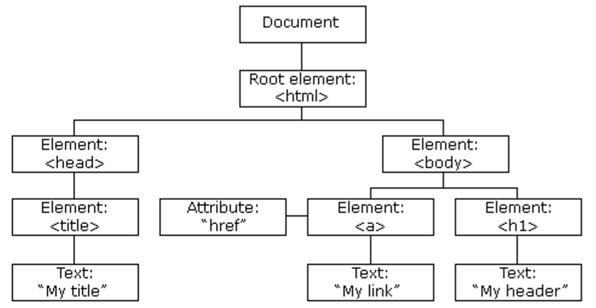
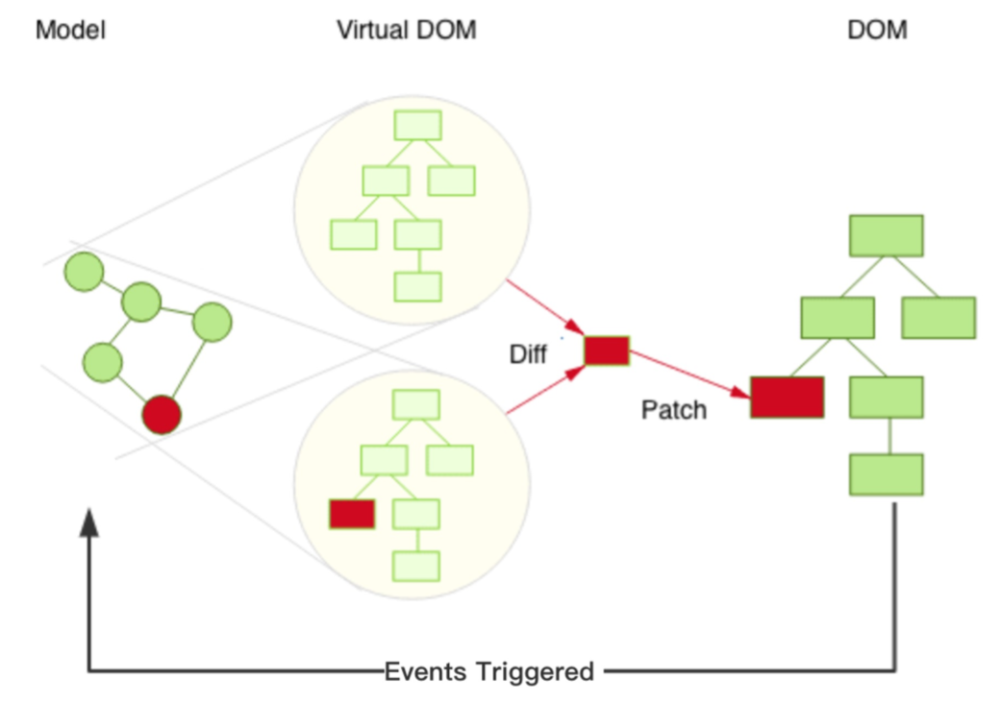

## Che Cos'è React

**React** è una **libreria JavaScript** per costruire interfacce utente di **Single Page Application**. Sviluppata e mantenuta da Facebook, è uscita a maggio 2013. Trattandosi di una libreria front-end si può usare da sola, per contenuti statici o dati di servizi esterni, oppure abbinata a un back-end in qualsiasi linguaggio.

L'idea di fondo è progettare l'interfaccia per **ogni stato** dell'applicazione: quando lo stato cambia, React aggiorna solo le parti che ne dipendono. Lo scopo è essere **veloce, scalabile e semplice**, modificando i dati senza ricaricare la pagina.

Le slide spiegano perché studiare React: è abbastanza semplice da imparare, è richiesto nel mercato italiano, è ottimo per approfondire JavaScript, e passare da lì ad altri framework come Angular è meno complesso che partire da JavaScript puro.

## Single Page Application

Una **Single Page Application (SPA)** è costruita a partire da una singola pagina. Navigando, la pagina non viene mai ricaricata, e i dati vengono aggiornati costantemente mentre si usa l'applicazione.

:::caution[Due equivoci da evitare]
- Una SPA è una pagina singola, ma **il codice non sta in un unico file**.
- Pur caricando tutto in una pagina, grazie al **routing** si possono associare degli URL a parti dell'applicazione.
:::

## DOM e Virtual DOM

Quando carica una pagina, il browser crea il **DOM**, un albero di oggetti. L'HTML DOM è uno standard che definisce elementi, proprietà, metodi ed eventi: in altre parole, come ottenere, modificare, aggiungere o eliminare elementi.



Modificare il DOM è rapido, ma dopo la modifica **l'elemento e i suoi figli vanno ridisegnati**. Il re-rendering è relativamente lento, e più componenti ci sono, più diventa oneroso.

React risolve il problema con il **Virtual DOM**, una rappresentazione virtuale del DOM. A ogni cambio di stato:

1. Viene creato un **nuovo albero** virtuale.
2. Questo viene **confrontato** con quello precedente (*diff*).
3. React calcola il modo migliore per applicare le modifiche al DOM reale (*patch*).



Le operazioni sul DOM reale sono così minime. Se ad esempio si aggiorna l'età di un utente in un blocco HTML, cambia solo quella parte.

:::tip[Il ciclo di React]
Evento → cambia lo stato → nuovo Virtual DOM → diff con il precedente → patch del DOM reale. È il concetto chiave da saper spiegare.
:::

## Creare un Progetto

React può essere adottato gradualmente, anche in una pagina esistente, ma esistono **toolchain** che preparano un ambiente pronto all'uso. La più nota era *Create React App*, ora rimossa dalla documentazione ufficiale, che promuove **Vite**.

Servono due prerequisiti:

- **Node.js**.
- **NPM**, il gestore di pacchetti di Node.js, installato insieme a esso. Da [npmjs.com](https://www.npmjs.com/) si scaricano i pacchetti per i propri progetti.

:::note[Su Windows]
PowerShell potrebbe impedire l'uso di npm. Si risolve con `Set-ExecutionPolicy RemoteSigned`.
:::

**Vite** supporta costruzione, sviluppo e rilascio di SPA. Non gestisce back-end o database, ma crea una catena di build per il front-end, con due elementi principali: un **server di sviluppo** e un **comando per il pacchetto distribuibile**.

```bash
npx create-vite@latest my-react-app --template react
cd my-react-app
npm install
npm run dev
```

L'applicazione è poi su `http://localhost:5173/`. WebStorm offre gli stessi passaggi dall'interfaccia. Per creare la versione finale:

```bash
npm run build
```

Viene creata una cartella `dist` con il codice ottimizzato in **asset statici**.

| Comando | Effetto |
| --- | --- |
| `npm install` | Scarica le dipendenze in `node_modules` |
| `npm run dev` | Avvia il server di sviluppo |
| `npm run build` | Crea la versione ottimizzata in `dist` |
| `npm run preview` | Mostra la versione ottimizzata con il server interno |

:::note[La conoscenza invecchia]
Le slide riportano anche i vecchi comandi di Create React App (`npx create-react-app esreact`, `npm start`, porta 3000), proprio per ricordare che **la conoscenza tecnica invecchia rapidamente**.
:::

## Serve Davvero un App Builder?

**No**: non sarebbe neppure necessario avere Node sulla propria macchina. Lo dimostra l'esempio del **Tic Tac Toe**, che è una semplice pagina che carica React da una CDN.

```html
<div id="root"></div>
<script src="https://unpkg.com/react@17/umd/react.development.js"></script>
<script src="https://unpkg.com/react-dom@17/umd/react-dom.development.js"></script>
<script src="./script.js"></script>
```

### Analisi del Tic Tac Toe

Il codice dell'esempio usa `React.createElement` direttamente, che è ciò che il [JSX](../05-jsx-componenti-props-state/) genera. Qui lo riscrivo in JSX, che è più leggibile, mantenendo la stessa struttura.

**Square** è un componente senza stato: riceve valore e gestore dalle props.

```jsx
function Square(props) {
    return (
        <button className="square" onClick={props.onClick}>
            {props.value}
        </button>
    );
}
```

**Board** è un componente con stato, e contiene la logica.

```jsx
class Board extends React.Component {
    constructor(props) {
        super(props);
        this.state = {
            squares: Array(9).fill(null),
            xIsNext: true,
        };
    }

    handleClick(i) {
        const squares = this.state.squares.slice();
        if (calculateWinner(squares) || squares[i]) {
            return;
        }
        squares[i] = this.state.xIsNext ? 'X' : 'O';
        this.setState({
            squares: squares,
            xIsNext: !this.state.xIsNext,
        });
    }

    renderSquare(i) {
        return <Square value={this.state.squares[i]} onClick={() => this.handleClick(i)} />;
    }

    render() {
        const winner = calculateWinner(this.state.squares);
        const status = winner
            ? 'Winner: ' + winner
            : 'Next player: ' + (this.state.xIsNext ? 'X' : 'O');

        return (
            <div>
                <div className="status">{status}</div>
                <div className="board-row">
                    {this.renderSquare(0)}{this.renderSquare(1)}{this.renderSquare(2)}
                </div>
                <div className="board-row">
                    {this.renderSquare(3)}{this.renderSquare(4)}{this.renderSquare(5)}
                </div>
                <div className="board-row">
                    {this.renderSquare(6)}{this.renderSquare(7)}{this.renderSquare(8)}
                </div>
            </div>
        );
    }
}
```

`calculateWinner` è una normale funzione JavaScript:

```javascript
function calculateWinner(squares) {
    const lines = [
        [0, 1, 2], [3, 4, 5], [6, 7, 8],
        [0, 3, 6], [1, 4, 7], [2, 5, 8],
        [0, 4, 8], [2, 4, 6],
    ];
    for (let i = 0; i < lines.length; i++) {
        const [a, b, c] = lines[i];
        if (squares[a] && squares[a] === squares[b] && squares[a] === squares[c]) {
            return squares[a];
        }
    }
    return null;
}
```

Vale la pena notare:

| Elemento | Perché è fatto così |
| --- | --- |
| Lo stato sta in `Board`, non in `Square` | Il tabellone deve conoscere tutte le caselle. Le caselle ricevono i dati dal padre |
| `Square` riceve `onClick` come prop | Il figlio segnala l'evento, il padre decide cosa fare |
| `squares.slice()` | Crea una **copia**: lo stato non si modifica direttamente, ma si sostituisce con `setState` |
| `() => this.handleClick(i)` | Una funzione che ricorda quale casella è stata cliccata |
| `className` | In JSX `class` è una parola riservata di JavaScript |

Il flusso è quello tipico: clic → `handleClick` → `setState` → React chiama di nuovo `render` → cambia solo la casella interessata.

## Autotest

**1.** Che cos'è una Single Page Application?

<details>
<summary>Soluzione</summary>

Un'applicazione costruita da una singola pagina, che non viene mai ricaricata: i dati vengono aggiornati mentre la si usa.

</details>

**2.** Come funziona il Virtual DOM?

<details>
<summary>Soluzione</summary>

A ogni cambio di stato si crea un nuovo albero virtuale, lo si confronta con il precedente e si applicano al DOM reale solo le differenze.

</details>

**3.** Perché il Virtual DOM migliora le prestazioni?

<details>
<summary>Soluzione</summary>

Perché ridisegnare è costoso, e riducendo al minimo le operazioni sul DOM reale si riduce il lavoro.

</details>

**4.** Che differenza c'è tra `npm run dev` e `npm run build`?

<details>
<summary>Soluzione</summary>

`dev` avvia il server di sviluppo, `build` crea il pacchetto ottimizzato in `dist`.

</details>

**5.** Perché `handleClick` usa `slice()`?

<details>
<summary>Soluzione</summary>

Per lavorare su una copia dell'array: lo stato di React non va modificato direttamente, ma sostituito con `setState`.

</details>

**6.** Perché nel Tic Tac Toe lo stato sta in `Board` e non in ogni `Square`?

<details>
<summary>Soluzione</summary>

Perché per capire chi ha vinto serve conoscere tutte le caselle. Lo stato condiviso si tiene nel componente padre e si passa ai figli con le props.

</details>

**7.** Vite gestisce il database dell'applicazione?

<details>
<summary>Soluzione</summary>

No: crea solo la catena di build per il front-end.

</details>

## Glossario

- **React** - Libreria JavaScript per interfacce utente.
- **SPA** - Applicazione costruita da una singola pagina.
- **Routing** - Associazione di URL a parti dell'applicazione.
- **Virtual DOM** - Rappresentazione virtuale del DOM.
- **Diff / Patch** - Confronto tra alberi e applicazione delle differenze.
- **Toolchain** - Strumenti che preparano l'ambiente di sviluppo.
- **Vite** - Strumento di build per il front-end.
- **npm** - Gestore di pacchetti di Node.js.
- **CDN** - Rete che distribuisce file statici.
