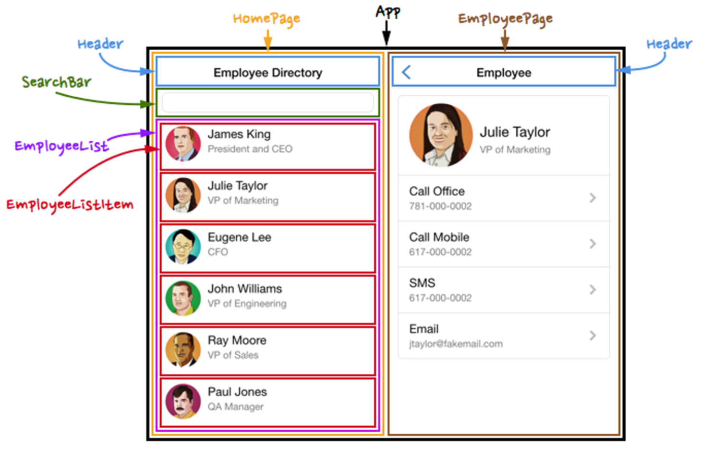
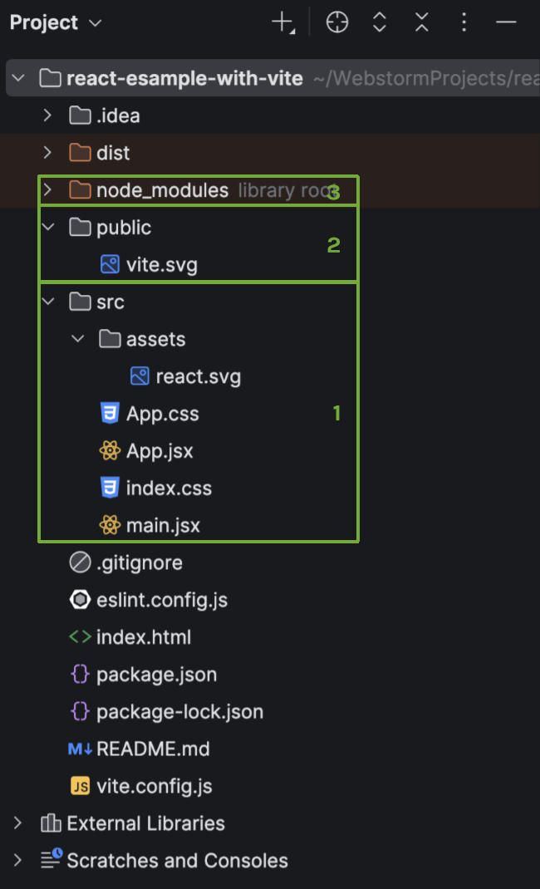

## Il Rendering

Un'applicazione React è composta solo da codice JavaScript. Per mostrare l'HTML nella pagina, si crea la **radice** del DOM virtuale dentro a un elemento HTML, e si chiama `render()`.

```html
<!-- index.html -->
<body>
    <div id="root"></div>
</body>
```

```jsx
// main.jsx
createRoot(document.getElementById('root')).render(
    <StrictMode>
        <App />
    </StrictMode>,
);
```

## JSX

**JSX** (*JavaScript XML*) è un'estensione di sintassi per JavaScript che permette di scrivere HTML in React, senza chiamare `createElement()` o `appendChild()`. Non è obbligatorio, ma semplifica molto.

```jsx
// Con JSX
const elementoJsx = <h1>I Love JSX!</h1>;

// Senza JSX
const elementoPuro = React.createElement('h1', {}, 'I do not use JSX!');
```

Le regole sono quattro.

**1. Le espressioni vanno tra graffe.** Qualsiasi espressione JavaScript valida viene eseguita.

```jsx
const user = "Giorgio";
const element = <p>Hello {user}! It's {new Date().toLocaleTimeString()}</p>;
```

**2. Più righe vanno tra parentesi tonde.**

```jsx
const lista = (
    <ul>
        <li>Apples</li>
        <li>Bananas</li>
    </ul>
);
```

**3. Ci deve essere un solo elemento al livello principale.** Si usa un contenitore come `<div>`, oppure un **Fragment**, che raccoglie gli elementi senza produrre alcun tag: `<React.Fragment>`, abbreviabile in `<>`.

```jsx
const celle = (
    <>
        <td>Cell 1</td>
        <td>Cell 2</td>
    </>
);
```

**4. Tutti i tag vanno chiusi**, perché JSX segue le regole di XML.

```jsx
const campo = <input type="text" />;
const immagine = ;
```

## I Componenti

I **componenti** sono porzioni di codice **riusabili e indipendenti**, che si annidano per comporre l'interfaccia, sotto un'unica radice.



Si comportano come funzioni: accettano parametri, le **props**, e restituiscono elementi da mostrare.

| Tipo | Definizione | Stato |
| --- | --- | --- |
| **Function component** | Una funzione che riceve le props | Di base senza stato. Con gli [Hooks](#hooks-e-usestate) lo ottiene |
| **Class component** | Una classe ES6 con un metodo `render` | Ha uno stato |

```jsx
// Function component
function Welcome(props) {
    return <h1>Hello, {props.name}</h1>;
}
```

```jsx
// Class component
class Saluto extends React.Component {
    render() {
        return <h1>Hello, {this.props.name}</h1>;
    }
}
```

### Usare un Componente

È buona pratica un file per componente. Il componente va **esportato** dove è definito e **importato** dove serve, e si richiama con `<NomeComponente />`.

```jsx
// Welcome.jsx
function Welcome(props) {
    return <h1>Hello, {props.name}</h1>;
}
export default Welcome;
```

```jsx
// App.jsx
import Welcome from './Welcome';

function App() {
    return <Welcome name="Giorgio" />;
}
```

:::caution[Slide 15]
La slide consiglia "un file .js" per componente, ma gli esempi usano `.jsx`. Con Vite il JSX va nei file **`.jsx`**.
:::

Per convenzione, il file ha il nome del componente con l'iniziale **maiuscola**.

## Props

Le **props** sono gli argomenti passati ai componenti, e possono essere qualsiasi cosa: testi, variabili, stili, funzioni. La sintassi è quella degli attributi HTML, con le graffe se il valore non è una stringa.

```jsx
const primo = <Car brand="Ford" />;

const carname = "Ford";
const secondo = <Car brand={carname} />;
```

:::tip[Le props sono in sola lettura]
Le props vanno considerate **costanti**: si usano nel componente, ma non si modificano mai.
:::

## State

Le interfacce cambiano nel tempo. Oltre alle props, un componente può definire uno **stato**, che gli permette di cambiare l'output in seguito ad azioni dell'utente o risposte dalla rete. Lo stato è **privato** e completamente gestito dal componente stesso.

Nei **class component** si inizializza nel costruttore e si modifica con `setState`. Quando lo stato cambia, l'interfaccia si aggiorna.

```jsx
class Commento extends React.Component {
    constructor(props) {
        super(props);
        this.state = { comment: "" };
    }

    aggiorna() {
        // Sbagliato: this.state.comment = 'Hello';
        this.setState({ comment: 'Hello' });
    }

    render() {
        return <button onClick={() => this.aggiorna()}>{this.state.comment}</button>;
    }
}
```

:::caution[Mai assegnare direttamente]
Lo stato non si modifica mai con un'assegnazione: React non se ne accorgerebbe e non aggiornerebbe l'interfaccia. Si usa sempre `setState`.
:::

| | Props | State |
| --- | --- | --- |
| **Da dove arrivano** | Dal componente padre | Dal componente stesso |
| **Modificabili** | No, sola lettura | Sì, con `setState` o il setter |
| **Scopo** | Configurare il componente | Rappresentare ciò che cambia nel tempo |
| **Cambiano l'output** | Sì, se il padre passa valori nuovi | Sì |

## Hooks e useState

Da React 16.8 esistono gli **Hooks**, che permettono ai componenti funzione di accedere allo stato. Il supporto alle classi resta, ma React incoraggia gli Hooks, che semplificano il codice e permettono di condividere logica tra componenti.

**`useState`** riceve il valore iniziale e restituisce **due valori**: lo stato corrente e la funzione per aggiornarlo.

```jsx
function EsempioStati() {
    const [age, setAge] = useState(42);
    const [fruit, setFruit] = useState('banana');
    const [todos, setTodos] = useState([{ text: 'Learn Hooks' }]);
}
```

Lo stesso contatore con i due stili:

```jsx
// con una classe
class Example extends React.Component {
    constructor(props) {
        super(props);
        this.state = { count: 0 };
    }

    render() {
        return (
            <div>
                <p>You clicked {this.state.count} times</p>
                <button onClick={() => this.setState({ count: this.state.count + 1 })}>
                    Click me
                </button>
            </div>
        );
    }
}
```

```jsx
// con gli Hooks
import { useState } from 'react';

function Example() {
    const [count, setCount] = useState(0);

    return (
        <div>
            <p>You clicked {count} times</p>
            <button onClick={() => setCount(count + 1)}>Click me</button>
        </div>
    );
}
```

## Quiz: Props o State?

È la domanda da farsi sempre: **il dato viene da fuori o cambia dentro al componente?** Le slide propongono cinque casi, senza riportare la soluzione.

| Caso | Risposta | Perché |
| --- | --- | --- |
| La label di un `<Button />` generico | **Props** | La decide chi usa il bottone |
| La variante del bottone (full, outline, text) | **Props** | Stessa cosa: è configurazione |
| Il bottone mostra un'icona di loading finché l'azione non termina | **State** | Cambia nel tempo, all'interno del componente |
| Le lancette di un `<Clock />`, aggiornate ogni secondo | **State** | Il componente aggiorna da solo l'orario |
| I link di una `<TopNavBar />` riutilizzabile | **Props** | Il componente mostra ciò che gli viene fornito |

## Organizzare un Progetto

React non impone un'organizzazione dei file. Gli approcci più comuni sono raggruppare per **funzionalità** o per **tipo di contenuto**, ad esempio una cartella per i componenti e una per le API. L'unico accorgimento è **evitare troppi livelli di cartelle**, scomodi negli import.



| Elemento | Contenuto |
| --- | --- |
| `src/` | I sorgenti: componenti, CSS, asset |
| `public/` | File pubblici |
| `node_modules/` | I moduli necessari, da non modificare |
| `index.html` | La pagina, che include `main.jsx` |
| `src/main.jsx` | Crea la radice nel `div` con `id="root"` e mostra `<App />` |
| `src/App.jsx` | Il componente radice, da cui discendono gli altri |
| `package.json` | Metadati del progetto |

:::caution[Slide 32]
Il testo dice che `public` contiene `index.html`, ma lo schermo accanto mostra che in Vite `index.html` sta nella **radice del progetto**, e `public` contiene solo `vite.svg`. Il testo viene dalle vecchie slide su Create React App.
:::

Il percorso all'avvio è quindi: `index.html` → `main.jsx` → `<App />` → componenti figli.

`package.json` contiene `name`, `version`, `dependencies` (i moduli installati con `npm install nome-modulo`) e `scripts` (i comandi `dev`, `build`, `preview`).

## Autotest

**1.** Quali sono le quattro regole di JSX?

<details>
<summary>Soluzione</summary>

Espressioni tra graffe, più righe tra parentesi tonde, un solo elemento al livello principale, tutti i tag chiusi.

</details>

**2.** Cosa c'è di sbagliato in questo componente?

```jsx
function Bad() {
    return <h1>Titolo</h1><p>Testo</p>;
}
```

<details>
<summary>Soluzione</summary>

Restituisce due elementi al livello principale. Vanno racchiusi in un contenitore o in un Fragment, tra parentesi:

```jsx
function Good() {
    return (
        <>
            <h1>Titolo</h1>
            <p>Testo</p>
        </>
    );
}
```

</details>

**3.** Che differenza c'è tra props e state?

<details>
<summary>Soluzione</summary>

Le **props** arrivano dal padre e sono in sola lettura. Lo **state** è privato del componente, che lo modifica nel tempo.

</details>

**4.** Perché `this.state.count = 5` è sbagliato?

<details>
<summary>Soluzione</summary>

Perché React non rileva la modifica e non aggiorna l'interfaccia. Serve `setState`.

</details>

**5.** Che cosa restituisce `useState(0)`?

<details>
<summary>Soluzione</summary>

Un array con il valore corrente, inizialmente 0, e la funzione per aggiornarlo.

</details>

**6.** Scrivi un componente che mostra un testo e lo nasconde con un bottone.

<details>
<summary>Soluzione</summary>

```jsx
function Toggle() {
    const [visibile, setVisibile] = useState(true);
    return (
        <div>
            <button onClick={() => setVisibile(!visibile)}>Mostra o nascondi</button>
            {visibile && <p>Testo</p>}
        </div>
    );
}
```

`{visibile && ...}` è il **rendering condizionale**: l'elemento viene mostrato solo se la condizione è vera.

</details>

**7.** Riscrivi `Welcome` in forma di arrow function, con un valore predefinito.

<details>
<summary>Soluzione</summary>

```jsx
const Welcome = ({ name = 'ospite' }) => <h1>Hello, {name}</h1>;
```

Le graffe nei parametri estraggono `name` dall'oggetto props.

</details>

## Glossario

- **JSX** - Estensione di sintassi per scrivere HTML in JavaScript.
- **Componente** - Porzione di interfaccia riusabile e indipendente.
- **Fragment** - Contenitore che non produce alcun tag.
- **Props** - Argomenti in sola lettura passati a un componente.
- **State** - Dati privati di un componente che cambiano nel tempo.
- **`setState`** - Metodo che aggiorna lo stato di un class component.
- **Hook** - Funzione che dà ai componenti funzione accesso alle funzionalità di React.
- **`useState`** - Hook per lo stato.
- **`createRoot`** - Funzione che crea la radice di React in un elemento HTML.
