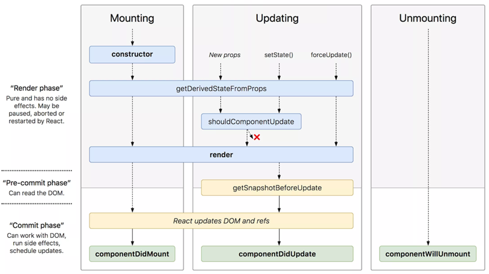

## Il Ciclo di Vita

Ogni componente React di tipo classe attraversa **tre fasi**:

| Fase | Quando |
| --- | --- |
| **Mounting** | Il componente viene inserito nel DOM |
| **Updating** | Cambiano le sue props o il suo stato |
| **Unmounting** | Il componente viene rimosso dal DOM |



Lo schema ha anche tre momenti verticali. La **render phase** è pura e senza effetti collaterali, e può essere interrotta da React. Nella **pre-commit phase** si può leggere il DOM. Nella **commit phase** si può lavorare con il DOM ed eseguire effetti collaterali.

:::caution[ReactDOM.render nelle slide]
Gli esempi di queste slide usano `ReactDOM.render(...)`, che è la vecchia sintassi. Nei progetti con Vite si usa `createRoot`, come già visto in [JSX e Componenti](../05-jsx-componenti-props-state/#il-rendering): è il cambio di sintassi di cui parlano le slide.
:::

## Mounting

I metodi vengono chiamati in quest'ordine:

| Metodo | Scopo |
| --- | --- |
| `constructor()` | Chiamato per primo. Definisce lo stato iniziale |
| `getDerivedStateFromProps()` | Chiamato appena prima del render. Assegna uno stato a partire dalle props |
| `render()` | **Obbligatorio**: esamina props e state e restituisce l'HTML |
| `componentDidMount()` | Chiamato dopo il render. È il posto giusto per caricare dati da API o per la logica che richiede il componente nel DOM |

`render` deve essere **pura**: non modifica lo stato, restituisce sempre lo stesso risultato a parità di props e state, e non interagisce direttamente con il browser.

```jsx
class Header extends React.Component {
    constructor(props) {
        super(props);
        this.state = { favoritecolor: "red" };
    }

    componentDidMount() {
        setTimeout(() => {
            this.setState({ favoritecolor: "yellow" });
        }, 1000);
    }

    render() {
        return <h1>My Favorite Color is {this.state.favoritecolor}</h1>;
    }
}
```

Il colore parte da `red` e dopo un secondo diventa `yellow`: il `setState` provoca un aggiornamento.

## Updating

Un componente si aggiorna quando cambiano **props o state**. L'ordine è:

| Metodo | Scopo |
| --- | --- |
| `getDerivedStateFromProps()` | Di nuovo: può assegnare allo stato un valore dalle props |
| `shouldComponentUpdate()` | Restituisce `true` o `false`: decide se proseguire con l'aggiornamento |
| `render()` | **Obbligatorio**: produce il nuovo HTML |
| `getSnapshotBeforeUpdate()` | Dà accesso a props e state **precedenti** |
| `componentDidUpdate()` | Chiamato dopo l'aggiornamento nel DOM |

Solo `render` è obbligatorio: gli altri sono opzionali. Se definisci `getSnapshotBeforeUpdate`, devi definire anche `componentDidUpdate`, altrimenti viene sollevato un errore.

:::note[Un esempio che sorprende]
```jsx
class Header extends React.Component {
    constructor(props) {
        super(props);
        this.state = { favoritecolor: "red" };
    }

    static getDerivedStateFromProps(props, state) {
        return { favoritecolor: props.favcol };
    }

    changeColor = () => this.setState({ favoritecolor: "blue" });

    render() {
        return (
            <div>
                <h1>My Favorite Color is {this.state.favoritecolor}</h1>
                <button type="button" onClick={this.changeColor}>Change color</button>
            </div>
        );
    }
}
```
Con `<Header favcol="yellow" />`, il bottone **non cambia nulla**: `setState` imposta `blue`, ma `getDerivedStateFromProps` viene eseguito anche in aggiornamento e lo sovrascrive subito con `yellow`.
:::

## Unmounting

C'è un solo metodo: `componentWillUnmount()`, chiamato quando il componente sta per essere rimosso dal DOM.

:::caution[Slide 21]
La slide intitola il metodo "Updating", ma `componentWillUnmount` appartiene alla fase di **Unmounting**.
:::

## Hooks e Ciclo di Vita

Con gli Hooks la gestione del ciclo di vita è molto più semplice. Non tutti i metodi hanno un corrispettivo, ma i più importanti sì.

| Class component | Hook |
| --- | --- |
| `constructor` con `this.state` | `useState` |
| `componentDidMount` | `useEffect` con `[]` |
| `componentDidUpdate` | `useEffect` con le dipendenze |
| `componentWillUnmount` | La funzione di **cleanup** di `useEffect` |

## Side Effect e useEffect

Un componente funzione usa props e state per calcolare l'output. Tutto ciò che fa **senza avere come obiettivo diretto l'output** è un **side effect**: chiamare un'API, manipolare direttamente il DOM, usare `setTimeout`.

Queste operazioni non vanno eseguite nel corpo della funzione:

```jsx
function Sbagliato({ name }) {
    const message = `Hello, ${name}!`;   // calcola l'output
    document.title = 'Greetings page';   // side effect: da evitare qui
    return <div>{message}</div>;
}
```

Rendering e side effect devono essere **indipendenti**, e l'hook **`useEffect`** serve a questo.

```jsx
import { useEffect } from 'react';

function Greet({ name }) {
    const message = `Hello, ${name}!`;

    useEffect(() => {
        document.title = 'Greetings page';
    }, []);

    return <div>{message}</div>;
}
```

### Le Dipendenze

```text
useEffect(callback, [dependencies]);
```

La `callback` contiene la logica. Il secondo argomento, facoltativo, controlla **quando** viene eseguita:

| Dipendenze | Quando viene eseguita la callback |
| --- | --- |
| Nessuna | **Dopo ogni render** |
| `[]` | **Una sola volta**, dopo il primo render |
| `[prop1, state1]` | Dopo il primo render e quando **cambia uno dei valori** |

:::tip[Il caso più importante da saper dire]
Array **assente** e array **vuoto** sono cose opposte: il primo significa "sempre", il secondo "solo la prima volta".
:::

Se il titolo dipende da una prop, questa va tra le dipendenze:

```jsx
function GreetName({ name }) {
    const message = `Hello, ${name}!`;

    useEffect(() => {
        document.title = `Greetings to ${name}`;
    }, [name]);

    return <div>{message}</div>;
}
```

| Render | Prop | L'effetto viene eseguito? |
| --- | --- | --- |
| Primo | `Eric` | Sì |
| Secondo | `Stan` | Sì, è cambiata |
| Terzo | `Stan` | No, è uguale |
| Quarto | `Butters` | Sì, è cambiata |

### Il Cleanup

A volte un side effect va "resettato". Se la callback restituisce una funzione, `useEffect` la invoca come **funzione di cleanup**.

```jsx
useEffect(() => {
    // side effect
    return function cleanup() {
        // annulla il side effect
    };
}, [dependencies]);
```

| Momento | Cosa succede |
| --- | --- |
| **Primo render** | Viene eseguita la callback. Il cleanup **no** |
| **Render successivi** | Prima il cleanup dell'esecuzione precedente, poi la nuova callback |
| **Smontaggio** | Viene eseguito il cleanup dell'ultima esecuzione |

Un esempio classico è un timer da fermare:

```jsx
function Orologio() {
    const [ora, setOra] = useState(new Date());

    useEffect(() => {
        const id = setInterval(() => setOra(new Date()), 1000);
        return () => clearInterval(id);
    }, []);

    return <p>{ora.toLocaleTimeString()}</p>;
}
```

Le slide mostrano un caso con una chiamata asincrona: se il componente viene smontato prima della risposta, il cleanup lo segnala con una variabile, e lo stato non viene aggiornato.

```jsx
function Example() {
    const [loading, setLoading] = useState(true);

    useEffect(() => {
        let mounted = true;
        fetchAPI.then(() => {
            if (mounted) {
                setLoading(false);
            }
        });
        return function cleanup() {
            mounted = false;
        };
    }, []);

    return <div>{loading ? <p>loading...</p> : <p>Fetched!!</p>}</div>;
}
```

`loading ? ... : ...` è un altro esempio di rendering condizionale.

## Riepilogo: la Vita di un Componente Funzione

1. Se esistono, vengono create le variabili di stato e i setter, eventualmente a partire dalle props.
2. C'è il primo render: il componente è montato.
3. Vengono eseguiti subito gli effetti.
4. A ogni aggiornamento, gli effetti si eseguono secondo le dipendenze: mai con `[]`, sempre senza array, al cambio dei valori elencati.
5. I cleanup vengono chiamati prima del nuovo effetto e prima dello smontaggio.

:::note[Complemento: perché vedi tutto due volte]
Le slide invitano a inserire dei `console.log` per verificare l'ordine. Il `main.jsx` creato da Vite usa `<StrictMode>`, che **in sviluppo** monta, smonta e rimonta i componenti per scovare gli errori. Vedrai quindi effetto, cleanup ed effetto subito dopo il primo render. In produzione non succede.
:::

## Autotest

**1.** Quali sono le tre fasi del ciclo di vita?

<details>
<summary>Soluzione</summary>

Mounting, updating e unmounting.

</details>

**2.** In quale metodo di una classe si caricano i dati da un'API? E con gli Hooks?

<details>
<summary>Soluzione</summary>

In `componentDidMount`. Con gli Hooks, in `useEffect` con `[]`.

</details>

**3.** Quale metodo è obbligatorio, e cosa significa che deve essere puro?

<details>
<summary>Soluzione</summary>

`render`. Non modifica lo stato, a parità di props e state restituisce sempre lo stesso risultato e non interagisce direttamente con il browser.

</details>

**4.** Che differenza c'è tra `useEffect(f)`, `useEffect(f, [])` e `useEffect(f, [x])`?

<details>
<summary>Soluzione</summary>

Il primo esegue `f` dopo ogni render, il secondo solo dopo il primo, il terzo dopo il primo e quando cambia `x`.

</details>

**5.** Che cos'è un side effect? Fai tre esempi.

<details>
<summary>Soluzione</summary>

Un'operazione che non ha come obiettivo diretto l'output del componente. Esempi: chiamare un'API, modificare direttamente il DOM, usare `setTimeout`.

</details>

**6.** Quando viene eseguita la funzione di cleanup?

<details>
<summary>Soluzione</summary>

Prima di ogni nuova esecuzione dell'effetto, e allo smontaggio. Non dopo il primo render.

</details>

**7.** Che cosa fa `shouldComponentUpdate` se restituisce `false`?

<details>
<summary>Soluzione</summary>

Interrompe l'aggiornamento: `render` non viene chiamato.

</details>

**8.** Scrivi un componente che mostra quanti secondi sono passati dal montaggio.

<details>
<summary>Soluzione</summary>

```jsx
function Secondi() {
    const [secondi, setSecondi] = useState(0);

    useEffect(() => {
        const id = setInterval(() => setSecondi((s) => s + 1), 1000);
        return () => clearInterval(id);
    }, []);

    return <p>{secondi} secondi</p>;
}
```

Si usa la forma `setSecondi((s) => s + 1)` perché l'effetto viene eseguito una volta sola: scrivendo `secondi + 1`, il valore resterebbe quello del primo render.

</details>

## Glossario

- **Mounting** - Inserimento di un componente nel DOM.
- **Updating** - Aggiornamento al cambio di props o state.
- **Unmounting** - Rimozione di un componente dal DOM.
- **Side effect** - Operazione che non calcola direttamente l'output.
- **`useEffect`** - Hook per i side effect.
- **Dipendenze** - Valori che determinano quando rieseguire un effetto.
- **Cleanup** - Funzione che annulla un effetto.
- **Rendering condizionale** - Elementi mostrati in base a una condizione.
- **StrictMode** - Modalità di sviluppo che evidenzia problemi potenziali.
