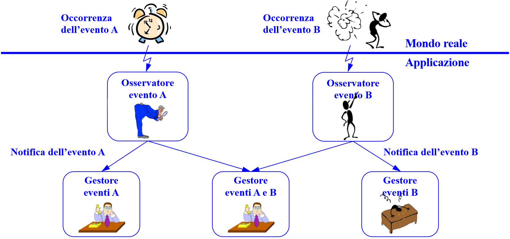

## Le Funzioni

Una **funzione** associa a un blocco di istruzioni un **nome** e dei **parametri**, così da poterlo richiamare.

```javascript
function computeAge(thisYear, birthYear) {  // parametri formali
    let age = 0;                 // buona regola: assegnare sempre un valore
    age = thisYear - birthYear;
    return age;                  // termina la funzione e restituisce il valore
}

let birthDate = [2003, 1983, 1990, 2000];
let thisYear = 2018;
for (let i = 0; i < birthDate.length; i++) {
    let age = computeAge(thisYear, birthDate[i]);  // parametri attuali
}
```

| Termine | Significato |
| --- | --- |
| **Dichiarazione** | Definisce la funzione, che non viene ancora eseguita |
| **Chiamata** | Esegue la funzione |
| **Parametri formali** | I nomi nella dichiarazione |
| **Parametri attuali** | I valori passati nella chiamata. Possono avere nomi diversi dai formali |
| **`return`** | Termina la funzione e, facoltativamente, restituisce un valore |

:::caution[Slide 4 e 5]
Il ciclo della slide usa `birthYear.length`, ma l'array si chiama `birthDate`: fuori dalla funzione `birthYear` non esiste. Qui sopra è corretto.
:::

### Scope

Nell'esempio ci sono due dichiarazioni di `age`, senza conflitto. La **scope** di una variabile determina dove è valida: **globale** se è fuori da tutti i blocchi, **locale** in un blocco e in quelli annidati.

## Riutilizzare il Codice

L'**esercizio 4 bis** chiede il minimo di più array: invece di ripetere il codice, lo si incapsula in una funzione.

```javascript
function calcolaMinimo(array) {
    let minimo = array[0];
    for (let i = 1; i < array.length; i++) {
        if (array[i] < minimo) {
            minimo = array[i];
        }
    }
    return minimo;
}

const lista = [[2003, 1983, 1990, 2000], [15, 35, 21, 8, 43, 67, 5], [23, 4, 8, 12, 3, 67]];
for (let i = 0; i < lista.length; i++) {
    console.log(calcolaMinimo(lista[i]));
}
```

## La Programmazione a Eventi

Un **paradigma di programmazione** è uno stile fondamentale che definisce come il programmatore concepisce il programma: algoritmico, a oggetti, strutturato, funzionale, concorrente.

:::tip[Definizione]
La **programmazione event-driven** è un paradigma in cui il flusso del programma è determinato da **eventi esterni**: azioni dell'utente, segnali di sensori, messaggi da altri processi.
:::

In un programma tradizionale l'esecuzione segue percorsi fissi. Qui invece:

- Non c'è un `main` classico, né un algoritmo unico, né un inizio e una fine concettuali.
- Il programma è una **collezione di funzioni attivabili a richiesta**.
- Il `main` si limita a inizializzare, creando gli osservatori e associando i gestori.
- L'applicazione è puramente **reattiva**, e non si può identificare staticamente un flusso di controllo unitario.

I vantaggi sono **flessibilità** (l'utente decide quali attività attivare), **asincronia** (non c'è un ordine temporale imposto) e **robustezza** (le attività sono autonome e indipendenti).

### Il Modello Generale



Un evento accade nel mondo reale. Un **osservatore** lo rileva e notifica uno o più **gestori** (*handler*), che eseguono le azioni. Un gestore può occuparsi di più tipi di evento.

Un **evento** è un'azione originata da un utente, un dispositivo, un processo o il sistema operativo. Porta con sé tipo, timestamp, sorgente ed eventuali altre informazioni. Può essere ignorato o inviato a più gestori in ascolto.

### Gli Eventi in HTML

Il codice di una funzione viene eseguito quando qualcosa la invoca: un evento, altro codice JavaScript, o l'auto-invocazione. Gli **eventi HTML** sono cose che accadono agli elementi, e JavaScript può reagire.

**Primo modo**: l'attributo dell'evento nell'HTML.

```html
<input type="button" value="The time is?" onclick="displayDate()">
<p id="demo"></p>
<script>
    function displayDate() {
        document.getElementById("demo").innerHTML = Date();
    }
</script>
```

Il **browser** fa da osservatore e registra `displayDate` come **funzione di callback**. Al clic chiama il gestore, che modifica la pagina.

**Secondo modo**: `addEventListener`, che separa HTML e JavaScript e permette di associare **più gestori** allo stesso elemento.

```html
<button id="button">The time is?</button>
<p id="demo"></p>
<script>
    document.getElementById('button').addEventListener('click', displayDate);
    function displayDate() {
        document.getElementById("demo").innerHTML = Date();
    }
</script>
```

:::caution[I due errori tipici con addEventListener]
- Il tipo di evento va scritto **senza `on`**: `"click"`, non `"onclick"`.
- La funzione va passata **senza parentesi**: `displayDate`, non `displayDate()`. Con le parentesi la funzione verrebbe eseguita subito, e il listener riceverebbe il suo risultato.

Il secondo parametro può essere anche una funzione anonima.
:::

### Passare i Dati al Gestore

Il gestore può ricevere il dato, oppure leggerlo dall'HTML:

```html
<!-- il dato viene passato come parametro -->
<input type="text" onkeyup="echo1(this.value)">

<!-- il dato viene letto nel gestore -->
<input type="text" id="txt1" onkeyup="echo2()">
```

```javascript
function echo1(str) {
    document.getElementById("demo").innerHTML = str;
}
function echo2() {
    document.getElementById("demo").innerHTML = document.getElementById("txt1").value;
}
```

`this` indica l'elemento che ha generato l'evento. Il primo modo è più flessibile: la stessa funzione serve più campi di input, mentre `echo2` è legata a `txt1`.

## Esercizio Svolto: Posso Bere Alcolici?

**Consegna**: una pagina che legge l'anno di nascita e dice se è possibile bere alcolici. Si sviluppa **per passi**, verificando ogni volta:

| Passo | Cosa si aggiunge | Problema che resta |
| --- | --- | --- |
| 1 | Il codice in una pagina | Non si vede nulla |
| 2 | Un tag `<span>` e la scrittura del risultato | Gira solo al caricamento |
| 3 | Un bottone e una funzione `canDrink` | L'anno è fisso |
| 4 | Un campo di input letto nella funzione | Funziona |

```html
<p>Anno di nascita: <input type="text" id="txt1"></p>
<p><input type="button" value="Posso bere alcolici?" onclick="canDrink()"></p>
<p>Risposta: <span id="demo"></span></p>
<script>
    function canDrink() {
        const birthYear = parseInt(document.getElementById("txt1").value);
        const thisYear = new Date().getFullYear();
        document.getElementById("demo").innerHTML = thisYear - birthYear >= 18;
    }
</script>
```

Questa versione applica i miglioramenti suggeriti dalle slide: elimina le variabili superflue, trasforma in intero il valore letto, che è una stringa, e calcola l'anno corrente.

## Le Forme delle Funzioni

```javascript
// ES5
function f1(x, y) {
    return x * y;
}
var f2 = function (x, y) {
    return x * y;
};

// ES6: arrow function
const f3 = (x, y) => x * y;
const f4 = (x, y) => { return x * y };
```

`return` e le parentesi graffe si possono omettere solo se la funzione ha **una sola istruzione**. Se tieni le graffe, `return` serve: `(x, y) => { x * y }` restituisce `undefined`. Per questo le slide suggeriscono di usarli sempre.

:::note[Complemento: ordine di dichiarazione]
Una dichiarazione `function` si può usare anche prima del punto in cui è scritta (*hoisting*). Una funzione assegnata a una `const`, compresa una arrow function, **deve essere dichiarata prima dell'uso**.
:::

## Un Esempio Completo: i Suggerimenti

Mentre l'utente digita, la pagina suggerisce i nomi che iniziano con quanto scritto.

```html
First name: <input type="text" onkeyup="showHint(this.value)">
<p>Suggestions: <span id="txtHint"></span></p>
<script>
    function showHint(str) {
        const names = ["Anna", "Brittany", "Cinderella", "Diana", "Eva", "Fiona"];
        let hint = "";
        if (str.length === 0) {
            document.getElementById("txtHint").innerHTML = "";
            return;
        }
        for (let i = 0; i < names.length; i++) {
            if (names[i].indexOf(str) === 0) {
                if (hint.length === 0)
                    hint = names[i];
                else
                    hint = hint + ", " + names[i];
            }
        }
        document.getElementById("txtHint").innerHTML = hint;
    }
</script>
```

`indexOf` restituisce la posizione della prima occorrenza, o `-1` se non c'è: `=== 0` significa "inizia con". È **sensibile alle maiuscole**.

## Autotest

**1.** Che differenza c'è tra parametri formali e attuali?

<details>
<summary>Soluzione</summary>

I **formali** sono i nomi nella dichiarazione, gli **attuali** sono i valori passati nella chiamata.

</details>

**2.** Quali sono le caratteristiche di un programma a eventi?

<details>
<summary>Soluzione</summary>

Non c'è un main classico, il programma è una collezione di funzioni attivabili, reagisce a stimoli esterni e il flusso non si determina staticamente. I vantaggi sono flessibilità, asincronia e robustezza.

</details>

**3.** Che cosa c'è di sbagliato in questo codice?

```javascript
button.addEventListener('onclick', gestore());
```

<details>
<summary>Soluzione</summary>

Due errori: il tipo di evento va scritto `'click'`, senza `on`, e la funzione va passata senza parentesi: `gestore`.

</details>

**4.** Scrivi una arrow function che restituisce il quadrato di un numero.

<details>
<summary>Soluzione</summary>

```javascript
const quadrato = (x) => x * x;
```

</details>

**5.** Che cosa restituisce `const f = (x) => { x + 1 };` con `f(2)`?

<details>
<summary>Soluzione</summary>

`undefined`, perché con le graffe il valore va restituito con `return`.

</details>

**6.** Che cosa indica `this` in `onkeyup="echo(this.value)"`?

<details>
<summary>Soluzione</summary>

L'elemento HTML che ha generato l'evento, cioè il campo di input.

</details>

**7.** Modifica `showHint` perché non distingua tra maiuscole e minuscole.

<details>
<summary>Soluzione</summary>

Si confrontano le versioni in minuscolo:

```javascript
const trovato = names[i].toLowerCase().indexOf(str.toLowerCase()) === 0;
```

</details>

## Glossario

- **Funzione** - Blocco di istruzioni con un nome e dei parametri.
- **Parametri formali / attuali** - Nomi nella dichiarazione e valori nella chiamata.
- **Event-driven** - Paradigma in cui gli eventi determinano il flusso del programma.
- **Osservatore** - Componente che rileva un evento.
- **Gestore (handler)** - Funzione eseguita in risposta a un evento.
- **Callback** - Funzione passata perché venga chiamata in seguito.
- **`addEventListener`** - Metodo che associa un gestore a un evento.
- **Arrow function** - Forma compatta di funzione introdotta da ES6.
- **Hoisting** - Disponibilità delle dichiarazioni `function` prima del punto in cui sono scritte.
