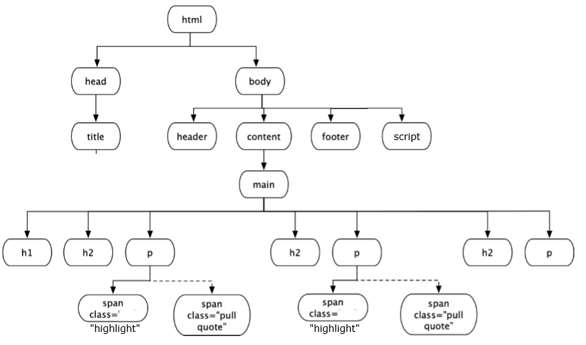

## Il DOM

Il **DOM** (*Document Object Model*) è la rappresentazione della pagina come **albero** di elementi. Ogni tag HTML è un nodo, e JavaScript può leggere e modificare i nodi, cambiando la pagina mentre è visualizzata.



L'esercizio di questa lezione costruisce passo dopo passo le **pull quote**, i riquadri delle riviste che ripetono in evidenza una frase dell'articolo. Le sei versioni complete del codice sono nel materiale del corso.

**Consegna**: data una pagina di testo, evidenziare una selezione e riportarla in un box.

## Passo 1: Classe e CSS

Con il solo HTML e CSS, si avvolge il testo in un `<span>` con una classe, e una regola CSS ne definisce l'aspetto.

```html
<style>
    .highlight {
        background-color: rgb(255, 0, 0);
    }
</style>
...
<p>... <span class="highlight">Vivamus justo mi, aliquam vitae.</span> ...</p>
```

Una **classe** permette di trattare insieme tutti gli elementi che la condividono.

## Passo 2: il Box con JavaScript

**Problema**: come duplicare il testo in un box, lasciandolo anche nella pagina? Con il solo HTML dovremmo riscriverlo.

**Soluzione**: una funzione che modifica il DOM al caricamento della pagina.

```html
<style>
    .pullquote {
        float: right;
        clear: right;
        width: 200px;
        padding: 10px;
        font-size: 20px;
    }
</style>
...
<script>
    document.addEventListener('DOMContentLoaded', function () {
        const collection = document.getElementsByClassName("highlight");
        for (let i = 0; i < collection.length; i++) {
            let quote = collection[i].cloneNode(true);
            quote.classList.remove('highlight');
            quote.classList.add('pullquote');
            collection[i].parentElement.insertBefore(quote, collection[i].nextSibling);
        }
    });
</script>
```

Una funzione anonima viene associata come gestore all'evento **`DOMContentLoaded`**, che scatta quando il documento è stato caricato. Il suo effetto è:

| Istruzione | Effetto |
| --- | --- |
| `getElementsByClassName("highlight")` | Estrae tutti gli elementi della classe |
| `cloneNode(true)` | Duplica l'elemento con il suo contenuto |
| `classList.remove` e `classList.add` | Cambiano la classe del duplicato in `pullquote` |
| `insertBefore(quote, ...nextSibling)` | Inserisce il duplicato subito dopo l'originale, come **fratello** |

:::note[Perché insertBefore con nextSibling]
Non esiste un `insertAfter` su `parentElement`: inserire prima del fratello successivo equivale a inserire dopo l'elemento.
:::

## Passo 3: il Testo Editabile

La soluzione è **statica**: il testo evidenziato è scritto nell'HTML, e l'utente non può scegliere. Serve permettergli di selezionare.

1. Si rende il testo modificabile con l'attributo `contenteditable`.
2. Si usa la funzione come gestore dell'evento `mouseup`, che scatta quando si rilascia il mouse dopo una selezione.

```html
<div contenteditable="true" id="editable" class="main">
    <h1>Auto-Pull Quotes</h1>
    ...
</div>
<script>
    document.getElementById('editable').addEventListener('mouseup', () => {
        const selection = window.getSelection();
        const selectedText = selection.toString();

        if (selectedText.length > 0) {
            // span per evidenziare il testo selezionato
            const span = document.createElement('span');
            span.className = 'highlight';
            selection.getRangeAt(0).surroundContents(span);

            // box con il testo selezionato
            const pullquote = document.createElement('span');
            pullquote.className = 'pullquote';
            pullquote.textContent = selectedText;

            // inserimento del box prima del testo
            span.before(pullquote);
        }
    });
</script>
```

| Istruzione | Effetto |
| --- | --- |
| `window.getSelection()` | Restituisce la selezione corrente |
| `selection.toString()` | Il testo selezionato |
| `document.createElement('span')` | Crea un nuovo elemento |
| `getRangeAt(0).surroundContents(span)` | Avvolge la selezione nell'elemento |
| `span.before(pullquote)` | Inserisce un elemento prima di un altro |

## Passo 4: il Menu di Controllo

Si aggiunge un bottone per abilitare la modifica. All'inizio `contenteditable` vale `false`, dopo il clic diventa `true`, e dopo una selezione il DOM cambia, e con esso l'HTML.

```javascript
const toggleButton = document.getElementById('toggleButton');
const editable = document.getElementById('editable');

toggleButton.addEventListener('click', () => {
    if (editable.contentEditable === 'true') {
        editable.contentEditable = 'false';
        toggleButton.textContent = 'Enable Edit Mode';
    } else {
        editable.contentEditable = 'true';
        toggleButton.textContent = 'Disable Edit Mode';
    }
});

editable.addEventListener('mouseup', () => {
    if (editable.contentEditable === 'true') {
        const selection = window.getSelection();
        const selectedText = selection.toString();
        if (selectedText.length > 0) {
            const span = document.createElement('span');
            span.className = 'highlight';
            selection.getRangeAt(0).surroundContents(span);

            const pullquote = document.createElement('div');
            pullquote.className = 'pullquote';
            pullquote.textContent = selectedText;
            span.after(pullquote);
        }
    }
});
```

Due funzioni anonime fanno da gestori di `click` e `mouseup`. La prima attiva e disattiva la modalità di modifica, la seconda, solo se il testo è modificabile, evidenzia la selezione e crea il box.

:::tip[Il modello mentale]
Lo schema si ripete in tutte le pagine dinamiche: **evento → gestore → modifica del DOM → il browser ridisegna**.
:::

## Autotest

**1.** Che cos'è il DOM?

<details>
<summary>Soluzione</summary>

La rappresentazione della pagina come albero di oggetti, che JavaScript può leggere e modificare mentre la pagina è visualizzata.

</details>

**2.** Perché nel passo 2 il codice è dentro al gestore di `DOMContentLoaded`?

<details>
<summary>Soluzione</summary>

Per eseguirlo dopo il caricamento del documento, quando gli elementi esistono.

</details>

**3.** Che cosa fa `cloneNode(true)`? E con `false`?

<details>
<summary>Soluzione</summary>

Con `true` copia l'elemento **e tutti i discendenti**, compreso il testo. Con `false` copia solo l'elemento.

</details>

**4.** Perché si usa `mouseup` e non `click`, per intercettare la selezione?

<details>
<summary>Soluzione</summary>

Perché la selezione del testo termina al rilascio del pulsante del mouse.

</details>

**5.** Che cosa cambia tra `className = 'x'` e `classList.add('x')`?

<details>
<summary>Soluzione</summary>

`className` sostituisce tutte le classi, `classList.add` ne aggiunge una mantenendo le altre.

</details>

**6.** Quali operazioni servono per aggiungere un nuovo paragrafo alla fine di un `div`?

<details>
<summary>Soluzione</summary>

Si crea l'elemento, gli si dà un contenuto e lo si inserisce:

```javascript
const p = document.createElement('p');
p.textContent = 'Nuovo testo';
document.getElementById('contenitore').appendChild(p);
```

</details>

## Glossario

- **DOM** - Rappresentazione ad albero della pagina.
- **Nodo** - Elemento dell'albero del DOM.
- **Classe** - Attributo che raggruppa elementi per lo stile e per il codice.
- **`DOMContentLoaded`** - Evento che segnala il caricamento del documento.
- **`contenteditable`** - Attributo che rende modificabile un elemento.
- **`cloneNode`** - Metodo che duplica un nodo.
- **Pull quote** - Citazione ripetuta in evidenza.
