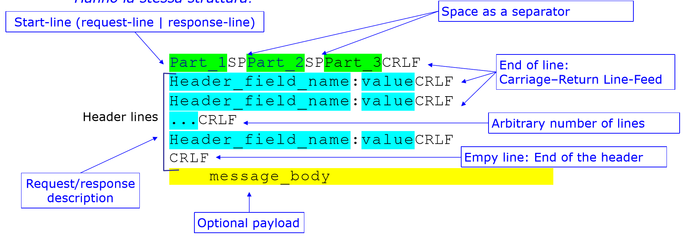
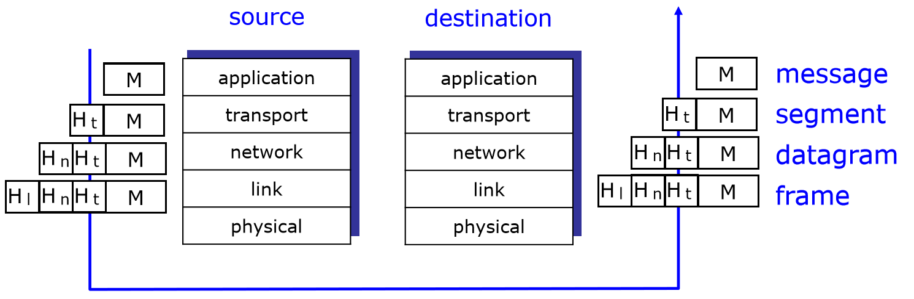
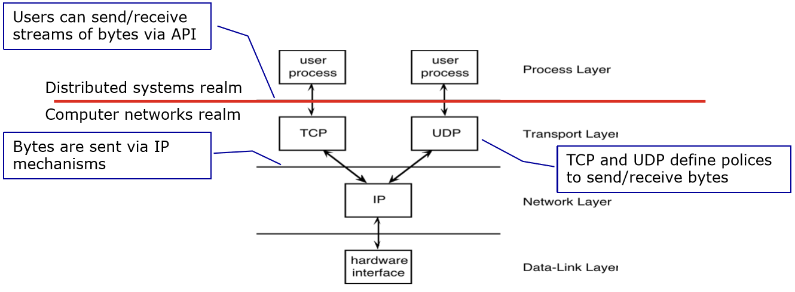
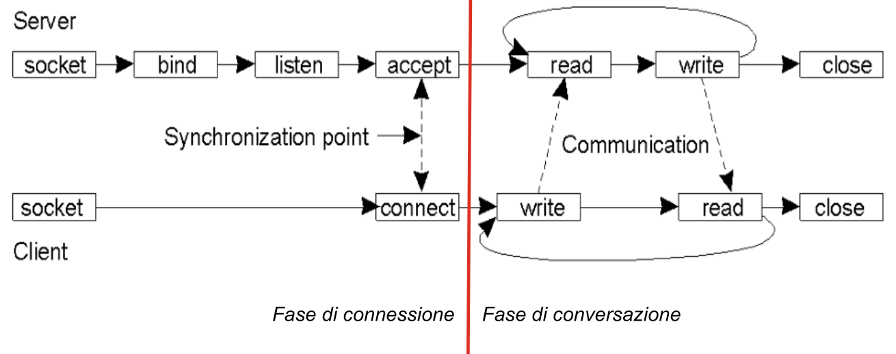
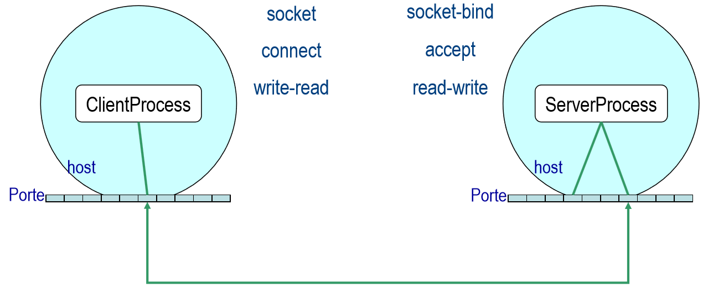

## Internet e i Protocolli

**Internet** è una "rete di reti", a struttura parzialmente gerarchica, con segmenti pubblici e intranet private. I **protocolli** regolano la comunicazione tra i sistemi. Gli standard sono le **RFC** (*Request for Comments*), prodotte dalla IETF. La rete permette di usare applicazioni remote: web, email, giochi, e-commerce.

:::tip[Definizione di protocollo]
Un **protocollo** definisce il **formato**, l'**ordine di invio e ricezione** dei messaggi tra i dispositivi, il **tipo dei dati** e le **azioni** da eseguire quando si riceve un messaggio. Per capirsi, due processi devono concordarne uno.
:::

### Applicazioni e Processi

Un'applicazione di rete è fatta da **processi distribuiti** che si scambiano messaggi. I **protocolli applicativi** sono una parte di ogni applicazione: definiscono il formato e il significato dei messaggi, e usano i servizi degli strati inferiori.

:::caution[Chi comunica]
Non sono le macchine a comunicare, ma **i processi** in esecuzione sulle macchine.
:::

| Concetto | Significato |
| --- | --- |
| **Programma** | Sequenza di istruzioni eseguibili dalla macchina |
| **Processo** | Entità gestita dal sistema operativo: area di RAM, registro della prossima istruzione, canali di comunicazione |
| **Canale** | Gestisce flussi di dati in ingresso e in uscita. Schermo, tastiera e rete sono canali |
| **Porta** | Numero intero che identifica un canale dall'esterno |

Gli **end system** (host) stanno ai bordi della rete e ospitano i processi. I modelli sono due:

| Modello | Funzionamento | Esempi |
| --- | --- | --- |
| **Client-server** | Il client **inizia** il dialogo e richiede un servizio, il server lo fornisce | Web, posta |
| **Peer-to-peer** | Interazione simmetrica tra host | Teleconferenza, Gnutella |

## Il Protocollo HTTP

**HTTP** (*HyperText Transfer Protocol*) è il protocollo applicativo del Web, basato su client-server: il browser richiede, riceve e mostra oggetti Web, e il Web server li invia.

### Il Formato dei Messaggi

I messaggi sono di due tipi, **request** e **response**, in **ASCII** e con la **stessa struttura**:



Una riga iniziale con tre parti separate da spazi, un numero arbitrario di **header** `nome:valore`, una **riga vuota** che chiude l'header, e un **corpo** facoltativo. Ogni riga termina con **CRLF**.

**Request**:

```http
GET /somedir/page.html HTTP/1.1
Host: www.someschool.edu
Connection: close
User-agent: Mozilla/4.0
Accept: text/html, image/gif, image/jpeg
Accept-language: fr
```

La **request line** contiene metodo, percorso e versione. `Connection: close` chiede di chiudere la connessione dopo la richiesta, `User-agent` qualifica il richiedente, `Accept` esprime i desideri sulla risposta.

**Response**:

```http
HTTP/1.1 200 OK
Connection: close
Date: Thu, 06 Aug 1998 12:00:15 GMT
Server: Apache/1.3.0 (Unix)
Last-Modified: Mon, 22 Jun 1998 ...
Content-Length: 6821
Content-Type: text/html

data data data ...
```

La **status line** contiene protocollo, codice e frase di stato. Il corpo contiene la rappresentazione della risorsa.

:::note[Domanda delle slide]
Perché ci sono informazioni su dimensione e tipo dei dati nella risposta? `Content-Length` dice al client **quando il messaggio è finito**, dato che TCP trasporta solo un flusso di byte. `Content-Type` dice **come interpretare** i dati.
:::

In **HTTP 1.0** il server chiude la connessione alla fine della richiesta, in **HTTP 1.1** la tiene aperta, a meno di `Connection: close`.

### I Codici di Stato

| Classe | Significato |
| --- | --- |
| **1xx** | Informativo: richiesta ricevuta, in elaborazione |
| **2xx** | Successo |
| **3xx** | Redirezione: serve un'altra azione |
| **4xx** | Errore del client |
| **5xx** | Errore del server |

| Codice | Significato |
| --- | --- |
| `200 OK` | Successo, l'oggetto richiesto è nel messaggio |
| `301 Moved Permanently` | L'oggetto è stato spostato, il nuovo indirizzo è nell'header `Location` |
| `400 Bad Request` | Richiesta incomprensibile |
| `404 Not Found` | Documento non trovato |
| `505 HTTP Version Not Supported` | Versione non supportata |

### Tipi MIME

**MIME** (*Multipurpose Internet Mail Extensions*) viene dalla posta SMTP e qualifica i dati inviati. In HTTP indica il tipo del corpo, nel formato `tipo/sottotipo`.

| Tipo | Esempi |
| --- | --- |
| `text` | `plain`, `html` |
| `image` | `jpeg`, `gif` |
| `audio` | `basic`, `32kadpcm` |
| `video` | `mpeg`, `quicktime` |
| `application` | `msword`, `octet-stream`: dati da elaborare con un'applicazione |

:::caution[Slide 18]
La slide cita le RFC 2045 e 2056. La seconda è un refuso: MIME è definito da **RFC 2045 e 2046**.
:::

## La Stratificazione

Le reti sono complesse: host, router, link diversi, applicazioni, protocolli. Si organizzano in **strati**, come il servizio postale: ogni strato implementa un servizio con funzioni interne, usando i servizi degli strati inferiori.

La **modularità** facilita la manutenzione: cambiare l'implementazione di uno strato è trasparente, purché non cambi l'interfaccia. Cambiare il corriere non altera il servizio postale.

| Strato | Funzione | Protocolli | Unità di dati |
| --- | --- | --- | --- |
| **Application** | Supporto alle applicazioni di rete | HTTP, FTP, SMTP | Messaggio |
| **Transport** | Trasferimento end-to-end tra processi | TCP, UDP | Segmento |
| **Network** | Trasferimento di datagrammi da host a host | IP, routing | Datagramma |
| **Link** | Trasferimento tra elementi adiacenti | PPP, Ethernet | Frame |
| **Physical** | Bit sul cavo | | Bit |

Ogni strato è distribuito: le **entità** su ogni host scambiano messaggi con le **entità pari** (*peer*). La comunicazione logica è orizzontale, quella fisica scende fino al cavo e risale.



Ogni strato riceve i dati dallo strato superiore, **aggiunge un header** e passa la nuova unità allo strato inferiore: è l'**incapsulamento**. A destinazione si fa il contrario.

## TCP e UDP

Il livello di trasporto separa il mondo dei sistemi distribuiti da quello delle reti:



L'applicazione invia i messaggi come **flusso di byte**. TCP li scompone in **segmenti numerati**, e la numerazione permette di riordinare quelli arrivati fuori sequenza, scartare i duplicati e ritrasmettere i persi. IP non garantisce nulla: i segmenti possono arrivare in ordine diverso, e TCP li rimette a posto.

| | TCP | UDP |
| --- | --- | --- |
| **Connessione** | Sì, con **handshake** iniziale, che crea uno stato nei due processi | No |
| **Affidabilità** | Trasferimento affidabile: conferme e ritrasmissioni, ordine, duplicati | Nessuna, *best effort* |
| **Controllo di flusso** | Sì: il mittente non sommerge il ricevente | No |
| **Controllo di congestione** | Sì: il mittente rallenta se la rete è sovraccarica | No |
| **Garanzie di ritardo e banda** | No | No |
| **Usato da** | HTTP, FTP, Telnet, SMTP | Streaming, telefonia su Internet |

:::caution[Slide 28: UDP e i flussi di byte]
La slide dice che UDP scompone lo stream di byte in segmenti. In realtà UDP lavora a **messaggi**: ogni invio produce un datagramma, e i confini vengono conservati. È TCP a lavorare a flussi.
:::

## I Requisiti delle Applicazioni

| Requisito | Significato |
| --- | --- |
| **Perdita di dati** | Alcune applicazioni, come l'audio, sono tolleranti, altre richiedono affidabilità totale |
| **Banda** | Alcune applicazioni richiedono una banda minima, altre, dette **elastiche**, usano quella disponibile |
| **Ritardo** | Alcune, come la telefonia e i giochi, richiedono un ritardo contenuto |

Alcuni requisiti derivano da esigenze percettive umane, come il ritardo nella telefonia via Internet.

:::caution[Slide 50 e 51]
- La slide 50, sotto *Ritardo*, dice "richiedono una banda minima": è un refuso, e il senso è **ritardo contenuto**.
- La slide 51 indica i *Web documents* come tolleranti alle perdite, ma HTTP usa TCP, che è affidabile: una pagina deve arrivare integra.
:::

| Applicazione | Perdita | Banda | Sensibile al tempo |
| --- | --- | --- | --- |
| Trasferimento file | No | Elastica | No |
| E-mail | No | Elastica | No |
| Audio/video in tempo reale | Tollerante | Audio 5 Kb-1 Mb, video 10 Kb-5 Mb | Sì, centinaia di ms |
| Audio/video registrato | Tollerante | Come sopra | Sì, pochi secondi |
| Giochi interattivi | Tollerante | Pochi Kbps | Sì, centinaia di ms |
| Applicazioni finanziarie | No | Elastica | Sì e no |

| Applicazione | Protocollo applicativo | Trasporto |
| --- | --- | --- |
| E-mail | SMTP (RFC 821) | TCP |
| Terminale remoto | Telnet (RFC 854) | TCP |
| Web | HTTP (RFC 2068) | TCP |
| Trasferimento file | FTP (RFC 959) | TCP |
| Streaming multimediale | Proprietario | TCP o UDP |
| File server remoto | NFS | TCP o UDP |
| Telefonia su Internet | Proprietario | Tipicamente UDP |

## Identificare la Controparte

Un processo identifica quello con cui comunica tramite l'**indirizzo IP** dell'host e il **numero di porta**, ad esempio `149.132.125.21:8080`.

**URI**, *Uniform Resource Identifier*, è una stringa compatta che identifica una risorsa: **URI = URL + URN**.

| Tipo | Scopo | Esempio |
| --- | --- | --- |
| **URN** | Identificatore **persistente** | `urn:isbn:0-486-27557-4` |
| **URL** | Dice **dove** e **come** è disponibile | `http://example.org/resource.txt` |

Una **URL** ha cinque componenti:

```text
protocollo://indirizzo_IP[:porta]/cammino/risorsa
```

Ad esempio `http://www.someSchool.edu:80/someDept/pic.gif`: protocollo `http`, host `www.someSchool.edu`, porta `80`, cammino `someDept`, risorsa `pic.gif`.

## Le Socket

Come si usano i canali di comunicazione da un programma? Serve un'**API** (*Application Programming Interface*), l'interfaccia tra l'applicazione e il canale, così come un telecomando è l'interfaccia umana di un lettore: lo stesso servizio ha pulsanti per le persone e funzioni come `play()` per i programmi.

:::tip[Definizione]
La **socket** è l'oggetto software, un'astrazione, attraverso cui un'applicazione invia e riceve dati in rete. È l'API di Internet: due processi comunicano leggendo e scrivendo dati sulla socket.
:::

Il programmatore controlla il processo, il sistema operativo gestisce TCP, con buffer e variabili.



| Fase | Funzione | Lato | Effetto |
| --- | --- | --- | --- |
| **Connessione** | `socket` | Entrambi | Crea una nuova socket |
| | `bind` | Server | Associa una porta alla socket |
| | `listen` | Server | Rende la socket **passiva**, capace di ricevere richieste, e stabilisce quante possono restare in attesa |
| | `accept` | Server | Accetta una connessione, creando **una nuova socket** per comunicare |
| | `connect` | Client | Stabilisce la connessione, indicando indirizzo e porta |
| **Conversazione** | `write` | Entrambi | Invia byte |
| | `read` | Entrambi | Riceve byte |
| | `close` | Entrambi | Chiude e rilascia la socket |

Sono le stesse funzioni usate per i file: in Unix le socket sono "file speciali".

### Leggere da una Socket

Le socket trasportano **stream di byte**: non esiste il concetto di messaggio, e si legge un numero arbitrario di byte.

```text
byteLetti = read(socket, buffer, dimBuffer);
```

`byteLetti` è il numero di byte letti davvero, `socket` il canale, `buffer` la memoria di destinazione, `dimBuffer` il massimo leggibile.

Bisogna quindi prevedere **cicli di lettura**, che terminano in base alla dimensione dei messaggi stabilita dal protocollo applicativo. Per HTTP sono la riga vuota e `Content-Length`.

### Processi e Porte



Il server ha una **well-known port** dedicata a ricevere le richieste di connessione. Per parlare con ogni client, `accept` crea una socket dedicata, così quella principale torna libera per accogliere altri client.

:::caution[Slide 44-48: "una nuova porta"]
Le slide dicono che la nuova socket è collegata a **una nuova porta**, e all'esame va bene questo schema. Nella realtà di TCP la socket creata da `accept` usa **la stessa porta locale**: le connessioni si distinguono dalla quaterna IP e porta di sorgente e destinazione. Il concetto importante non cambia: la socket di ascolto resta dedicata alle nuove connessioni.
:::

**Chi stabilisce il formato della richiesta?** L'**applicazione**, tramite il protocollo applicativo: il trasporto vede solo byte.

## Autotest

**1.** Che cosa definisce un protocollo?

<details>
<summary>Soluzione</summary>

Il formato, l'ordine di invio e ricezione dei messaggi, il tipo dei dati e le azioni da eseguire alla ricezione.

</details>

**2.** Come sono strutturati i messaggi HTTP?

<details>
<summary>Soluzione</summary>

Riga iniziale con tre parti, righe di header `nome:valore`, riga vuota, corpo facoltativo. Ogni riga termina con CRLF.

</details>

**3.** Scrivi una richiesta HTTP per `/index.html` su `www.unimib.it`.

<details>
<summary>Soluzione</summary>

```http
GET /index.html HTTP/1.1
Host: www.unimib.it
```

Seguita da una riga vuota.

</details>

**4.** Come cambia la gestione della connessione tra HTTP 1.0 e 1.1?

<details>
<summary>Soluzione</summary>

In 1.0 il server chiude dopo ogni richiesta. In 1.1 la connessione resta aperta, salvo `Connection: close`.

</details>

**5.** Che cosa significano `301`, `404` e `505`?

<details>
<summary>Soluzione</summary>

Oggetto spostato in modo permanente, documento non trovato, versione HTTP non supportata.

</details>

**6.** Che cos'è l'incapsulamento?

<details>
<summary>Soluzione</summary>

Ogni strato aggiunge un header ai dati ricevuti dallo strato superiore. Messaggio, segmento, datagramma e frame sono il risultato.

</details>

**7.** Cosa offre TCP che UDP non offre?

<details>
<summary>Soluzione</summary>

Connessione, affidabilità, ordine, controllo di flusso e di congestione.

</details>

**8.** Scrivi la sequenza delle chiamate di client e server TCP.

<details>
<summary>Soluzione</summary>

**Server**: `socket`, `bind`, `listen`, `accept`, poi `read` e `write`, infine `close`. **Client**: `socket`, `connect`, poi `write` e `read`, infine `close`.

</details>

**9.** Perché servono cicli di lettura su una socket?

<details>
<summary>Soluzione</summary>

Perché TCP è uno stream di byte, senza confini tra i messaggi: una `read` può restituire solo una parte. La fine si capisce dal protocollo applicativo.

</details>

**10.** Scomponi `http://example.org:8080/docs/a.html`.

<details>
<summary>Soluzione</summary>

Protocollo `http`, host `example.org`, porta `8080`, cammino `docs`, risorsa `a.html`.

</details>

## Glossario

- **Protocollo** - Regole di comunicazione tra sistemi.
- **RFC** - Documenti che definiscono gli standard di Internet.
- **Processo** - Programma in esecuzione, gestito dal sistema operativo.
- **Porta** - Numero che identifica un canale di comunicazione.
- **HTTP** - Protocollo applicativo del Web.
- **CRLF** - Sequenza che termina una riga.
- **MIME** - Sistema che qualifica il tipo dei dati.
- **Incapsulamento** - Aggiunta di un header a ogni strato.
- **Handshake** - Scambio iniziale di informazioni di controllo.
- **Best effort** - Consegna senza garanzie.
- **URI / URL / URN** - Identificatore di risorsa, localizzatore e nome persistente.
- **Socket** - Astrazione con cui un'applicazione comunica in rete.
- **Well-known port** - Porta nota di un servizio.
