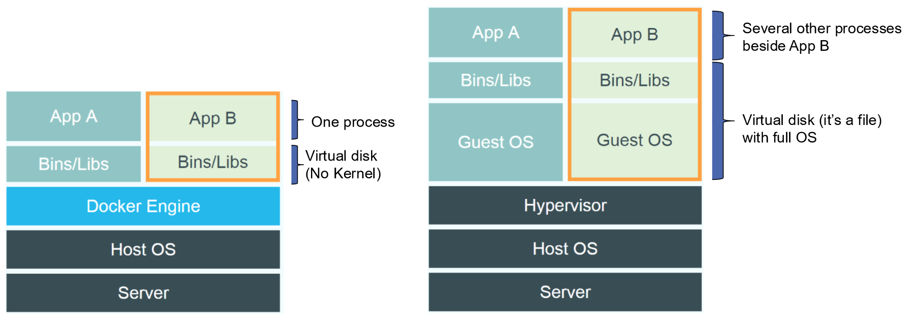
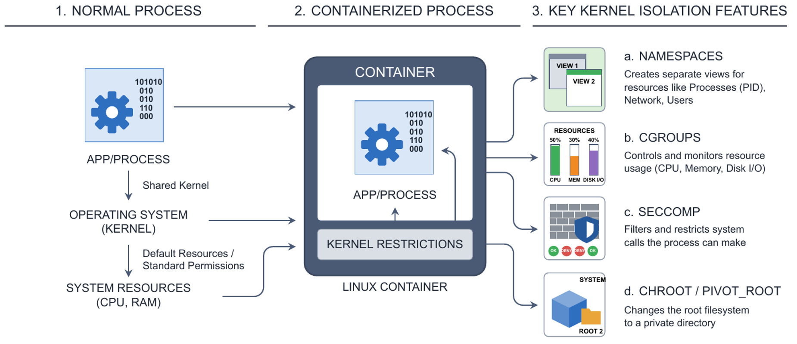
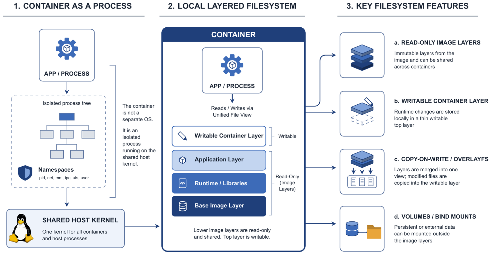
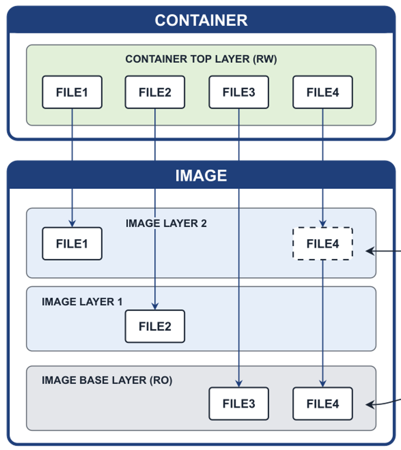
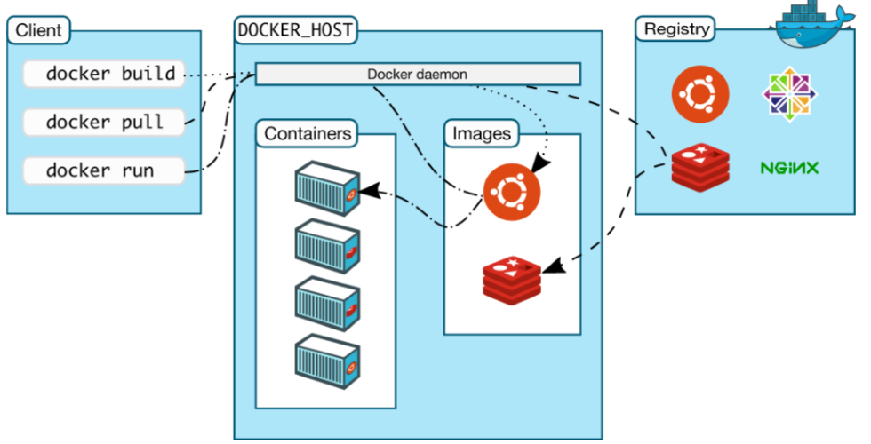
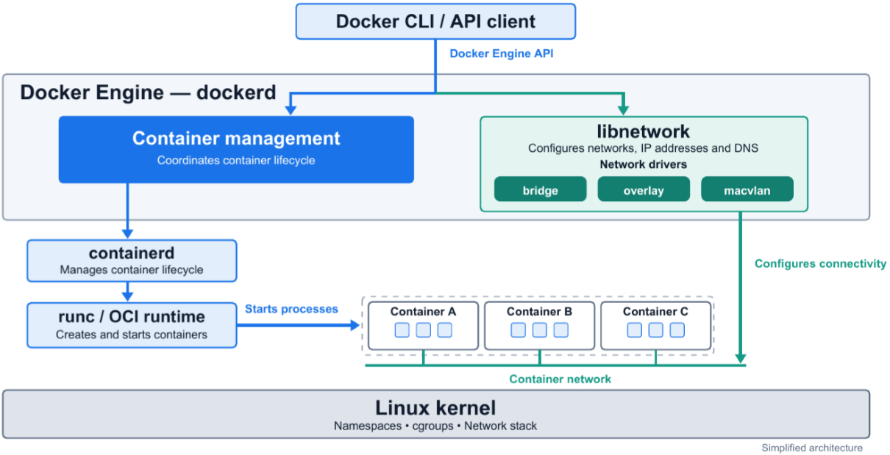
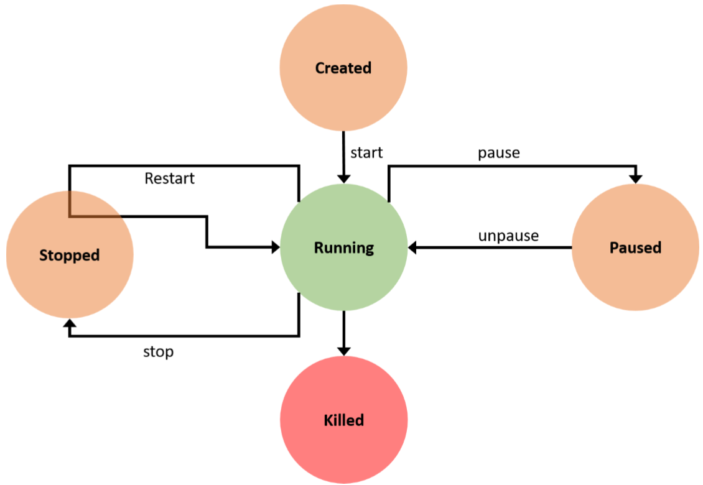

:::note[Preparazione dell'ambiente]
Il laboratorio si svolge in una **VM Linux** (consigliata Ubuntu 24.04, con 2 vCPU, 4 GB di RAM e 25 GB di disco), creata con Multipass o VirtualBox, con **Docker Engine installato dentro la VM**. Docker Desktop direttamente sul laptop è sconsigliato, perché non fornisce l'ambiente necessario ad alcuni esercizi. Aggiungendo l'utente al gruppo `docker` si evita `sudo`, ma si ottengono privilegi amministrativi sulla VM.
:::

## Perché le VM Non Bastano

Una VM dà un isolamento forte intercettando le operazioni sensibili sull'hardware, ma questa astrazione ha un costo: trap su CPU, seconda traduzione della memoria, emulazione dell'I/O. L'hardware moderno riduce l'overhead, ma una VM non è mai gratis (vedi [Virtualizzazione](../../teoria/03-virtualizzazione/)).

Con una VM per componente si ha forte isolamento, ma ogni VM si porta dietro un **sistema operativo guest completo**. Per i **microservizi** questo è un problema:

- **Confine di isolamento grossolano**: la VM è un'unità troppo grande per un servizio leggero.
- **Unità di scaling grande**: scalare un servizio significa replicare una VM intera.
- **Overhead operativo**: patch, monitoraggio e aggiornamenti si moltiplicano per ogni macchina.
- **Spreco di risorse**: i guest OS duplicati consumano CPU, memoria e disco.

## Che Cos'è un Container

Un **container** è come una valigia già pronta per il software: contiene l'applicazione con tutto ciò che le serve (librerie, strumenti, configurazioni), così funziona allo stesso modo su qualsiasi macchina.

- **Pacchettizzazione standard** di software e dipendenze.
- **Isolamento** dell'applicazione, per sicurezza e condivisione delle risorse.
- **Leggerezza**: i container condividono il kernel dell'host.



| | Container | Macchina virtuale |
| --- | --- | --- |
| **Contiene** | Applicazione e librerie, **senza kernel** | Sistema operativo guest completo |
| **Processi** | Di solito uno | Molti altri oltre all'applicazione |
| **Disco** | Layer condivisi | Disco virtuale, un file con l'OS intero |
| **Avvio** | Immediato | Boot di un sistema operativo |
| **Isolamento** | Processo isolato sullo stesso kernel | Forte, con hypervisor |

**Docker** automatizza il deployment delle applicazioni in container, fornendo un livello di astrazione sulla virtualizzazione a livello di sistema operativo di Linux. Il nome viene da *docker*, lo scaricatore di porto. L'obiettivo è impacchettare ed eseguire il software in modo uniforme: *Build, Ship and Run Any App, Anywhere*. Come un container navale, è sempre uguale qualunque cosa contenga, e quindi si adatta a camion, gru e navi.

## Container = Processi Limitati

Il punto concettuale più importante è questo: **un container non è un sistema operativo separato, è un processo isolato che gira sul kernel condiviso dell'host**.



Il kernel Linux fornisce gli strumenti:

| Meccanismo | A cosa serve | Cosa controlla |
| --- | --- | --- |
| **Namespaces** | **Isolano**: danno al processo la sua vista del sistema | `pid` (processi), `net` (rete), `mnt` (filesystem), `uts` (hostname), `ipc` (semafori), `user` (UID) |
| **Cgroups** | **Limitano e misurano** l'uso delle risorse | Memoria, CPU, I/O a blocchi, rete |
| **Seccomp** | Filtra le system call utilizzabili | System call |
| **Chroot / pivot_root** | Cambia il filesystem radice | Directory privata |

:::tip[Per ricordarlo]
I **namespaces** decidono **cosa può vedere** un processo, i **cgroups** decidono **quanto può usare**.
:::

## Immagini e Container

| Concetto | Significato |
| --- | --- |
| **Immagine** | Modello **di sola lettura** per creare container: codice, librerie e dipendenze. Può basarsi su altre immagini |
| **Container** | **Istanza in esecuzione** di un'immagine, isolata ed effimera |
| **Registry** | Archivio per conservare e distribuire immagini, pubblico o privato |
| **Container runtime** | Software che crea ed esegue i container |

La relazione ricorda quella tra classe e oggetto, o tra [AMI e istanza](../../teoria/04-amazon-aws/#immagine-e-istanza): da un'immagine si creano tanti container.

### Filesystem a Layer

Il filesystem di un container è ottenuto "cucendo" più **layer**:



- Un'immagine è fatta di più **layer immutabili**, ciascuno un file con un pezzo di filesystem.
- I layer si possono **condividere** tra immagini, e tra container.
- Un container **non copia** l'immagine ma ci si collega, per questo parte subito.
- Ogni container ha sopra un sottile **layer scrivibile** tutto suo.

### Copy-on-Write



- I layer dell'immagine sono in sola lettura, sia per le immagini sia per i container.
- Se un container deve **modificare** un file, prima lo copia nel suo layer scrivibile, e la copia **oscura** quella sottostante.
- I file non modificati non vengono copiati, così il layer scrivibile resta il più piccolo possibile.
- Se durante la build si modifica un file, si crea un nuovo layer con quel file.

Quando il container viene rimosso, il suo layer scrivibile sparisce: per questo [servono i volumi](../02-docker-risorse-e-storage/#storage-persistente).

## L'Architettura di Docker

**Docker Engine** è un'applicazione **client-server** con tre componenti: il **daemon** `dockerd`, una **REST API** e il **client** `docker`, la CLI. Il daemon crea e gestisce gli oggetti Docker: immagini, container, reti e volumi. Client e daemon possono stare sulla stessa macchina o su macchine diverse, e comunicano via REST su socket UNIX o interfaccia di rete.



Il **registry** conserva le immagini. Docker Hub è quello pubblico predefinito, ma si può avere un registry privato.

Scendendo nel dettaglio, sotto a Docker Engine lavorano due componenti:



| Componente | Compito |
| --- | --- |
| **containerd** | Daemon che gestisce l'intero ciclo di vita: scarica e conserva le immagini, prepara il filesystem, configura la rete, supervisiona i container. Non crea i container direttamente |
| **runc** | Runtime a basso livello, conforme allo standard **OCI**. È lui che crea ed esegue il container, usando namespaces e cgroups |

## I Comandi

`docker run` fa tutto insieme: cerca l'immagine in locale, se manca la scarica dal registry (*pull*), crea il container (*create*) e lo avvia (*start*).

```bash
docker run -d --rm -it --name web -p 8081:80 nginx:latest
```

| Opzione | Significato |
| --- | --- |
| `-d` | Detached: esecuzione in background |
| `--rm` | Rimuove il container quando termina |
| `-it` | Interattivo con terminale: `-i` tiene aperto stdin, `-t` alloca un terminale |
| `--name` | Dà un nome al container |
| `-p 8081:80` | Pubblica la porta del container 80 sulla porta dell'host 8081 |
| `nginx:latest` | Immagine e tag. Il tag è facoltativo |

:::caution[L'ordine della porta]
In `-p 8081:80` a sinistra c'è l'**host**, a destra il **container**: la regola è `host:container`.
:::

| Comando | A cosa serve |
| --- | --- |
| `docker search ubuntu` | Cerca immagini. Filtri: `--filter is-official=true`, `--filter stars=100`, `--limit 5` |
| `docker pull alpine:3.9.4` | Scarica un'immagine |
| `docker images` / `docker image ls` | Elenca le immagini. `-a` tutte, `-q` solo ID, `--no-trunc` ID completi |
| `docker ps` / `docker container ls` | Elenca i container attivi. `-a` tutti, `-s` con la dimensione |
| `docker stats <id>` | Uso delle risorse in tempo reale |
| `docker exec <id> <cmd>` | Esegue un comando in un container attivo |
| `docker top <id>` | Processi dentro il container |
| `docker rmi ` / `docker image rm` | Elimina un'immagine |

Con `docker exec`, per aprire una shell interattiva servono entrambe le opzioni: `docker exec -it <id> bash`. Senza `-i` non puoi scrivere, senza `-t` non hai un terminale, e con `-d` il comando va in background.

### Il Ciclo di Vita



| Comando | Effetto |
| --- | --- |
| `docker create` | Crea senza avviare |
| `docker run` | Crea e avvia |
| `docker start` / `stop` | Avvia e ferma |
| `docker restart` | Ferma e riavvia |
| `docker pause` / `unpause` | Sospende e riprende i processi, **senza rilasciare le risorse** |
| `docker kill` | Invia il segnale SIGKILL |
| `docker rm` | Elimina un container fermo, `-f` forza anche se è in esecuzione |

:::tip[Soluzioni utili]
- Eliminare tutte le immagini: `docker rmi $(docker images -q)`.
- **Esercizio 4** (pull di `alpine` e `miciav/micro`): il secondo pull non riscarica il layer condiviso. I layer sono identificati dal contenuto, e Docker scarica solo quelli che non ha già.
:::

:::note[Le risorse di default]
Un container è un processo come gli altri: **vede tutta la memoria e tutte le CPU**, senza limiti. Come limitarli si vede nella [prossima lezione](../02-docker-risorse-e-storage/#limitare-le-risorse).
:::

## Autotest

**1.** Che cosa sono namespaces e cgroups, e che differenza c'è?

<details>
<summary>Soluzione</summary>

Sono funzioni del kernel Linux. I **namespaces** isolano, dando al processo una vista privata di processi, rete, filesystem e così via. I **cgroups** limitano e misurano le risorse come CPU e memoria.

</details>

**2.** Che differenza c'è tra immagine e container?

<details>
<summary>Soluzione</summary>

L'immagine è un modello di sola lettura, fatto di layer. Il container è un'istanza in esecuzione, con un sottile layer scrivibile sopra l'immagine.

</details>

**3.** Perché avviare un container è immediato?

<details>
<summary>Soluzione</summary>

Perché non c'è un sistema operativo da avviare e l'immagine non viene copiata: il container si collega ai suoi layer e aggiunge solo un layer scrivibile.

</details>

**4.** Che cosa succede quando un container modifica un file di un layer dell'immagine?

<details>
<summary>Soluzione</summary>

Per il **copy-on-write**, il file viene copiato nel layer scrivibile e lì modificato. La copia oscura l'originale, che resta intatto nell'immagine.

</details>

**5.** Che cosa fanno containerd e runc?

<details>
<summary>Soluzione</summary>

**containerd** gestisce il ciclo di vita dei container, le immagini e la rete. **runc** è il runtime OCI che crea effettivamente il container con namespaces e cgroups.

</details>

**6.** Quale comando crea e avvia nginx in background, pubblicando la porta 80 del container sulla 8081 dell'host?

<details>
<summary>Soluzione</summary>

`docker run -d -p 8081:80 nginx`.

</details>

**7.** Che differenza c'è tra `docker stop`, `docker pause` e `docker kill`?

<details>
<summary>Soluzione</summary>

`stop` ferma il container, `pause` sospende i processi tenendo le risorse, `kill` invia SIGKILL.

</details>

## Glossario

- **Container** - Processo isolato che condivide il kernel dell'host.
- **Immagine** - Modello di sola lettura per creare container.
- **Layer** - Porzione immutabile del filesystem di un'immagine.
- **Copy-on-write** - Copia di un file nel layer scrivibile al momento della modifica.
- **Registry** - Archivio di immagini, come Docker Hub.
- **Namespace** - Vista isolata di una risorsa del kernel.
- **Cgroup** - Limitazione e misura delle risorse.
- **dockerd** - Il daemon di Docker.
- **containerd** - Daemon che gestisce il ciclo di vita dei container.
- **runc** - Runtime di basso livello conforme a OCI.
- **OCI** - Open Container Initiative, lo standard dei container.
