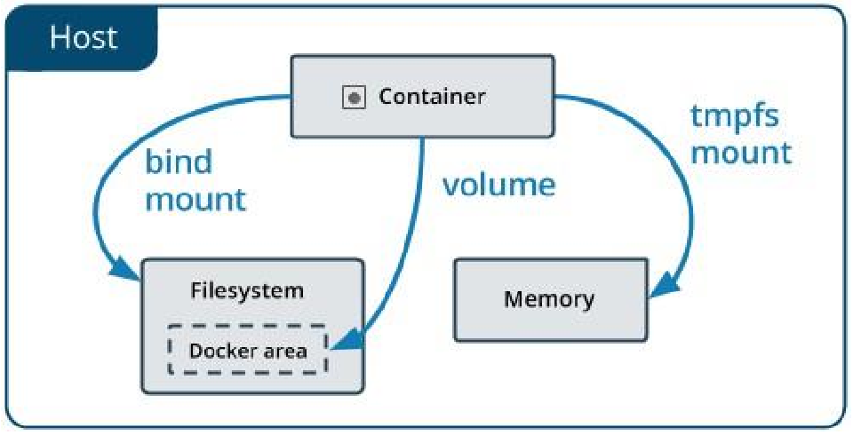

## Informazioni dal Sistema

| Comando | A cosa serve |
| --- | --- |
| `docker system df` | Spazio usato da immagini, container e volumi. `-v` per i dettagli |
| `docker system events` | Mostra in tempo reale gli eventi. Prova ad aprirlo in un terminale e ad agire sui container in un altro |
| `docker system prune` | Recupera spazio eliminando gli oggetti inutilizzati. `-a` per una pulizia più aggressiva |

## Limitare le Risorse

Di default un container **non ha vincoli** e può usare tutto ciò che il kernel gli concede. Con due container su un host da 4 CPU e 8 GB, ciascuno crede di averle tutte.

Docker può imporre due tipi di limite:

| Tipo | Significato | Esempio |
| --- | --- | --- |
| **Hard limit** | Il container non può superare la quantità | `docker run -m 256m ` |
| **Soft limit** | Il container può usare ciò che serve, finché non c'è contesa sull'host | `docker run --memory-reservation 256m ` |

Per la CPU le opzioni principali sono:

| Opzione | Significato |
| --- | --- |
| `--cpus=1.5` | Quanta CPU può usare al massimo. È l'opzione da preferire |
| `--cpu-period`, `--cpu-quota` | Periodo e quota del CFS: l'equivalente a basso livello di `--cpus` |
| `--cpuset-cpus=0-3` | Su quali core può girare, ad esempio `0-3` o `1,3` |
| `--cpu-shares` | Peso relativo, 1024 di default. Vale **solo quando la CPU è contesa** |

:::note[Esempio dal laboratorio]
```bash
docker run --name fullcpu -d alpine dd if=/dev/zero of=/dev/null
docker run --name halfcpu -d --cpus=.5 -m 100m alpine dd if=/dev/zero of=/dev/null
```
Il primo porta la CPU al 100%, il secondo si ferma al 50%: lo verifichi con `docker stats`.
:::

## Ispezionare i Container

| Comando | A cosa serve |
| --- | --- |
| `docker exec <id> env` | Mostra le variabili d'ambiente |
| `docker inspect <id>` | Tutti i dettagli del container, in JSON |
| `docker inspect -f '{{ .NetworkSettings.IPAddress }}' <id>` | Filtra un campo con un template Go |
| `docker logs <id>` | Output del comando. Opzioni: `--follow`, `--details`, `--tail 5`, `--timestamps` |

## Storage Persistente

Salvare i dati nel layer scrivibile del container ha diversi problemi:

- I dati **non sopravvivono** alla rimozione del container.
- È difficile farli usare a un altro processo.
- Il layer è legato alla macchina host.
- Serve uno storage driver, e il filesystem a layer è più lento di un volume, che scrive direttamente sull'host.

L'esercizio con MySQL lo dimostra: crei un database, rimuovi il container, ne crei uno identico e i dati sono spariti.

Docker offre tre soluzioni. La differenza principale è **dove stanno i dati sull'host**.



| Tipo | Dove stanno i dati | Gestito da | Quando usarlo |
| --- | --- | --- | --- |
| **Volume** | In un'area gestita da Docker (`/var/lib/docker/volumes/`) | Docker | **Il modo preferito** per persistere i dati |
| **Bind mount** | Ovunque sull'host | L'utente | Condividere file con l'host, come il codice in sviluppo |
| **tmpfs** | Solo nella **memoria** dell'host | Docker | Stato non persistente o dati sensibili |

### Volumi

- Si creano esplicitamente con `docker volume create` oppure li crea Docker con il container.
- Sono isolati dalle funzioni principali dell'host.
- Possono essere **montati in più container** insieme.
- Possono essere **con nome** o **anonimi**.
- Supportano i **volume driver**, plugin per salvare i dati su host remoti o cloud provider.

### Bind Mount

Sono il tipo più vecchio, con funzioni più limitate. Un file o una directory dell'host viene montato nel container, indicandone il percorso. Sono performanti, ma dipendono dalla struttura delle directory dell'host, e la CLI di Docker non può gestirli. Poiché il container può modificare il filesystem dell'host, comportano **rischi di sicurezza**.

### Regole di Montaggio

| Situazione | Risultato |
| --- | --- |
| **Volume vuoto** su una directory con file | I file vengono **copiati** nel volume |
| Volume che **non esiste** | Viene creato vuoto |
| **Bind mount o volume non vuoto** su una directory con file | I file originali vengono **oscurati**: non sono cancellati, ma non sono accessibili finché dura il mount |

Una directory creata così appartiene di solito a `root:root`, perché a crearla è il daemon, tradizionalmente in esecuzione come root.

### Specificare un Volume

`-v` e `--mount` hanno lo stesso comportamento di base. `--mount` è più esplicito, con coppie chiave-valore: `type` (`bind`, `volume`, `tmpfs`), `source`, `destination` e `readonly`.

```bash
docker run -d --name nginxtest \
  --mount source=nginx-vol,destination=/usr/share/nginx/html \
  nginx:latest
```

```bash
docker run -d -v my-vol:/var/lib/mysql mysql/mysql-server:8.0.20   # volume con nome
docker run -it -v "$(pwd)/es-python:/app" adreeve/python-numpy python ./app/es-python.py   # bind mount
```

:::note[Complemento: una differenza tra -v e --mount]
Con un bind mount su una directory host inesistente, `-v` la crea, mentre `--mount` dà errore. Le slide dicono che la directory viene creata on demand, ed è il comportamento di `-v`.
:::

| Comando | A cosa serve |
| --- | --- |
| `docker volume create <nome>` | Crea |
| `docker volume ls` | Elenca |
| `docker inspect <nome>` | Dettagli |
| `docker volume rm <nome>` | Elimina |
| `docker volume prune` | Elimina i volumi non montati |

:::caution[Ambienti multi-host]
In produzione, con più host e container che si spostano, il volume locale non basta. Servono i **volume driver**, come Azure file storage, GlusterFS o Ceph RBD, che salvano i dati su storage condiviso.
:::

## Docker come Strumento di Sviluppo

Docker permette di compilare ed eseguire senza installare nulla sull'host: basta un bind mount sul progetto.

```bash
# Esercizio 6: compilare con Maven
docker run --rm -v "$(pwd)/es-micro:/app" -w /app maven:3.5-jdk-8 \
  mvn clean install -Dmaven.test.skip=true

# Esercizio 7: eseguire il jar prodotto
docker run --rm -p 8080:8080 -v "$(pwd)/es-micro:/app" -w /app/target maven:3.5-jdk-8 \
  java -jar ./micro-0.0.1-SNAPSHOT.jar
```

`-w` imposta la directory di lavoro, e `--rm` elimina il container al termine.

## Esercizi Svolti

**MySQL con un volume** (esercizi 3 e 4):

```bash
docker volume create my-vol
docker run -d --name mysql-server -p 3306:3306 \
  -e MYSQL_ROOT_PASSWORD='cloud' -e MYSQL_ROOT_HOST='%' \
  -v my-vol:/var/lib/mysql mysql/mysql-server:8.0.20
docker exec -it mysql-server bash   # poi: mysql -uroot -p
```

Rimuovendo il container e creandone uno nuovo con lo stesso volume, il database è ancora lì.

**Condividere un file con l'host** (esercizio 5):

```bash
docker run -it --rm -v "$(pwd)/shared:/mnt/shared" alpine ash
# dentro al container
echo "Laboratorio di CC" >> /mnt/shared/cloud.txt
```

Alpine non ha `bash`, quindi si usa `ash`. Dopo la rimozione del container il file resta nella cartella dell'host.

## Autotest

**1.** Che differenza c'è tra hard limit e soft limit?

<details>
<summary>Soluzione</summary>

L'**hard limit** non può mai essere superato. Il **soft limit** viene applicato solo in presenza di contesa sull'host.

</details>

**2.** Quando ha effetto `--cpu-shares`?

<details>
<summary>Soluzione</summary>

Solo quando i cicli di CPU sono contesi. Se c'è CPU libera, tutti i container ne usano quanta serve.

</details>

**3.** Quali sono le tre forme di storage di Docker, e dove stanno i dati?

<details>
<summary>Soluzione</summary>

**Volume**: nell'area dell'host gestita da Docker. **Bind mount**: in un percorso qualsiasi dell'host. **tmpfs**: nella memoria dell'host.

</details>

**4.** Perché i volumi sono preferiti ai bind mount?

<details>
<summary>Soluzione</summary>

Perché sono gestiti da Docker, isolati dall'host, indipendenti dalla sua struttura di directory, e supportano i driver per storage remoto. Sono anche più sicuri, dato che un bind mount permette di modificare il filesystem dell'host.

</details>

**5.** Monti un bind mount su `/usr/share/nginx/html`, che nell'immagine contiene dei file. Cosa succede a quei file?

<details>
<summary>Soluzione</summary>

Vengono **oscurati**: non sono cancellati, ma non sono visibili finché dura il mount. Con un volume **vuoto**, invece, i file sarebbero stati copiati nel volume.

</details>

**6.** Quando useresti tmpfs?

<details>
<summary>Soluzione</summary>

Per stato non persistente o dati sensibili che non devono finire su disco.

</details>

## Glossario

- **Hard / Soft limit** - Limite invalicabile e limite applicato solo in caso di contesa.
- **Volume** - Spazio persistente gestito da Docker.
- **Bind mount** - Montaggio di un percorso dell'host nel container.
- **tmpfs** - Montaggio in memoria, non persistente.
- **Volume driver** - Plugin per salvare i volumi su storage remoto.
- **docker inspect** - Comando che mostra i dettagli di un oggetto Docker.
