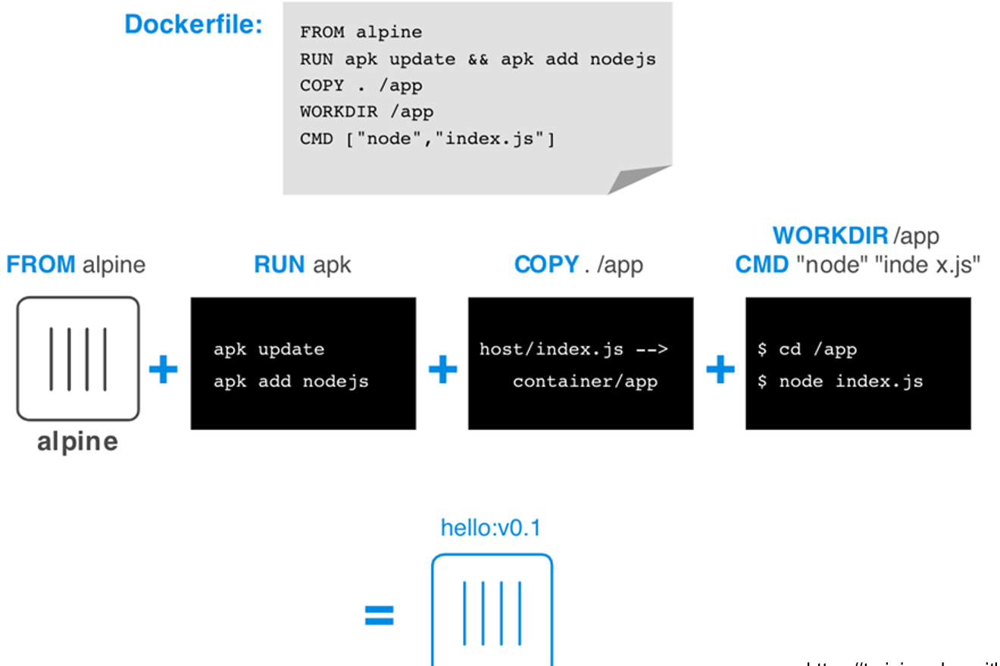

## Image Building

**Building** is the Docker process that **creates a Docker image**:

- It **packs libraries and programs** in a **layered filesystem** (e.g. UnionFS).
- It adds **configuration info (metadata)**: memory quota, disk quota, CPU share, processes to be executed (entrypoint), security options.

The build receives as input a **Dockerfile** with the instructions and a **context**, the set of files available at a specified location (**PATH or URL**), and produces a **Docker image**. During the process several **intermediate containers** are created, run and **committed into images**.

```bash
docker build -t mymongo:0.1 .                       # the dot is the context
docker build -t mymongo:0.1 -f path/to/Dockerfile . # Dockerfile with another name or path
```

| Option | Meaning |
| --- | --- |
| `--tag`, `-t` | Name and optionally a tag, `name:tag`. You can assign **multiple tags** to one image (e.g. `myimage:1.0.0` and `myimage:latest`) |
| `--file`, `-f` | Name of the Dockerfile (default `PATH/Dockerfile`) |
| `--build-arg` | Sets build-time variables |
| `--target` | Sets the target build stage |
| `--pull` | Always attempts to pull a newer version of the base image |
| `--rm` / `--force-rm` | Removes intermediate containers after a successful build / always |
| `--quiet`, `-q` | Suppresses the output and prints the image ID |

:::note[Resource limits during build]
Options like `--cpu-period`, `--cpu-quota`, `--cpu-shares`, `--cpuset-cpus`, `--memory` and `--memory-swap` limit the resources of **each RUN step**, **not the final image**. Multiple RUN steps can run in parallel, so overall usage may be higher. Modern Docker uses **BuildKit** by default, and `docker build` is generally an alias for `docker buildx build`, which configures limits with `--resource`, e.g. `--resource memory=2g,cpu-quota=50000,cpu-period=100000`.
:::

The manual alternative is the **image promotion process**: run a container, install something, then `docker commit`. The result is not reproducible, which is why Dockerfiles are used.

## The Dockerfile

A **Dockerfile** is a **script** containing instructions and arguments that Docker uses to create an image, **executed in sequential order**. Each statement has the format `INSTRUCTION argument`, and comments start with `#`.

Some instructions are used to build the image, others when a container is instantiated:

| Build | Both | Run |
| --- | --- | --- |
| `FROM` | `WORKDIR` | `CMD` |
| `MAINTAINER` | `USER` | `EXPOSE` |
| `COPY` | `ENV` | `VOLUME` |
| `ADD` | | `ENTRYPOINT` |
| `RUN` | | `LABEL` |
| `ONBUILD` | | |
| `ARG` | | |



### Main Instructions

| Instruction | What it does | Notes |
| --- | --- | --- |
| `FROM` | Defines the **base image** the build starts from | Dockerfiles begin with it. `FROM scratch` is an explicitly empty image |
| `LABEL` | Sets **metadata** (documentation) | Right after `FROM`. Labels of base images are **inherited**, and the most recent value overrides |
| `RUN` | The **central executing directive**: runs a command in a temporary container from the previous step | **Forms a new layer**. Chain commands with `&&` to use the disk wisely: one RUN that downloads and unpacks avoids using `ADD` |
| `COPY` | Copies files from the **context** to the destination | Two arguments: source and destination |
| `ADD` | Like `COPY`, but the source **can be a URL**: contents are downloaded, **unpacked** if necessary and placed at the destination | |
| `WORKDIR` | Working directory for following `RUN`, `CMD`, `ENTRYPOINT`, `COPY`, `ADD` | Created if missing, can be set multiple times. Use **absolute paths**, and use it instead of `RUN cd ...` |
| `ENV` | Sets an **environment variable** for all subsequent commands | Two forms: `ENV <key> <value>` and `ENV <key>=<value> ...` for multiple variables |
| `ARG` | A variable passed **at build time** with `--build-arg <name>=<value>` | Multiple ARGs allowed, defaults allowed, **not persisted** |
| `USER` | Username/UID and optionally group/GID | Used when running the image and for following `RUN`, `CMD`, `ENTRYPOINT` |
| `EXPOSE` | Informs Docker that the container **listens on a port** at runtime (TCP by default, or UDP) | **Does not publish the port**: it is documentation. Use `docker run -p` or `-P` |
| `VOLUME` | Creates a **mount point** for an externally mounted volume | JSON array (`VOLUME ["/var/log/"]`) or plain string. `docker run` initializes the **anonymous volume** with data from the image |
| `ONBUILD` | An instruction the parent gives to the **child** Dockerfile | **Not executed** in the current Dockerfile. Runs in images derived FROM it, **before any command of the child**. Useful to automate software stack builds |

**Environment replacement**: variables are used as `$variable_name` or `${variable_name}`, with two special forms:

- `${variable:-word}`: the variable's value if set, otherwise `word`.
- `${variable:+word}`: `word` if the variable is set, otherwise the empty string.

**`.dockerignore`** is not an instruction, but controls **which files are added to the build context**: a newline-separated list of patterns like `*.md`, with `!README*.md` for exceptions.

:::caution[EXPOSE does not publish]
The most common confusion. `EXPOSE 80` is **documentation**. To reach the container from the host you need `-p host_port:container_port`, or `-P`, which publishes all exposed ports to **random host ports**.
:::

### ENTRYPOINT and CMD

The most important instructions, and the easiest to confuse.

| | `ENTRYPOINT` | `CMD` |
| --- | --- | --- |
| **Purpose** | The command **executed at starting time** | **Provides defaults** for an executing container |
| **How many** | The last one counts | Only one: if more are listed, **only the last takes effect** |
| **With arguments in `docker run`** | **Receives them as arguments**: `docker run <image> --pippo` passes `--pippo` to the entrypoint | Is **replaced** |
| **To override it** | `--entrypoint` | Arguments after the image name |

ENTRYPOINT has two forms, CMD three:

| Form | Syntax | Notes |
| --- | --- | --- |
| **Exec** (recommended) | `ENTRYPOINT ["executable", "param1"]`, `CMD ["executable", "param1"]` | The process receives signals directly. The ENTRYPOINT exec form can be **combined with CMD** |
| **Default parameters** | `CMD ["param1", "param2"]` | Default parameters to ENTRYPOINT. If the executable is omitted, ENTRYPOINT must be specified |
| **Shell** | `ENTRYPOINT executable param1`, `CMD command param1` | Started as a subcommand of `/bin/sh -c`, **which does not pass signals**: `docker stop` does not work, zombie containers |

The typical combination is ENTRYPOINT in exec form for the command, and CMD for the default parameters:

```dockerfile
ENTRYPOINT ["/usr/bin/mongod"]
CMD ["--port", "27017", "--dbpath", "/data/db", "--bind_ip_all"]
```

| Command | What runs |
| --- | --- |
| `docker run mymongo` | `mongod --port 27017 --dbpath /data/db --bind_ip_all` |
| `docker run mymongo --port 28000` | `mongod --port 28000`: CMD has been replaced |
| `docker run --entrypoint sh mymongo` | `sh`, without the Dockerfile's CMD |

To override the defaults you **do not need to rebuild** the image: `docker run --entrypoint=<my-entrypoint> [options] <image> <my-cmd>`.

:::caution[Slide 26: inaccurate example]
The slide has three inaccuracies:

- `CMD ["--port 27017"]` passes a **single** argument containing a space. They must be separated: `["--port", "27017"]`.
- `ENTRYPOINT usr/bin/mongod` is in shell form, and **in shell form CMD is ignored**. Use the exec form with the absolute path.
- It says you can override ENTRYPOINT or CMD "not both", right after showing a command that overrides both. You can override either one, or both.

The [MongoDB Dockerfile](#complete-example) of the exercise is written correctly.
:::

### Multiple Services in a Container

The recommendation is to separate areas of concern by using **one service per container**; that service may fork into multiple processes. The container's main process is responsible for managing all the processes it starts. If several services are really needed:

- Put all the commands in a **wrapper script** and run it as your CMD.
- Use a **process manager** like **supervisord**, packaged in the image with its configuration.

### Complete Example

The Dockerfile of Ex. 1 installs MongoDB on Ubuntu:

```dockerfile
FROM ubuntu:24.04
LABEL org.opencontainers.image.authors="Cloud Computing laboratory"

RUN apt-get update \
 && apt-get install -y --no-install-recommends ca-certificates curl gnupg \
 && ... \
 && rm -rf /var/lib/apt/lists/* /tmp/server-8.0.asc
RUN mkdir -p /data/db && chown mongodb:mongodb /data/db

USER mongodb
VOLUME ["/data/db"]
EXPOSE 27017
ENTRYPOINT ["/usr/bin/mongod"]
CMD ["--port", "27017", "--dbpath", "/data/db", "--bind_ip_all"]
```

Note the `RUN`: it is a single instruction that **cleans up** temporary files in the same layer. A separate `RUN rm` would not reduce the image size, because the files would stay in the previous layer.

Build and run it with `docker build -t mymongo:0.1 .`, then `docker run -d --name mymongocontainer -P mymongo:0.1`, and check with `docker logs` and `docker inspect`.

## Multi-Stage Builds

With **multi-stage builds** you use **multiple `FROM` statements** in your Dockerfile. Each `FROM` can use a different base and **begins a new stage**. The idea is to **selectively copy artifacts** from one stage to another, **leaving behind everything you don't need** in the final image: a small image, without build tools.

The official solution of Ex. 6 (dockerize a Java application):

```dockerfile
FROM maven:3.9-eclipse-temurin-8 AS build
WORKDIR /app
COPY pom.xml .
COPY src/ src/
RUN mvn clean install -Dmaven.test.skip=true

FROM eclipse-temurin:8-jre
WORKDIR /app
COPY --from=build /app/target/micro-0.0.1-SNAPSHOT.jar .
EXPOSE 8080
ENTRYPOINT ["java", "-jar", "micro-0.0.1-SNAPSHOT.jar"]
```

`--target` specifies an intermediate stage by name as the final stage; commands after it are skipped: `docker build -t mybuild --target build .`.

The official solution of Ex. 3 (custom NGINX):

```dockerfile
FROM nginx:1.18.0
COPY --chmod=755 docker-entrypoint.sh /docker-entrypoint.sh
COPY html /usr/share/nginx/html
EXPOSE 80
ENTRYPOINT ["/docker-entrypoint.sh"]
CMD ["nginx", "-g", "daemon off;"]
```

Run it with the memory limited to 500 MB and port 80 published: `docker run -d -m 500m -p 80:80 <image>`.

## Distributing Images

`docker build` supports **Git repositories as build contexts**: the repository is pulled into a temporary directory and sent to the daemon. A fragment after `:` selects a branch, tag or remote reference.

```bash
docker build -t <user>/nginx-example github.com/atbaker/nginx-example
```

One of Docker's main strengths is **streamlining the sharing and distribution of images**, and the **Docker registry** is the tool in charge of it. **Docker Hub** offers **free public** repositories and **pay-per-use private** ones.

```bash
docker login
docker push <user>/<image>:<tag>
```

Ex. 7 uses a **local registry**:

```bash
docker run -d -p 5000:5000 --restart=always --name registry registry:latest
docker tag <image> localhost:5000/<image>
docker push localhost:5000/<image>
curl http://localhost:5000/v2/_catalog
docker pull localhost:5000/<image>
```

## Self-Test

**1.** What is the difference between `COPY` and `ADD`?

<details>
<summary>Solution</summary>

Both copy from the context. `ADD` also accepts a URL as source, and unpacks archives.

</details>

**2.** What is the difference between `ARG` and `ENV`?

<details>
<summary>Solution</summary>

`ARG` exists only at build time and is set with `--build-arg`, it is not persisted. `ENV` persists in the image and is available in the container.

</details>

**3.** The Dockerfile has `EXPOSE 80`. If you run `docker run nginx-custom`, is the port reachable from the host?

<details>
<summary>Solution</summary>

No: `EXPOSE` is documentation. You need `-p 80:80` or `-P`.

</details>

**4.** Given `ENTRYPOINT ["python"]` and `CMD ["app.py"]`, what does `docker run img test.py` execute?

<details>
<summary>Solution</summary>

`python test.py`: the arguments replace CMD, while ENTRYPOINT stays.

</details>

**5.** Why is the exec form of `ENTRYPOINT` preferred?

<details>
<summary>Solution</summary>

The main process receives signals directly. In shell form it runs under `/bin/sh -c`, which does not pass signals, so `docker stop` does not stop it cleanly. The shell form also ignores CMD.

</details>

**6.** When is an `ONBUILD` instruction executed?

<details>
<summary>Solution</summary>

When building a **child** image, before the child Dockerfile's instructions. Never in the current build, and never at container start.

</details>

**7.** What is the advantage of multi-stage builds?

<details>
<summary>Solution</summary>

A small final image, containing only the artifacts, without compilers and build dependencies.

</details>

**8.** Why doesn't a separate `RUN rm file` reduce the image size?

<details>
<summary>Solution</summary>

Each `RUN` creates a layer: the file stays in the previous layer, and the new one only hides it.

</details>

## Glossary

- **Dockerfile** - Script of instructions to build an image.
- **Build context** - Set of files available during the build.
- **Exec / shell form** - JSON array syntax, or command as plain text.
- **Multi-stage build** - Build with several `FROM`s, copying only the artifacts.
- **BuildKit** - Docker's modern build engine.
- **Tag** - Label identifying a version of an image.
- **.dockerignore** - Patterns of files excluded from the context.
- **Image promotion** - Creating an image with `docker commit`.
- **Registry** - Tool that stores and distributes images.
