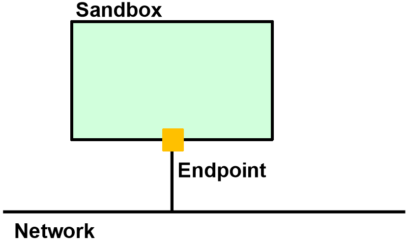
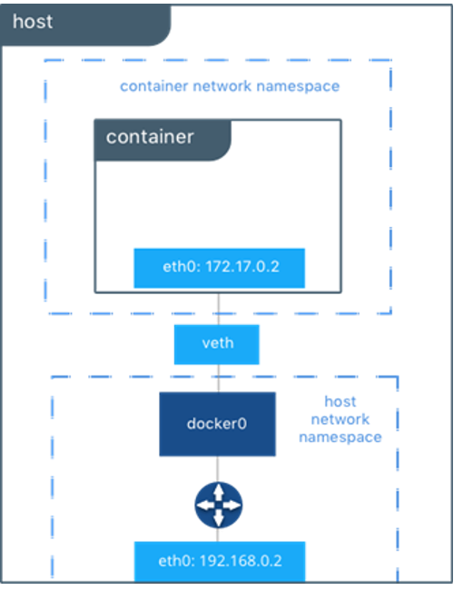
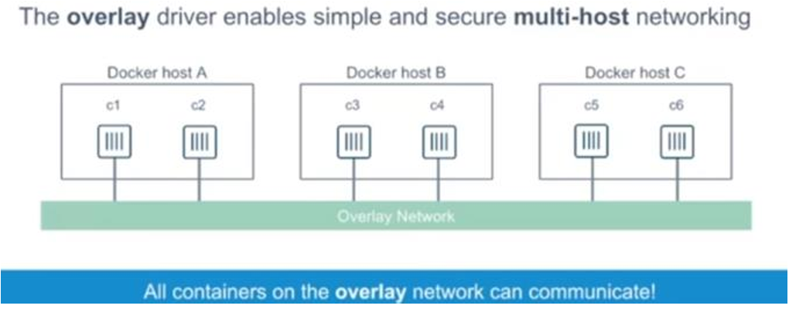
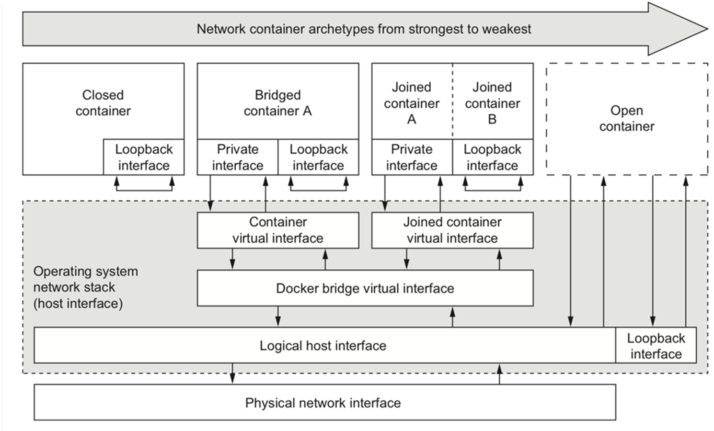

## Container Network Model

"We'll do for Networking what Docker did for Compute" (Moby project).

Conventional networks are made of **interfaces**, **Ethernet cables** and **switches**. The **Container Network Model (CNM)** is Docker's way of defining a networking interface specification:

- **Idea**: reproducing the essential abstractions of conventional computer networking **in software**.
- **Goal**: let containers have **virtual network interfaces**, communicate over **virtual networks**, and benefit from **connectivity and isolation**.



The CNM has four main components:

| Component | What it is | Analogy | Implementation |
| --- | --- | --- | --- |
| **Sandbox** | The configuration of a container's network stack: **network interfaces, IP addresses, routing table, DNS settings** | The computer | Linux network namespace, FreeBSD jail |
| **Endpoint** | **Joins a Sandbox to a Network**. It belongs to **only one network and one sandbox** | The cable and network card | veth pair, Open vSwitch internal port |
| **Network** | A **group of Endpoints** that can communicate with each other | The switch | Linux bridge, VLAN |
| **Cluster** | A group of Docker hosts connected by one or more networks | | |

A sandbox may contain **many endpoints from multiple networks**: a container can be part of, and communicate with, **multiple networks**.

:::note[Fundamentals: two Linux building blocks]
- A **Linux network namespace** is an **isolated network stack** in the kernel, with its own interfaces, routes and firewall rules. It ensures that two containers on the same host **cannot communicate** with each other, or with the host, unless configured to do so via Docker networks. Typically each container has its own namespace, but containers can share one, or even the host's.
- A **veth** (virtual Ethernet device) is a Linux interface that acts as a **connecting wire between two network namespaces**: a **full duplex** link with one interface in each sandbox. When a container is attached to a Docker network, **one end is inside the container**, the other is **attached to the Docker network**.
:::

:::caution[CNM is not the only one]
Google, Mesos and Cloud Foundry have their own alternative, the **Container Networking Interface (CNI)**, **used in Kubernetes**.
:::

### libnetwork

**libnetwork** **implements the CNM**: a library for creating and managing network stacks for containers. It implements **driver-based networking** (plugins for different network implementations), with **native service discovery and load balancing**.

The CNM provides two **pluggable and open interfaces**:

- **Network driver**: APIs to create/delete networks and add/remove containers.
- **IPAM driver**: APIs to create/delete **address pools** and allocate/deallocate container IP addresses.

The **remote driver** does not provide a driver itself: it is used to write **third-party networking plugins**. The **native network drivers** are none, host, bridge, macvlan and overlay.

## Native Network Drivers

| Driver | Behavior | Use |
| --- | --- | --- |
| **none** | A no-operation implementation, **no networking**. Only loopback is available | Maximum isolation |
| **host** | **Direct and full access to the host namespace**. Removes network isolation between host and containers | Performance, with less isolation |
| **bridge** (default) | A Linux-specific bridging implementation based on the **Linux Bridge** | Containers on the same host, development |
| **macvlan** | Assigns a **MAC address** to a container, making it appear as a **physical device** on the network. The daemon routes traffic by MAC address | The best choice for **legacy applications** |
| **overlay** | Networking that **spans multiple hosts**, using L3 encapsulation such as **VXLAN** | Containers on different hosts |

`docker network ls` shows the three default networks: `bridge`, `host` and `none`.

### Bridge Mode

Docker creates **docker0**, a **virtual Ethernet bridge** that automatically forwards packets between the interfaces attached to it. When a container starts, Docker creates a **veth pair** connecting `eth0` in the container to the bridge. **External connectivity** is provided by **IP forwarding and iptables rules**. Good for the **development phase**.



:::tip[Linux Bridge]
Virtual networking requires a **virtual switch** inside a server or hypervisor. Even though it is called a bridge, the **Linux bridge is really a virtual switch**: a kernel module (since kernel 2.2, around 2000), administered with `brctl`. It forwards packets based on the **Ethernet address**, not the IP address like a router. Since forwarding is done at **Layer 2**, all protocols go through transparently.
:::

### Host Mode

With `docker run --net=host`, a container **shares the network namespace, interfaces and IP stack of the host**:

- All containers in host mode communicate with each other on the host interfaces. From a networking standpoint this is **equivalent to multiple processes running on the host** without containers.
- The container is **fully exposed to the public network** and must share the host's IP address.
- Containers must coordinate over host ports: **no two containers can bind to the same TCP port**.
- **Security issues**.

### Overlay Mode

The overlay driver creates a **distributed network among multiple Docker daemon hosts**. The network **sits on top of** (overlays) the host-specific networks, letting connected containers communicate securely. Docker **transparently routes** each packet to the correct host and container.



### Network Container Archetypes



From strongest to weakest isolation: **closed** (loopback only, none driver), **bridged**, **joined** (two containers share the same namespace), **open** (host driver, no barrier).

## Network Commands

| Command | Effect |
| --- | --- |
| `docker network create -d bridge <name>` | Create a network. `--subnet 172.25.0.0/16` to choose the subnet |
| `docker network ls` | List |
| `docker network inspect <name>` | Details |
| `docker network connect <net> <cont>` | Connect a container |
| `docker network disconnect <net> <cont>` | Disconnect it |
| `docker network rm <name>` | Remove |

**Ex. 1** (none mode): `docker run -it --net=none --name my-cont busybox`. `ifconfig` shows only loopback, and pinging `www.google.com` or `8.8.8.8` fails, as expected.

## Service Discovery

libnetwork provides **native service discovery** using an **embedded DNS**:

- **Independent of network drivers**.
- A **DNS listener per container**: each container can perform DNS queries.
- **Distributed**, for both bridge and overlay.
- Acts as a **proxy for external DNS** services.

:::caution[The difference to remember]
DNS works on **user-defined networks**. On the **default `bridge` network, containers cannot resolve each other by name**, only by IP.
:::

Ex. 3 and 4 show it clearly. You create `container1` on `bridge`, `container2` on `bridge` and `my-net`, and `container3` on `my-net` (with `--ip=172.25.3.3`):

| From | Command | Result | Why |
| --- | --- | --- | --- |
| `container2` | `ping container3` | Works | Same user-defined network, with DNS |
| `container2` | `ping container1` | Fails | No DNS on the default bridge |
| `container2` | `ping <container1 IP>` | Works | Both on `bridge` |
| `container1` | `ping container3` | Fails | Different networks |
| `container1` | `ping <container3 IP>` | Fails | Different networks: isolation applies to IPs too |

### Linking Containers

To communicate by name over the **default bridge**, you need the **legacy link** feature. It adds:

- The ability to **resolve container names** to IP addresses.
- The ability to define a **network alias** with `--link=CONTAINER-NAME:ALIAS`.
- **Environment variable injection**.

In Ex. 5, with `--link container4:c4`, `container5` resolves both `container4` and `c4`. Direction matters: from `container4` you cannot reach `container5` by name. Docker **strongly suggests user-defined networks**, which let you dynamically attach and detach containers.

### Network Aliases and Load Balancing

**Network aliases** give extra names to a container, and several containers can share the same alias, getting simple **load balancing** (Ex. 7):

```bash
docker run -itd --net=my-net --name c1 --net-alias foo busybox
docker run -itd --net=my-net --name c3 --net-alias foo busybox
# from another container: ping foo is answered sometimes by c1, sometimes by c3
```

## Complete Exercise: Micro and MariaDB

Ex. 8 puts networks, volumes and environment variables together:

```bash
docker network create --driver bridge my-net

docker run -d --name my-sql --network my-net \
  -v my-vol-mariadb:/var/lib/mysql \
  -e MARIADB_ROOT_PASSWORD='tasd-root' -e MARIADB_DATABASE='db_micro' \
  -e MARIADB_USER='micro' -e MARIADB_PASSWORD='tasd' \
  mariadb:11.4

docker run -d --name micro2 --network my-net \
  -e MYSQL_ADDRESS='my-sql' -e MYSQL_PORT=3306 \
  -e DB_USERNAME='micro' -e DB_PASSWORD='tasd' \
  -p 127.0.0.1:8080:8080 miciav/micro:0.3.0
```

Key observations:

- The database has **no published ports**: it is reachable only inside `my-net`.
- The application reaches the database **by name** (`my-sql`), thanks to DNS.
- `127.0.0.1:8080:8080` publishes the port only on the host's local interface.
- After "Started Micro" in the logs, `curl -i localhost:8080/api/sensors/1/value` works. If you stop `my-sql`, it returns **HTTP 500**.

Managing all this by hand is cumbersome: this is why [Docker Compose](../05-docker-compose/) exists.

## Self-Test

**1.** What are the components of the CNM?

<details>
<summary>Solution</summary>

Sandbox, endpoint, network and cluster.

</details>

**2.** Can a container be on two networks? Can an endpoint?

<details>
<summary>Solution</summary>

A container yes, because its sandbox can contain several endpoints. An endpoint no: it belongs to only one network and one sandbox.

</details>

**3.** What is a veth?

<details>
<summary>Solution</summary>

A virtual Ethernet device acting as a full duplex wire between two network namespaces, with one end in the container and the other attached to the Docker network.

</details>

**4.** Can two containers on the default `bridge` network reach each other by name?

<details>
<summary>Solution</summary>

No, only by IP. Name resolution requires a user-defined network, or legacy links.

</details>

**5.** Which driver connects containers on different hosts?

<details>
<summary>Solution</summary>

**overlay**.

</details>

**6.** With `--net=host`, why can't two containers both listen on port 80?

<details>
<summary>Solution</summary>

They share the host's network stack, and a TCP port can be bound by only one process.

</details>

**7.** What do you get by giving the same `--net-alias` to two containers?

<details>
<summary>Solution</summary>

One name resolved to both, with simple load balancing.

</details>

**8.** Order the archetypes from most to least isolated.

<details>
<summary>Solution</summary>

Closed, bridged, joined, open.

</details>

**9.** What are the two pluggable interfaces of the CNM?

<details>
<summary>Solution</summary>

Network driver (create/delete networks, add/remove containers) and IPAM driver (address pools and container IP addresses).

</details>

## Glossary

- **CNM** - Container Network Model, Docker's networking specification.
- **CNI** - Container Networking Interface, the specification used by Kubernetes.
- **libnetwork** - Library that implements the CNM.
- **Sandbox / Endpoint** - A container's network stack, and its connection to a network.
- **Network namespace** - Isolated network stack in the Linux kernel.
- **veth** - Pair of connected virtual interfaces.
- **docker0** - Docker's default virtual bridge.
- **Overlay** - Distributed network on top of the hosts' networks.
- **IPAM** - IP Address Management.
- **Service discovery** - Name resolution through the embedded DNS.
