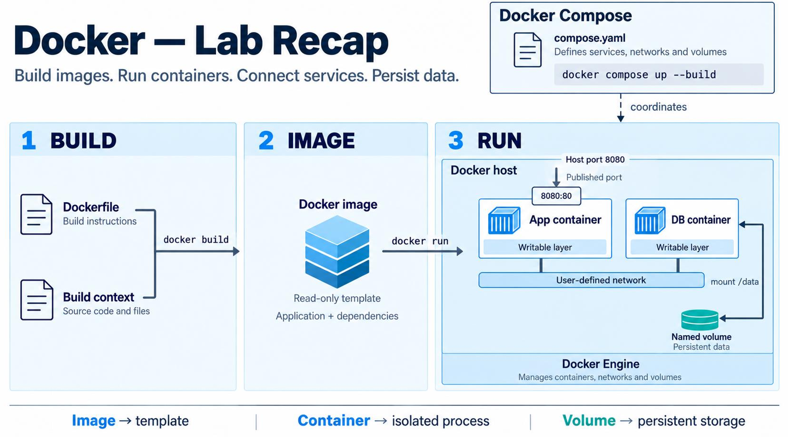

## Perché Compose

Un'applicazione distribuita è fatta di **servizi**: persistenza, frontend e così via. In Docker un servizio è, in sostanza, un "container in produzione", e può essere un insieme di **repliche** bilanciate dello stesso container. Scalare un servizio significa cambiare il numero di repliche, cioè fare **scaling orizzontale**.

Gestire tutto a riga di comando è scomodo: nell'[esercizio di Micro e MariaDB](../04-docker-networking/#esercizio-completo-micro-e-mariadb) servivano tre comandi lunghi, nell'ordine giusto. Come si gestiscono allora scaling, bilanciamento e disponibilità?

**Docker Compose** definisce ed esegue applicazioni **multi-servizio su un singolo nodo**, in modo **dichiarativo** con un file YAML:

```bash
docker compose up -d        # avvia tutto
docker compose down         # ferma e rimuove
```

L'obiettivo è avere ambienti di sviluppo **ripetibili, isolati e veloci**, integrabili anche in una pipeline CI/CD. Il comando è `docker compose` oppure `docker-compose`, a seconda dell'installazione.

## Il File Compose

Il file ha tre sezioni principali: `services`, `networks` e `volumes`.

```yaml
services:
  web:
    build:
      context: .
      dockerfile: Dockerfile
    image: demochatweb:0.1
    ports:
      - "80:9000"
    networks:
      - my-net
  mongo:
    image: mongo
    volumes:
      - type: volume
        source: data
        target: /data/db
    networks:
      - my-net

networks:
  my-net:
    driver: bridge

volumes:
  data:
    driver: local
```

Un servizio si crea da un'immagine (`image`) o da una build (`build`). Se non dichiari reti, Compose crea una **rete di default per il progetto**, e i servizi si raggiungono usando il **nome del servizio** come hostname.

:::note[La chiave version]
Le slide mostrano `version: '3.2'`. Nelle versioni attuali di Compose il campo è **obsoleto** e viene ignorato.
:::

### Chiavi Principali

| Chiave | Significato |
| --- | --- |
| `image` | Immagine da usare |
| `build` | `context`, `dockerfile`, `target` per costruire l'immagine |
| `ports` | Porte pubblicate, `"host:container"` |
| `expose` | Dichiara una porta **senza pubblicarla** sull'host |
| `volumes` | Named volume, bind mount o volume anonimo |
| `networks` | Reti del servizio |
| `environment` | Variabili d'ambiente |
| `env_file` | Legge le variabili da un file |
| `command` | Sostituisce il `CMD` dell'immagine |
| `entrypoint` | Sostituisce l'`ENTRYPOINT` |
| `restart` | Politica di riavvio |
| `depends_on` | Ordine di avvio |
| `healthcheck` | Comando che verifica la salute del servizio |
| `container_name` | Nome fisso, che **impedisce di scalare** il servizio |
| `deploy.resources` | Limiti di risorse |
| `stop_signal` | Segnale di arresto |
| `labels` | Metadati |

### Politiche di Riavvio

| Valore | Comportamento |
| --- | --- |
| `no` | Nessun riavvio (default) |
| `always` | Riavvia sempre. Uno stop manuale vale fino al riavvio del daemon |
| `on-failure` | Riavvia solo se il processo termina con errore |
| `unless-stopped` | Come `always`, ma un container fermato a mano resta fermo anche dopo un riavvio del daemon |

### Comandi

| Comando | Effetto |
| --- | --- |
| `up` | Crea e avvia, `-d` in background |
| `down` | Ferma e rimuove container e reti. **`-v` rimuove anche i volumi** |
| `build` / `pull` / `push` | Gestione delle immagini |
| `ps` / `top` / `logs` | Stato, processi e log. `logs -f` per seguire l'output |
| `exec` / `run` | Comando in un servizio attivo, o in un nuovo container temporaneo |
| `start` / `stop` / `restart` | Gestione dei servizi |
| `config` | Valida e mostra il file |
| `events` / `port` | Eventi e porta pubblica di un binding |

Con `-f` si indica il file se non si chiama `docker-compose.yml` o non sta nella directory corrente.

## depends_on e Healthcheck

:::caution[depends_on non attende che il servizio sia pronto]
Nella forma breve, `depends_on` stabilisce solo l'**ordine di avvio**. Il database può essere partito ma non ancora in grado di accettare connessioni. Per aspettare davvero servono un **`healthcheck`** e la forma lunga con `condition: service_healthy`.
:::

Una possibile soluzione dell'esercizio 3 con Micro e MariaDB:

```yaml
services:
  db:
    image: mariadb:11.4
    restart: unless-stopped
    environment:
      MARIADB_ROOT_PASSWORD: tasd-root
      MARIADB_DATABASE: db_micro
      MARIADB_USER: micro
      MARIADB_PASSWORD: tasd
    volumes:
      - db_data:/var/lib/mysql
    networks:
      - backend
    healthcheck:
      test: ["CMD", "healthcheck.sh", "--connect", "--innodb_initialized"]
      interval: 10s
      retries: 5

  micro:
    image: miciav/micro:0.3.0
    restart: on-failure
    environment:
      MYSQL_ADDRESS: db
      MYSQL_PORT: 3306
      DB_USERNAME: micro
      DB_PASSWORD: tasd
    ports:
      - "127.0.0.1:8080:8080"
    depends_on:
      db:
        condition: service_healthy
    networks:
      - backend
    deploy:
      resources:
        limits:
          cpus: "0.5"
          memory: 256M

volumes:
  db_data:

networks:
  backend:
    driver: bridge
```

Qui `MYSQL_ADDRESS: db` funziona perché il DNS risolve il nome del servizio. L'esercizio 3.1 estende il file con due file di variabili, `.env` e `.env.dev`, per osservare la **precedenza** tra le fonti.

:::caution[Due meccanismi diversi per le variabili]
Le variabili `${VAR}` nel file Compose vengono sostituite **da Compose** prima di creare i container, leggendole dalla shell o dal file `.env` del progetto. Le variabili in `environment` ed `env_file` invece **finiscono dentro il container**.
:::

## Scaling

Compose tratta i container come servizi, quindi si possono replicare:

```bash
docker compose up -d --scale whoami=2
```

:::caution[Vincolo sulle porte]
Si possono scalare solo i servizi **senza porte pubblicate su una porta fissa dell'host**: due repliche non possono occupare la stessa porta. Anche `container_name` impedisce di scalare.
:::

L'esercizio 4 mostra la soluzione tipica: un **reverse proxy** davanti alle repliche.

```yaml
services:
  nginx-proxy:
    image: jwilder/nginx-proxy
    ports:
      - "80:80"
    volumes:
      - /var/run/docker.sock:/tmp/docker.sock:ro
  whoami:
    image: jwilder/whoami
    environment:
      - VIRTUAL_HOST=whoami.local
```

Solo il proxy pubblica la porta. Con `curl -H "Host: whoami.local" localhost` ripetuto, rispondono repliche diverse. Il proxy scopre i container leggendo il socket Docker, montato in sola lettura.

## Più Reti e Risorse

L'esercizio 5 replica in Compose la topologia del Lab 4, con un IP statico:

```yaml
services:
  container1:
    image: busybox
    command: sleep 3600
    networks:
      - net1
  container2:
    image: busybox
    command: sleep 3600
    networks:
      - net1
      - net2
  container3:
    image: busybox
    command: sleep 3600
    networks:
      net2:
        ipv4_address: 172.25.3.3

networks:
  net1:
  net2:
    ipam:
      config:
        - subnet: 172.25.0.0/16
```

`container2` sta su entrambe le reti e parla con tutti. `container1` e `container3` non si vedono.

## Riepilogo di Docker



La catena completa è **build → immagine → run**: il Dockerfile e il context producono un'immagine, modello di sola lettura. Da questa nascono i container, processi isolati con un layer scrivibile, collegati da reti definite dall'utente e con dati persistenti nei volumi. Compose coordina il tutto.

### L'Esercizio Finale

Il Lab 6 propone un esercizio end-to-end, con consegna su e-learning:

1. Scrivere un servizio con un database (CRUD), in qualsiasi linguaggio.
2. Creare un **Dockerfile** con un'immagine piccola per il servizio.
3. Creare un **docker-compose** con volume per il database, rete virtuale, politica di riavvio adeguata e limiti di risorse.
4. Installarlo sulla VM e verificarne il funzionamento.
5. Scrivere un README con i comandi per compilare e installare.

Il lab propone anche di commentare un file Compose con Prometheus e Grafana, che è esattamente il tipo di [domanda d'esame](../../esami/).

## Autotest

**1.** Che differenza c'è tra Compose e Kubernetes?

<details>
<summary>Soluzione</summary>

Compose definisce applicazioni multi-container su **un singolo nodo**. [Kubernetes](../06-kubernetes/) orchestra container su **un cluster** di macchine.

</details>

**2.** `depends_on: [db]` garantisce che il database sia pronto?

<details>
<summary>Soluzione</summary>

No, garantisce solo l'ordine di avvio. Serve un `healthcheck` con `condition: service_healthy`.

</details>

**3.** Che differenza c'è tra `ports` ed `expose`?

<details>
<summary>Soluzione</summary>

`ports` pubblica la porta sull'host. `expose` la dichiara soltanto, e resta raggiungibile dagli altri servizi sulla stessa rete.

</details>

**4.** Che differenza c'è tra `always` e `unless-stopped`?

<details>
<summary>Soluzione</summary>

Dopo uno stop manuale, con `always` il container riparte al riavvio del daemon. Con `unless-stopped` resta fermo.

</details>

**5.** Dopo `docker compose down` i dati dei named volume ci sono ancora? E dopo `down -v`?

<details>
<summary>Soluzione</summary>

Dopo `down` sì. Con `down -v` i volumi vengono rimossi.

</details>

**6.** Perché un servizio con `ports: ["8080:8080"]` non si può scalare a 2 repliche?

<details>
<summary>Soluzione</summary>

Perché entrambe vorrebbero occupare la porta 8080 dell'host. La soluzione è pubblicare un proxy e lasciare le repliche senza porte.

</details>

**7.** Come fa un servizio a raggiungerne un altro nello stesso progetto?

<details>
<summary>Soluzione</summary>

Usando il **nome del servizio** come hostname, grazie al DNS della rete del progetto.

</details>

## Glossario

- **Servizio** - Componente di un'applicazione, realizzato da una o più repliche di un container.
- **Docker Compose** - Strumento per definire ed eseguire applicazioni multi-servizio su un nodo.
- **depends_on** - Ordine di avvio tra servizi.
- **healthcheck** - Comando che verifica la salute di un container.
- **restart policy** - Regola di riavvio di un container.
- **Reverse proxy** - Componente che riceve le richieste e le inoltra alle repliche.
- **Interpolazione** - Sostituzione di `${VAR}` nel file Compose.
