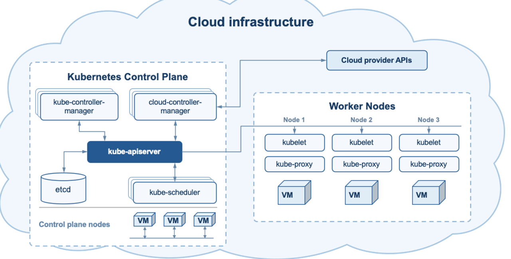
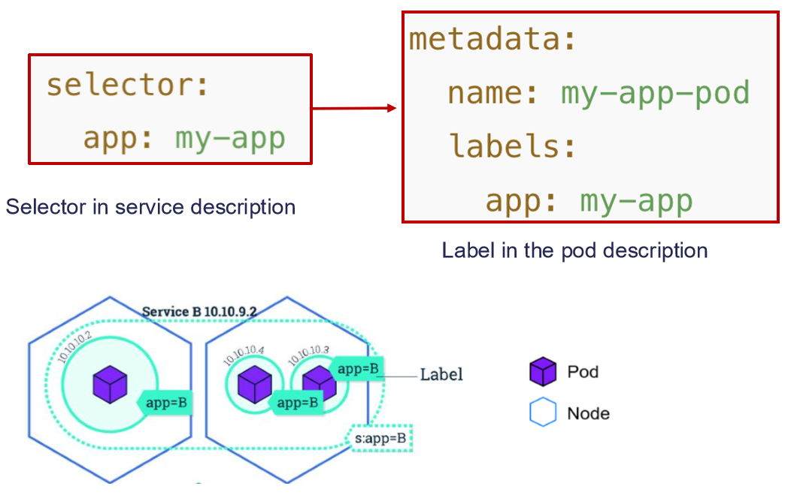
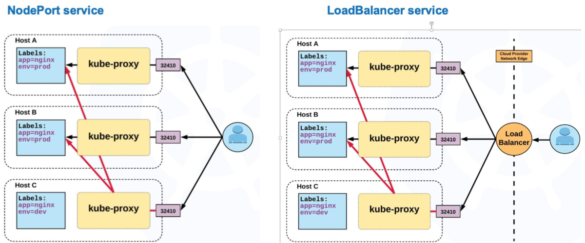

:::note[Numerazione]
Le slide si intitolano *Lab session 8*, il file è `Inf08`, e su e-learning la risorsa si chiama *Lab. Topic 7: Kubernetes 1*: è lo stesso materiale. Trattandosi della prima lezione su Kubernetes, è probabile che ne seguano altre.
:::

## Dove Siamo

Con Docker abbiamo visto immagini e container, poi la composizione su un nodo. Il passo successivo è l'ambiente **multi-host**, che richiede due funzioni:

- **Orchestrazione**: coordinamento automatico di task e servizi su più nodi, perché lavorino insieme armonicamente.
- **Gestione delle risorse**: allocazione e controllo coordinato di CPU, memoria, storage e rete su più nodi.

## Che Cos'è Kubernetes

:::tip[Definizione]
**Kubernetes** (K8s) è un sistema open source per automatizzare **deployment, scaling e gestione** di applicazioni containerizzate su più macchine, dette **nodi**.
:::

L'idea è "Docker per cluster di macchine", una sorta di **sistema operativo per i cluster**, che astrae l'infrastruttura sottostante. Nasce da oltre 15 anni di esperienza di Google ed è gestito dalla Cloud Native Computing Foundation. Raggruppa i container di un'applicazione in unità logiche: il focus non è più il singolo container.

Le funzionalità si reggono su tre fondamenti: **deployment dichiarativo**, **riconciliazione dello stato** da parte del control plane, **API generale ed estensibile**. Su questi si appoggiano scheduling automatico, networking multi-host, service discovery, load balancing, **self-healing**, scaling e deployment A/B e canary.

## Architettura

Kubernetes ha un'architettura **manager-worker**:



- Il **Control Plane** (manager) gestisce lo stato del cluster, schedula i carichi e orchestra. Per l'alta disponibilità si usano più nodi di control plane.
- I **Worker Node** eseguono davvero i carichi, nei container.

### Control Plane

| Componente | Ruolo |
| --- | --- |
| **kube-apiserver** | Espone le API: è il **front-end** del control plane. Scala orizzontalmente |
| **etcd** | Database chiave-valore consistente e ad alta disponibilità, con **tutti i dati del cluster** |
| **kube-scheduler** | Assegna ai nodi i Pod che ne sono privi, considerando risorse, vincoli, affinità e anti-affinità |
| **kube-controller-manager** | Esegue i **controller**, processi che portano lo stato corrente verso quello desiderato: node controller, replication controller, service account |
| **cloud-controller-manager** | Contiene la logica specifica del cloud e collega il cluster alle API del provider |

### Worker Node

| Componente | Ruolo |
| --- | --- |
| **kubelet** | Agente del nodo: osserva i Pod assegnati, li avvia tramite il runtime, fa health check e riporta lo stato |
| **kube-proxy** | Fa arrivare le richieste di rete ai Pod giusti, aggiornando le regole di rete |
| **Container runtime** | Scarica le immagini e gestisce i container. Il kubelet ci parla via **CRI**. Esempi: containerd e CRI-O |

:::note[Il percorso di un Pod]
L'utente invia un manifest all'**apiserver**, che lo salva in **etcd**. Un **controller** vede che servono Pod e li crea. Lo **scheduler** assegna ogni Pod a un nodo. Il **kubelet** di quel nodo lo avvia tramite il runtime.
:::

## I Pilastri di Kubernetes

### Stato Desiderato e Riconciliazione

È il concetto più importante. Non si dice a Kubernetes **cosa fare**, ma **cosa si vuole ottenere**:

- **Stato desiderato**: quali applicazioni eseguire, con quali immagini, quante repliche, quali risorse di rete e disco.
- **Riconciliazione**: il control plane osserva costantemente il cluster e corregge le differenze tra stato corrente e desiderato.

Se chiedi 3 repliche e una muore, Kubernetes ne crea un'altra senza che nessuno intervenga. Lo stato del cluster comprende sia i nodi sia le applicazioni.

Un **oggetto** Kubernetes è un **"record of intent"**: una volta creato, il sistema lavora costantemente per farlo esistere.

| Vantaggio del modello dichiarativo | Significato |
| --- | --- |
| **Focalizzato sullo stato** | Definisci il risultato, non i passi |
| **Idempotente** | Riapplicare lo stesso file non causa modifiche inutili |
| **Versionabile** | I file stanno in un sistema di controllo versione |
| **Automatizzabile** | Si descrive il traguardo, non la procedura |

### Gli Oggetti

| Oggetti base | Astrazioni di livello superiore |
| --- | --- |
| Pod, Volume, Namespace, Node | Service, Deployment, StatefulSet, DaemonSet, ReplicaSet, Job |

Gli oggetti base supportano qualsiasi carico. Quelli superiori servono per carichi comuni, come servizi di lunga durata e job batch.

### Il Pod

:::tip[Definizione]
Il **Pod** è l'**unità di esecuzione di base**, il più piccolo oggetto che si crea o installa. Contiene uno o pochi container strettamente accoppiati che condividono risorse. Di solito contiene **un solo container**.
:::

Un Pod incapsula i container, le risorse di storage, un **IP unico** e le opzioni di esecuzione.

### Manifest

Un **manifest** descrive un oggetto in YAML o JSON:

```yaml
apiVersion: v1
kind: Pod
metadata:
  name: nginx
  namespace: default
  labels:
    app.kubernetes.io/name: nginx
spec:
  containers:
    - name: nginx
      image: nginx:stable
      ports:
        - name: http
          containerPort: 80
          protocol: TCP
```

| Campo | Significato |
| --- | --- |
| `apiVersion` | Versione dell'API |
| `kind` | Tipo di oggetto: Pod, Deployment, Service, Job |
| `metadata` | Nome, namespace, **labels** (tag chiave-valore selezionabili) |
| `spec` | Lo stato desiderato |
| `status` | Compilato e gestito da Kubernetes |

### create e apply

`kubectl` supporta tre modi di gestire gli oggetti:

| Modo | Esempio |
| --- | --- |
| **Comandi imperativi** | `kubectl run my-pod --image=...` |
| **Configurazione imperativa** | `kubectl create -f file.yml` |
| **Configurazione dichiarativa** | `kubectl apply -f file.yml` |

:::caution[Slide 15]
La slide annuncia tre modi e ne elenca due. Il terzo, la configurazione imperativa, è quello di `kubectl create` indicato nella slide 29.
:::

| | `kubectl create` | `kubectl apply` |
| --- | --- | --- |
| **Se la risorsa esiste** | Fallisce | La aggiorna |
| **Aggiorna risorse** | No | Sì |
| **Dichiarativo** | No | Sì |
| **Conflitti** | Errore | Risolti aggiornando |

`apply` tiene traccia di ciò che è stato applicato, e **applica una patch** invece di sostituire.

## Namespace e Addon

Un **namespace** è un **cluster virtuale** dentro quello fisico: dà un ambito ai nomi, che devono essere unici solo al suo interno, e divide le risorse tra utenti con le quote.

| Namespace | Contenuto |
| --- | --- |
| `default` | Oggetti senza namespace specificato |
| `kube-system` | Oggetti creati da Kubernetes |
| `kube-public` | Leggibile da tutti, per il bootstrap del cluster |
| `kube-node-lease` | Oggetti per la gestione dei nodi |

Gli **addon** implementano funzioni del cluster con risorse Kubernetes in `kube-system`: **DNS** (necessario), **Dashboard** (interfaccia web) e **logging** a livello di cluster.

## ConfigMap

Una **ConfigMap** conserva dati di configurazione **non sensibili** come coppie chiave-valore. **Separa la configurazione dal codice**, e si inietta nei container come variabili d'ambiente, argomenti o file in un volume.

```yaml
apiVersion: v1
kind: ConfigMap
metadata:
  name: nginx-data
data:
  index.html: |-
    <p><strong>K8s rocks!</strong></p>
```

Nel Pod si monta come volume, e il suo contenuto compare come file:

```yaml
spec:
  containers:
    - name: nginx
      image: nginx:stable
      volumeMounts:
        - name: data
          mountPath: "/usr/share/nginx/html"
  volumes:
    - name: data
      configMap:
        name: nginx-data
```

:::note[Perché l'esercizio 3 fallisce]
Riapplicando il manifest su un Pod già esistente si ottiene un errore: i volumi di un Pod non si possono modificare a caldo. Bisogna cancellare il Pod e ricrearlo.
:::

## Service

I Pod sono **effimeri**: cambiano IP quando vengono ricreati. Come fanno i client a sapere a quale indirizzo connettersi?

:::tip[Definizione]
Un **Service** è un'astrazione che definisce un insieme logico di Pod identici e una politica di accesso. Offre un **punto di ingresso stabile**, con service discovery e load balancing.
:::

I Pod sono scelti tramite un **selector**, che corrisponde alle **labels**:



```yaml
apiVersion: v1
kind: Service
metadata:
  name: nginx
spec:
  type: ClusterIP
  selector:
    app.kubernetes.io/name: nginx
  ports:
    - name: http
      port: 8080        # porta del Service
      targetPort: 80    # porta del Pod
      protocol: TCP
```

Il Service **non gestisce i Pod**, li astrae soltanto. Nell'esercizio 4, cancellando il Pod gli **Endpoint** del Service si svuotano, e ricreandolo tornano. Aggiungendo `nginx-2` con la stessa label, gli endpoint diventano due.

| Tipo | Accesso |
| --- | --- |
| **ClusterIP** (default) | Solo **dentro** il cluster |
| **NodePort** | Estende ClusterIP, ed espone una porta su ogni nodo |
| **LoadBalancer** | Estende NodePort, con un load balancer esterno e un IP esterno |
| **ExternalName** | Referenzia endpoint **fuori** dal cluster |



:::caution[Variabili d'ambiente dei Service]
Il kubelet inietta nei Pod variabili come `NGINX_SERVICE_HOST` e `NGINX_SERVICE_PORT`, ma **solo se il Service esiste prima del container**. I container già in esecuzione non le ricevono: vanno ricreati. Sono dati di connessione, non credenziali.
:::

### DNS

| Oggetto | Nome DNS |
| --- | --- |
| **Service** | `<svc>.<namespace>.svc.<cluster-domain>` |
| **Pod** | `<ip-con-trattini>.<namespace>.pod.<cluster-domain>` |
| **Pod dietro un Service** | `<ip-con-trattini>.<svc>.<namespace>.svc.<cluster-domain>` |

Un Service si risolve anche con il nome breve `nginx`, nello stesso namespace, o con `nginx.default`. Ad esempio, un Pod in `default` con IP `172.17.0.3` si chiama `172-17-0-3.default.pod.cluster.local`.

## Il Laboratorio: minikube-cloud-lab

**minikube** realizza un cluster Kubernetes locale. **minikube-cloud-lab** simula un cloud provider con nodi Kubernetes reali eseguiti in Docker: si può creare un cluster, scegliere il tipo di macchina, impostare i limiti di nodi e osservare il **Cluster Autoscaler**.

```bash
git clone https://github.com/miciav/minikube-cloud-lab.git
cd minikube-cloud-lab
source scripts/configure.sh   # da rifare in ogni nuovo terminale
docker compose up -d

cloud clusters create lab --machine-type lab-small --min-nodes 1 --max-nodes 3
cloud clusters get-credentials lab
kubectl get nodes

# a fine lab
cloud clusters delete lab
docker compose down
```

`kubectl` legge le credenziali da **kubeconfig** (`~/.kube/config`), e il **context** attivo sceglie cluster e utente. L'autenticazione stabilisce chi sei, **RBAC** cosa puoi fare.

| Comando | A cosa serve |
| --- | --- |
| `kubectl run my-pod --image=...` | Crea un Pod in modo imperativo |
| `kubectl apply -f file.yml` | Applica un manifest |
| `kubectl get pods` / `services` / `nodes` | Elenca gli oggetti, `-A` su tutti i namespace |
| `kubectl describe pod nginx` | Dettagli ed eventi |
| `kubectl exec -it my-pod -- sh` | Esegue un comando nel Pod, `--` separa le opzioni dal comando |
| `kubectl port-forward pod/nginx 18080:80` | Inoltra una porta locale. **Solo per debug** |
| `kubectl delete pod my-pod` | Elimina |

## Autotest

**1.** Quali sono i componenti del control plane, e cosa fanno?

<details>
<summary>Soluzione</summary>

**kube-apiserver** espone le API. **etcd** memorizza lo stato. **kube-scheduler** assegna i Pod ai nodi. **kube-controller-manager** riconcilia lo stato. **cloud-controller-manager** si interfaccia con il cloud.

</details>

**2.** Quali componenti girano su ogni worker node?

<details>
<summary>Soluzione</summary>

kubelet, kube-proxy e il container runtime.

</details>

**3.** Che cosa significa che Kubernetes è dichiarativo?

<details>
<summary>Soluzione</summary>

Che si descrive lo stato desiderato, non i passi. I controller confrontano continuamente stato corrente e desiderato e correggono le differenze.

</details>

**4.** Che cos'è un Pod, e che rapporto ha con i container?

<details>
<summary>Soluzione</summary>

È l'unità minima di deployment. Contiene uno o pochi container accoppiati che condividono risorse e un IP, e di solito uno solo.

</details>

**5.** Perché servono i Service?

<details>
<summary>Soluzione</summary>

Perché i Pod sono effimeri e cambiano IP. Il Service offre un punto di accesso stabile, con service discovery e bilanciamento.

</details>

**6.** Come sceglie i Pod un Service?

<details>
<summary>Soluzione</summary>

Con un **selector** che corrisponde alle **labels** dei Pod.

</details>

**7.** Che differenza c'è tra `port` e `targetPort`?

<details>
<summary>Soluzione</summary>

`port` è la porta del Service, `targetPort` quella del container nel Pod.

</details>

**8.** Quale tipo di Service sceglieresti per un database interno, e quale per esporre un sito sul cloud?

<details>
<summary>Soluzione</summary>

**ClusterIP** per il database, che resta interno. **LoadBalancer** per il sito.

</details>

**9.** Che differenza c'è tra `kubectl create` e `kubectl apply`?

<details>
<summary>Soluzione</summary>

`create` è imperativo e fallisce se la risorsa esiste. `apply` è dichiarativo e la crea o aggiorna con una patch.

</details>

## Glossario

- **Orchestrazione** - Coordinamento automatico di servizi su più nodi.
- **Control Plane** - Parte del cluster che ne gestisce lo stato.
- **Worker Node** - Macchina che esegue i carichi.
- **kube-apiserver** - Front-end del control plane.
- **etcd** - Database chiave-valore dello stato del cluster.
- **kubelet** - Agente su ogni nodo.
- **kube-proxy** - Gestore delle regole di rete del nodo.
- **Pod** - Unità minima di esecuzione.
- **Manifest** - Descrizione di un oggetto in YAML o JSON.
- **Label / Selector** - Etichette degli oggetti e criterio per sceglierli.
- **Service** - Punto di accesso stabile a un insieme di Pod.
- **ConfigMap** - Configurazione non sensibile separata dal codice.
- **Namespace** - Cluster virtuale dentro il cluster.
- **CRI / CNI** - Interfacce standard per runtime e rete.
- **RBAC** - Controllo degli accessi basato sui ruoli.
- **Riconciliazione** - Correzione continua dello stato corrente verso quello desiderato.
