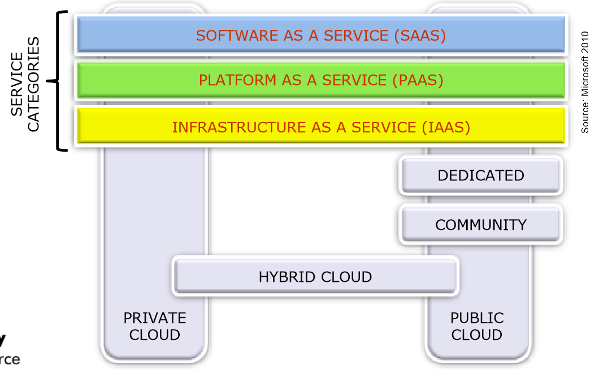
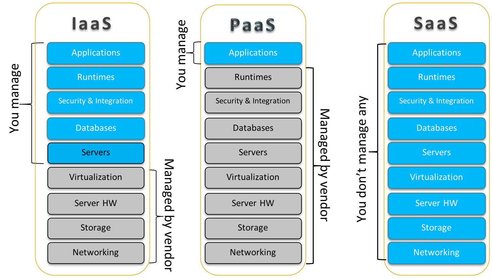

## Che Cos'è il Cloud

La definizione da ricordare, quella che le slide presentano come il minimo indispensabile, è questa:

:::tip[Definizione di base]
Un **cloud** è un tipo di sistema distribuito composto da computer **interconnessi e virtualizzati**, forniti **on demand** e accessibili **attraverso una rete**.
:::

Le parole chiave contano tutte: *distribuito* perché le risorse stanno su molte macchine, *virtualizzato* perché l'utente non vede l'hardware fisico, *on demand* perché le risorse si ottengono nel momento in cui servono, *attraverso la rete* perché non stanno in casa tua.

La definizione di riferimento del settore è quella del **NIST** (*National Institute of Standards and Technology*):

:::tip[Definizione NIST]
Il cloud computing è un modello che permette un accesso di rete **comodo e on demand** a un **pool condiviso** di risorse di calcolo configurabili (reti, server, storage, applicazioni, servizi), che possono essere **fornite e rilasciate rapidamente** con il minimo sforzo di gestione o interazione con il provider.
:::

Il modello NIST è la **bussola del corso**: promuove la disponibilità ed è composto da **5 caratteristiche essenziali**, **3 modelli di servizio** e **4 modelli di deployment**.

Le slide sottolineano che il cloud è insieme un modello **tecnologico, economico e sociale**.

:::note[Perché si chiama "cloud"]
Nei diagrammi di rete la nuvola rappresenta una rete **a scatola nera**: conosci le interfacce di accesso ma non la struttura interna. La metafora regge bene anche oltre: una nuvola è opaca e grande, ne esistono tipi diversi (come i servizi), possono sovrapporsi (lo stesso vendor offre più modelli) e cambiano forma (applicazioni e servizi si adattano dinamicamente).
:::

## Le 5 Caratteristiche Essenziali

| Caratteristica | Significato |
| --- | --- |
| **On-demand self-service** | Il consumatore si procura da solo risorse (server, storage) quando servono, in automatico, senza interazione umana con il provider |
| **Broad network access** | Le risorse sono disponibili in rete tramite meccanismi standard, da client eterogenei (telefoni, laptop) o da altri servizi |
| **Resource pooling** | Le risorse del provider sono raggruppate per servire più consumatori con un modello **multi-tenant**, e vengono assegnate e riassegnate dinamicamente secondo la domanda |
| **Rapid elasticity** | Le risorse si allocano e rilasciano rapidamente e automaticamente. Al consumatore sembrano illimitate, acquistabili in qualsiasi quantità e momento |
| **Measured service** | Il sistema misura l'uso delle risorse, lo controlla e lo ottimizza. L'utilizzo è monitorato e riportato, con trasparenza per provider e consumatore |

:::tip[Per ricordarle]
Pensa a come usi l'elettricità: la attivi da solo (*self-service*), ti arriva ovunque ci sia una presa (*network access*), la centrale serve tutti (*pooling*), ne puoi consumare quanta vuoi (*elasticity*) e il contatore la misura (*measured service*).
:::

## Il Data Center

I **data center** sono edifici che ospitano moltissimi server che supportano contemporaneamente molti servizi e applicazioni. Un data center tipico ha da **50.000 a 80.000 server** (25-30 MW). Spesso si usano processori **ARM** per ridurre i costi energetici, e la **virtualizzazione** è sfruttata massicciamente.

I data center sono costruiti su larga scala per ridurre i costi di manutenzione, **ma non troppo grandi**: anche per limitare il *blast radius*, cioè l'ampiezza dei danni in caso di guasto.

:::caution[Slide 7]
La stessa slide dice "centinaia di migliaia di server" e subito dopo "da 50.000 a 80.000". I due numeri non coincidono: il dato da ricordare è il secondo, che è quello preciso.
:::

Un data center ha bisogno di:

- **Alimentazione** con generatori per superare i blackout.
- **Raffreddamento** continuo.
- **Sicurezza**: antincendio, ventilazione, controllo degli accessi, videosorveglianza, biometria, armadi chiusi.
- **Rete ad alta velocità** interna, tra data center e verso Internet, spesso in fibra ottica su linee dedicate, anche intercontinentali.

### Region e Availability Zone

| Concetto | Definizione |
| --- | --- |
| **Availability Zone (AZ)** | Un data center indipendente, con **propria alimentazione e rete**, protetto dai guasti degli altri data center |
| **Region** | Cluster di AZ geograficamente vicine (ad esempio Milano), collegate tra loro con connessioni a **bassa latenza**, per tolleranza ai guasti e stabilità |

I grandi provider hanno region sparse in tutto il mondo. La distinzione è fondamentale: AZ diverse proteggono da un guasto locale, region diverse da un disastro geografico.

### Virtual Infrastructure Manager

Il problema chiave per un provider è gestire **in modo olistico** risorse fisiche e virtuali (server, storage, reti), orchestrandole per consegnarle rapidamente a utenti e applicazioni.

Il software che se ne occupa è il **Virtual Infrastructure Manager (VIM)**. Assomiglia a un sistema operativo tradizionale, un "**cloud operating system**", ma invece di gestire un singolo computer **aggrega le risorse di molti computer**, presentando una vista uniforme a utenti e applicazioni.

## I Modelli di Servizio

Un **modello di servizio** è una caratterizzazione ad alto livello del cloud, che si concentra sui servizi offerti e sul tipo di utenti. L'insieme dei tre modelli è una **tassonomia**, detta **modello SPI** (SaaS, PaaS, IaaS).

La differenza sta in **chi gestisce cosa**:

| | IaaS | PaaS | SaaS |
| --- | --- | --- | --- |
| **Cosa ottieni** | Infrastruttura virtuale | Piattaforma per sviluppare ed eseguire | Applicazione finita |
| **Cosa gestisci** | Applicazioni, runtime, dati, sistema operativo | Applicazioni e parte della configurazione | Solo impostazioni dell'utente |
| **Cosa non gestisci** | Infrastruttura sottostante | Rete, server, sistema operativo, storage | Tutto il resto |
| **Tecnica abilitante** | Virtualizzazione | Runtime environment | Web service |
| **Flessibilità** | Alta | Media | Bassa |
| **Esempi** | AWS EC2 | Azure App Service, Google App Engine | Webmail, office online |

:::tip[In una riga]
**IaaS** astrae l'infrastruttura, **PaaS** astrae infrastruttura, sistema operativo e middleware per aumentare la produttività dello sviluppatore, **SaaS** è l'applicazione finita che affitti e personalizzi.
:::

### IaaS - Infrastructure as a Service

Il consumatore può fornirsi di **macchine virtuali, storage, reti** e altre risorse fondamentali, e può installare ed eseguire software arbitrario, compresi sistemi operativi e applicazioni. Non gestisce l'infrastruttura sottostante, ma controlla sistema operativo, storage, applicazioni e, in parte, alcuni componenti di rete.

La **tecnica abilitante** è la **virtualizzazione**, in tre forme: server, storage e rete. IaaS fornisce due interfacce.

**Resource Management Interface** (RMI), per ottenere e gestire le risorse virtuali, via GUI o API:

| Risorsa | Operazioni di base |
| --- | --- |
| **Virtual Machine** | Creazione, sospensione, ripresa, terminazione |
| **Virtual Storage** | Allocazione e rilascio dello spazio, lettura e scrittura |
| **Virtual Network** | Allocazione di indirizzi IP, registrazione di domini, connessione, banda |

**System Monitoring Interface**, per monitorare le metriche:

| Risorsa | Metriche |
| --- | --- |
| **Virtual Machine** | Carico CPU, uso memoria, carico I/O, carico rete interna |
| **Virtual Storage** | Utilizzo dello spazio, duplicazione dei dati, banda di accesso |
| **Virtual Network** | Banda, connettività, bilanciamento del carico |

La virtualizzazione supporta tre coppie di proprietà:

- **Manageability e Interoperability**: controllo del sistema, billing, API.
- **Availability e Reliability**: più copie delle VM, ridondanza dello storage.
- **Scalability e Elasticity**: risorse fornite on demand.

### PaaS - Platform as a Service

Il consumatore può sviluppare e installare sul cloud applicazioni create con linguaggi e strumenti **supportati dal provider**. Non controlla rete, server, sistema operativo o storage, ma controlla le applicazioni e, in parte, la configurazione dell'ambiente di hosting.

La **tecnica abilitante** è il **Runtime Environment**, una collezione di servizi software implementata di solito da **librerie** e da un **motore di esecuzione**. Le sue proprietà comuni sono manageability, interoperability, performance, ottimizzazione, availability, reliability, scalability ed elasticity.

PaaS fornisce:

- **Programming IDE**: integra le funzionalità del runtime e strumenti come profiler, debugger e testing. Le API variano tra provider, ma esistono funzioni comuni su calcolo, storage e comunicazione.
- **System Control Interface**, con due approcci:
    - **Policy-based**: regole del tipo *if condition then action* che guidano le decisioni.
    - **Workflow-based**: descrive il flusso di installazione e configurazione delle risorse.

### SaaS - Software as a Service

Il consumatore usa le **applicazioni del provider**, accessibili da vari dispositivi tramite un thin client come il browser (ad esempio la webmail). Non controlla nulla, tranne eventuali impostazioni dell'utente.

La **tecnica abilitante** sono i **Web Service**. La logica è quella del Web 2.0: Internet come piattaforma di calcolo, applicazioni interattive eseguite nel browser, interconnessione e mobilità dei dispositivi. Internet fornisce le proprietà di **accessibility e portability**.

SaaS fornisce:

- **Applicazioni web**, per quattro ambiti: generali (office, messaggistica), business (ERP, CRM), scientifiche (simulazioni), governative (sanità, trasporti).
- **Web Portal**: oltre alla ricerca offrono altri servizi (mail, notizie) e permettono alle aziende di dare un'interfaccia coerente, con controllo di accesso, a più applicazioni e basi di dati.

:::caution[Il cloud reale è sfumato]
Il modello SPI è la classificazione più comune, ma nella realtà i confini sono sfumati: un provider offre servizi a livelli diversi e non è sempre facile classificarli. Le slide collocano ad esempio EC2, Azure, App Engine e Force.com lungo un continuum, da basso livello con poca gestione ad alto livello con molta gestione.
:::

## I Modelli di Deployment

Un **modello di deployment** dipende da **dove risiede l'infrastruttura** e **chi la controlla**. È una delle decisioni più importanti, e i modelli differiscono per accesso, dimensioni e proprietà.

| Modello | Chi lo usa | Caratteristiche |
| --- | --- | --- |
| **Public** | Pubblico generale, proprietà di chi vende il servizio | Infrastruttura omogenea, policy comuni, risorse condivise e multi-tenancy, infrastruttura in affitto, economie di scala |
| **Private** | Una sola organizzazione, gestita da essa o da terzi, on o off premise | Infrastruttura eterogenea, policy su misura, risorse dedicate, controllo end-to-end |
| **Community** | Più organizzazioni con esigenze comuni (missione, sicurezza, compliance) | Accesso ristretto ai membri. Esempio: università che collaborano a una ricerca |
| **Hybrid** | Composizione di due o più cloud che restano entità distinte | Tecnologia che permette portabilità di dati e applicazioni, ad esempio il **cloud bursting** |

:::note[Cloud bursting]
Tipico caso ibrido: un'azienda lavora normalmente sul cloud privato e, nei picchi di carico, trabocca sul pubblico. Così dimensiona il privato per il carico medio e non per il massimo.
:::

:::caution[Non confondere i due assi]
*Modello di servizio* (IaaS, PaaS, SaaS) e *modello di deployment* (public, private, community, hybrid) sono indipendenti. Una PaaS può essere pubblica o privata. Nelle domande a risposta multipla è una trappola classica.
:::

## Autotest

**1.** Quali sono i tre elementi che compongono il modello NIST? Elenca i loro componenti.

Soluzione

**5 caratteristiche**: on-demand self-service, broad network access, resource pooling, rapid elasticity, measured service. **3 modelli di servizio**: IaaS, PaaS, SaaS. **4 modelli di deployment**: public, private, community, hybrid.

**2.** Un'azienda installa il proprio database su una VM che ha affittato. Chi gestisce il sistema operativo? Che modello è?

Soluzione

L'azienda, perché è **IaaS**: il provider gestisce virtualizzazione, server, storage e rete, il consumatore tutto ciò che sta sopra.

**3.** Che differenza c'è tra Availability Zone e Region?

Soluzione

Una AZ è un singolo data center indipendente, con propria alimentazione e rete. Una region è un insieme di AZ geograficamente vicine, connesse a bassa latenza.

**4.** Quale tecnica abilita ciascun modello di servizio?

Soluzione

IaaS: virtualizzazione. PaaS: runtime environment. SaaS: web service.

**5.** Perché i data center non vengono costruiti grandi a piacere?

Soluzione

Oltre una certa dimensione conviene distribuire il rischio: un guasto colpirebbe troppi servizi. Si vuole limitare il *blast radius*.

**6.** Che cos'è il cloud bursting e a quale modello di deployment appartiene?

Soluzione

È il trabocco del carico da un cloud a un altro durante i picchi, tipicamente da privato a pubblico. Appartiene al modello **hybrid**.

**7.** A cosa serve un Virtual Infrastructure Manager?

Soluzione

Orchestra risorse fisiche e virtuali di molti computer, presentando una vista uniforme. È una sorta di sistema operativo del cloud.

## Glossario

- **NIST** - Ente statunitense la cui definizione di cloud è il riferimento del corso.
- **Multi-tenant** - Modello in cui le stesse risorse servono più clienti, isolati tra loro.
- **Availability Zone (AZ)** - Data center indipendente all'interno di una region.
- **Region** - Insieme di AZ geograficamente vicine.
- **Blast radius** - Estensione dei danni causati da un singolo guasto.
- **Virtual Infrastructure Manager (VIM)** - Software che orchestra le risorse del cloud.
- **SPI** - Classificazione dei servizi cloud in SaaS, PaaS, IaaS.
- **Cloud bursting** - Trabocco del carico verso un altro cloud durante i picchi.
