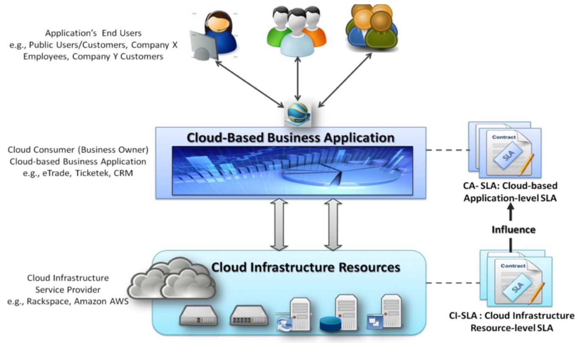
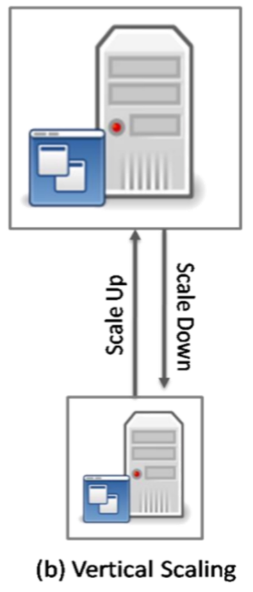
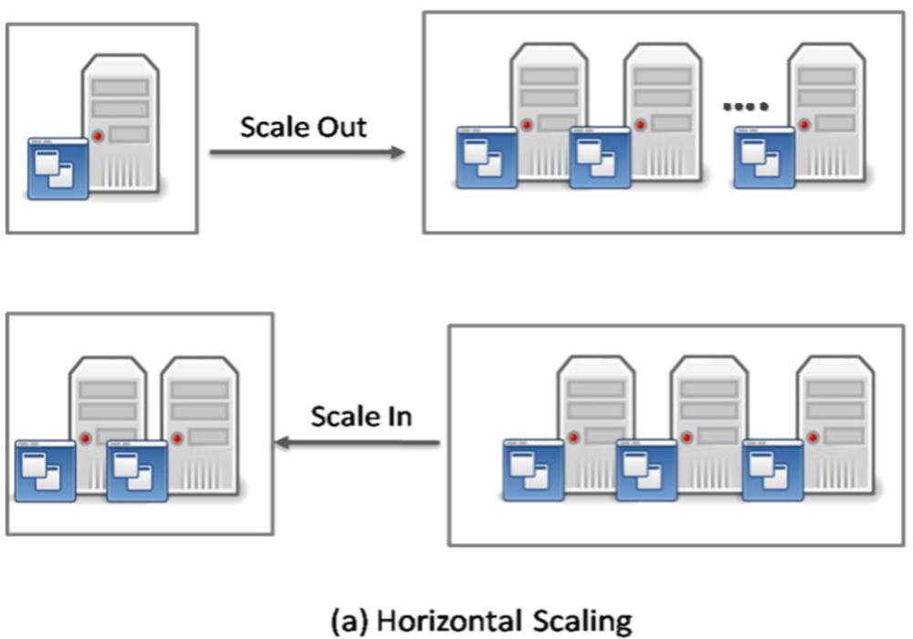
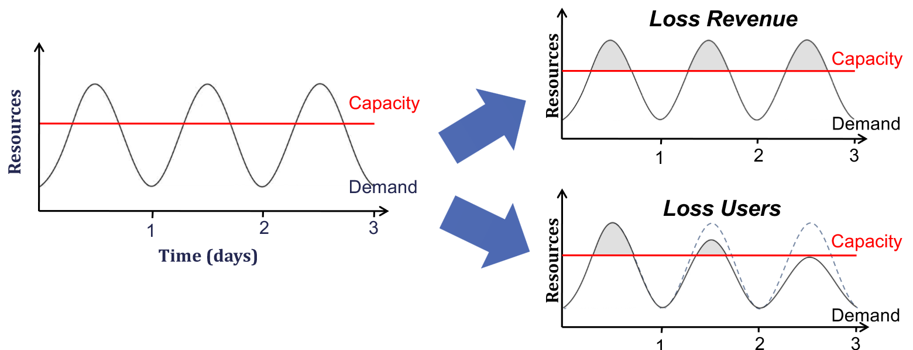
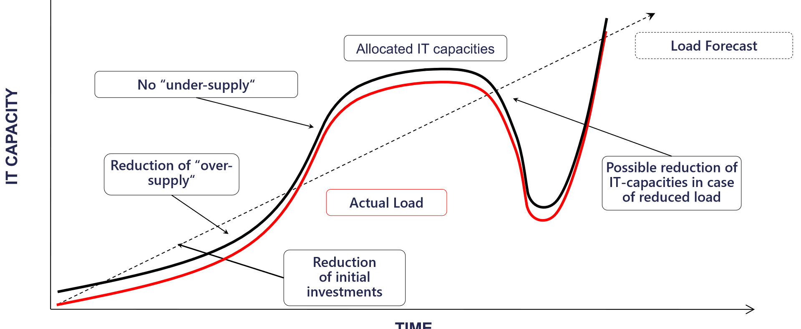

## Le Idee Centrali

Il cloud computing è un **paradigma**, un modo di pensare l'industria IT, non una tecnologia specifica. Le slide lo scompongono così:

| Idee centrali | Tecniche abilitanti |
| --- | --- |
| Utility Computing | Virtualizzazione |
| SOA - Service Oriented Architecture | Calcolo parallelo e distribuito |
| SLA - Service Level Agreement | Service-oriented computing |
| | Autonomic computing |

## Utility Computing

:::tip[Definizione]
L'**Utility Computing** è un modello in cui le risorse di calcolo sono fornite come **servizi misurati**, come le utenze di luce, acqua e gas. L'utente non possiede né gestisce l'hardware: accede alle risorse on demand e **paga solo ciò che consuma**.
:::

Il punto di vista dell'utente si riassume in tre contrapposizioni:

| All'utente non interessa | Gli interessa |
| --- | --- |
| *Come* viene fatto il lavoro | *Cosa* ottiene |
| Cosa fa il provider | La qualità del servizio |
| Possedere l'infrastruttura | Pagare a consumo |

È un modello di **fornitura di servizi**: il provider rende disponibili risorse e gestione quando servono e fattura l'uso specifico, non una tariffa fissa. L'obiettivo è massimizzare l'uso efficiente delle risorse lato provider e minimizzare i costi. La virtualizzazione aiuta molto, perché permette di condividere le macchine fisiche tra più clienti e di spostare o ridimensionare i carichi.

## SOA, QoS e SLA

Una **Service Oriented Architecture** è una collezione di servizi che comunicano tra loro: una suite di servizi **debolmente accoppiati** utilizzabile in più domini di business, di solito realizzata con il modello dei Web Service.

La **Quality of Service (QoS)**, nel contesto cloud, indica i livelli di **prestazioni, affidabilità e disponibilità** offerti dalla piattaforma che ospita un'applicazione. Riguarda *come* viene erogata una funzionalità, non quale funzionalità.

:::tip[Definizione di SLA]
Un **Service Level Agreement** è un **contratto** tra provider e cliente che specifica, in termini misurabili (la QoS), il livello di servizio garantito. Definisce le caratteristiche **non funzionali** e include più **SLO** (*Service Level Objective*), obiettivi di qualità espressi con metriche precise.
:::

Un SLA contiene di solito: metriche di prestazione garantite, rapporto tra up-time e down-time, tempi di risposta, **penali** per il mancato rispetto e capacità di sicurezza documentate.

Esistono due livelli di SLA, e quello inferiore **influenza** quello superiore:

- **CI-SLA** (*Cloud Infrastructure*): tra il provider dell'infrastruttura e chi ci costruisce sopra un'applicazione.
- **CA-SLA** (*Cloud-based Application*): tra chi offre l'applicazione e i suoi utenti finali.

Chi costruisce un'applicazione sul cloud non può promettere ai suoi clienti più di quanto l'infrastruttura gli garantisca.

## Le Proprietà e i Loro Meccanismi

Le slide organizzano le proprietà in coppie: da una parte ciò che si vuole, dall'altra il meccanismo che lo realizza.

| Proprietà | Meccanismo | Relazione |
| --- | --- | --- |
| **Scalability** | **Elasticity** | Capacità, ottenuta con un meccanismo dinamico sulle risorse |
| **Availability** | **Reliability** | Proprietà del servizio, ottenuta con meccanismi di fault tolerance |
| **Manageability** | **Interoperability** | Capacità di gestire, grazie alla capacità di integrare sistemi eterogenei |
| **Accessibility** | **Portability** | Capacità di accedere, e di spostarsi tra ambienti |
| **Performance** | **Optimization** | Risultato desiderato, e meccanismo per migliorarlo |

## Scalabilità ed Elasticità

La **scalabilità** è la capacità di un sistema di gestire carichi crescenti in modo graduale, o di essere facilmente potenziato. L'**elasticità** è la capacità di attuare azioni adattive **autonome** che rendono possibile la scalabilità. Si ottengono con il **dynamic provisioning**.

:::tip[Differenza da ricordare]
**Scalabile** significa che *si può* far crescere. **Elastico** significa che cresce e cala *da solo*, seguendo il carico.
:::

Esistono due modi di scalare:

| | Verticale | Orizzontale |
| --- | --- | --- |
| **Termini** | Scale-up / Scale-down | Scale-out / Scale-in |
| **Azione** | Risorse più potenti, server più grandi | Più risorse, più server |
| **Guasti** | **Single point of failure** | Affidabile: c'è almeno un nodo che subentra (fail-over) |
| **Gestione** | Intervento umano, overhead ragionevole | Automatizzabile, ma complessità crescente |

### Il Problema del Dimensionamento

Il **dynamic provisioning** descrive un ambiente in cui le istanze di calcolo vengono fornite da console o applicazione, eventualmente con regole di automazione (come gli auto scaling group di Amazon).

Nel modello tradizionale, senza cloud, devi fissare la capacità in anticipo, e qualunque scelta è sbagliata per una parte del tempo:

- **Under-provisioning**: la capacità è sotto i picchi. Perdi ricavi (*Loss Revenue*) e, col tempo, utenti insoddisfatti se ne vanno (*Loss Users*), tanto che anche la domanda cala.
- **Over-provisioning**: dimensioni sul picco massimo. La parte inutilizzata è spreco, con bassa utilizzazione media, costi operativi più alti e inefficienza del capitale.

Con il cloud la capacità segue la domanda quasi perfettamente, per variazioni stagionali, per i cicli specifici di un settore e per i picchi straordinari.

I vantaggi sono quattro: niente under-supply, meno over-supply, meno investimenti iniziali, prestazioni migliori. I costi fissi diventano costi variabili.

:::note[Caso di studio: Animoto]
Animoto crea video a partire da foto e musica degli utenti. Nell'aprile 2008 viene pubblicato come app di Facebook e in 3 giorni si iscrivono più di 750.000 persone. L'uso di EC2 passa da **50 a 5.000 VM**, un fattore 100, per poi ridiscendere quando il picco si esaurisce. Sarebbe stato impossibile dimensionare in anticipo un'infrastruttura propria.
:::

## Disponibilità e Affidabilità

La **disponibilità** è la frazione di tempo in cui un sistema funziona, calcolata come 100% meno l'indisponibilità. L'**affidabilità** è la capacità di svolgere le funzioni richieste, in condizioni stabilite, per un periodo definito.

:::note[Complemento: cosa significano i "nove"]
La tabella è calcolata e non è nelle slide. Serve a dare un ordine di grandezza quando si legge un SLA.

| Disponibilità | Fermo massimo all'anno | Fermo massimo al mese (30 giorni) |
| --- | --- | --- |
| 99% | 87,7 ore | 7,2 ore |
| 99,9% | 8,8 ore | 43,2 minuti |
| 99,99% | 52,6 minuti | 4,3 minuti |
| 99,999% ("five nines") | 5,3 minuti | 26 secondi |

:::

A livello applicativo si ottengono con tre mezzi: **tolleranza ai guasti**, **resilienza** e **sicurezza**.

### Fault Tolerance

La **tolleranza ai guasti** permette a un sistema di continuare a funzionare quando alcuni componenti si guastano. Se la qualità cala, deve calare **in proporzione alla gravità del guasto**, mentre in un sistema ingenuo un piccolo guasto può causare un crollo totale. Le quattro azioni di base sono:

1. **Nessun single point of failure**: nessun componente il cui guasto fermi tutto. Li si identifica in anticipo, e la **replicazione** aiuta.
2. **Rilevazione del guasto** nel componente difettoso (*Fault Detection and Isolation*): monitorare, capire quando è avvenuto un guasto, di che tipo e dove.
3. **Contenimento del guasto**, per impedirne la propagazione: si isola e termina il componente, di solito automaticamente nel cloud.
4. **Disponibilità di modalità di ripristino** (*reversion modes*).

Queste azioni sono implementate a livello cloud, ma il cloud aiuta il progettista a realizzarle anche a livello applicativo.

### Resilience e Disaster Recovery

La **resilienza** è la capacità di mantenere un livello di servizio accettabile di fronte a guasti e condizioni anomale, tornando allo stato originale il prima possibile.

Il **Disaster Recovery** è l'insieme di policy e procedure per prepararsi a un disastro e ripartire dopo. Le strategie comuni sono:

- **Backup**: copia periodica fuori sede, replicazione dei dati o dell'intero sistema.
- **Preparazione**: sistemi mirror locali, protezioni da sovratensione, gruppi di continuità (UPS).

### Sicurezza

La **sicurezza del cloud** è un sottoinsieme di sicurezza informatica, di rete e dell'informazione: policy, tecnologie e controlli per proteggere dati, applicazioni e infrastruttura. I temi principali sono:

| Tema | Requisito |
| --- | --- |
| **Protezione dei dati** | I dati di un cliente devono essere segregati da quelli degli altri |
| **Gestione delle identità** | Ogni azienda deve controllare l'accesso a informazioni e risorse |
| **Sicurezza applicativa** | Il provider deve garantire che le applicazioni offerte siano sicure |
| **Privacy** | I dati critici vengono mascherati e solo gli autorizzati li vedono interamente |

## Gestione e Interoperabilità

La **manageability** è la capacità di un sistema di essere controllato, da solo o con tecniche che facilitano il controllo esterno. L'**interoperabilità** è la capacità di funzionare con altri prodotti, presenti o futuri, senza restrizioni, grazie a interfacce aperte, interfacce web e virtualizzazione. Si realizzano con il monitoraggio dello stato e l'automazione del controllo.

- **System Monitor**: processo che raccoglie e memorizza dati di stato. Si monitorano hardware fisico e virtuale, metriche di prestazione, schemi di accesso alla rete, log.
- **Billing System**: il provider fissa i prezzi, registra l'uso di ogni utente grazie al monitoraggio, calcola e addebita automaticamente.
- **Load Balancing**: una forma di ottimizzazione che distribuisce il carico su più risorse per ottimizzarne l'uso, massimizzare il throughput, minimizzare il tempo di risposta ed evitare sovraccarichi. Migliora utilizzo, prestazioni ed efficienza energetica.

## L'Economia del Cloud

Tre aspetti entrano in una valutazione economica:

- **Pay-as-you-go**: nessun costo iniziale, si paga ciò che si consuma. Si passa da **CAPEX** (spese in conto capitale) a **OPEX** (spese operative).
- **Elasticità come trasferimento del rischio**: sparisce il rischio di sbagliare il dimensionamento, perché l'infrastruttura è a carico del provider.
- **Economie di scala**: i grandi data center hanno costi unitari più bassi per calcolo, storage, rete, energia, raffreddamento e spazio. I provider li trasferiscono sui clienti e offrono competenze che una piccola organizzazione non può permettersi.

## Autotest

**1.** Che differenza c'è tra SLA e SLO?

Soluzione

Lo **SLA** è il contratto tra provider e cliente. Gli **SLO** sono gli obiettivi misurabili al suo interno, ad esempio "tempo di risposta sotto i 200 ms nel 99% dei casi".

**2.** Confronta scaling verticale e orizzontale rispetto a guasti e automazione.

Soluzione

Il **verticale** ha un single point of failure e richiede intervento umano. L'**orizzontale** tollera i guasti grazie ai nodi che subentrano ed è automatizzabile, al prezzo di una gestione più complessa.

**3.** Perché l'under-provisioning fa perdere anche utenti e non solo ricavi?

Soluzione

Durante i picchi le richieste in eccesso non vengono servite (*loss revenue*). Gli utenti con un cattivo servizio abbandonano, quindi anche la domanda futura si riduce (*loss users*).

**4.** Scalabilità ed elasticità sono la stessa cosa?

Soluzione

No. La scalabilità è la proprietà: il sistema può crescere. L'elasticità è il meccanismo: azioni autonome che adeguano le risorse al carico, in entrambe le direzioni.

**5.** Quali sono le quattro azioni di base della fault tolerance?

Soluzione

Eliminare i single point of failure, rilevare il guasto, contenerlo impedendone la propagazione, avere modalità di ripristino.

**6.** Un SLA promette il 99,99% di disponibilità mensile. Quanto fermo è ammesso?

Soluzione

Lo 0,01% di 43.200 minuti, cioè circa 4,3 minuti al mese.

**7.** Che cosa significa passare da CAPEX a OPEX?

Soluzione

Invece di un grosso investimento iniziale in hardware si sostiene una spesa operativa proporzionale all'uso.

## Glossario

- **Utility Computing** - Risorse fornite come servizi misurati, come le utenze domestiche.
- **SOA** - Architettura fatta di servizi debolmente accoppiati.
- **QoS** - Livelli di prestazione, affidabilità e disponibilità di un servizio.
- **SLA / SLO** - Contratto sul livello di servizio e obiettivi misurabili in esso contenuti.
- **Scalability** - Capacità di gestire carichi crescenti.
- **Elasticity** - Adeguamento automatico delle risorse al carico.
- **Dynamic provisioning** - Fornitura delle risorse in base alla domanda reale.
- **Single Point of Failure (SPOF)** - Componente il cui guasto ferma l'intero sistema.
- **Fault tolerance** - Capacità di funzionare nonostante il guasto di alcuni componenti.
- **Resilience** - Capacità di mantenere un servizio accettabile e di tornare allo stato originale.
- **Disaster Recovery** - Policy e procedure per ripartire dopo un disastro.
- **CAPEX / OPEX** - Spese in conto capitale e spese operative.
