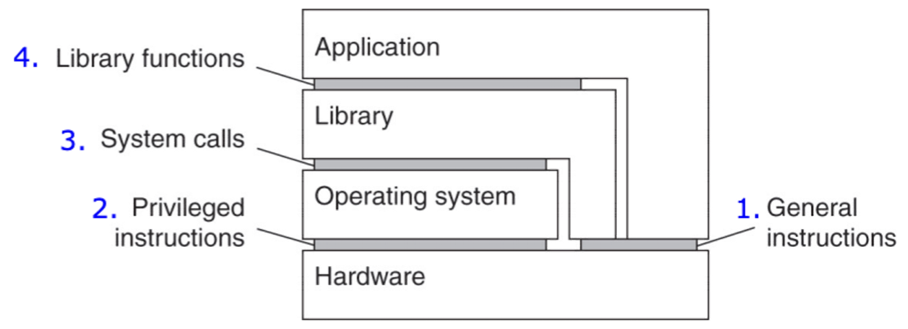
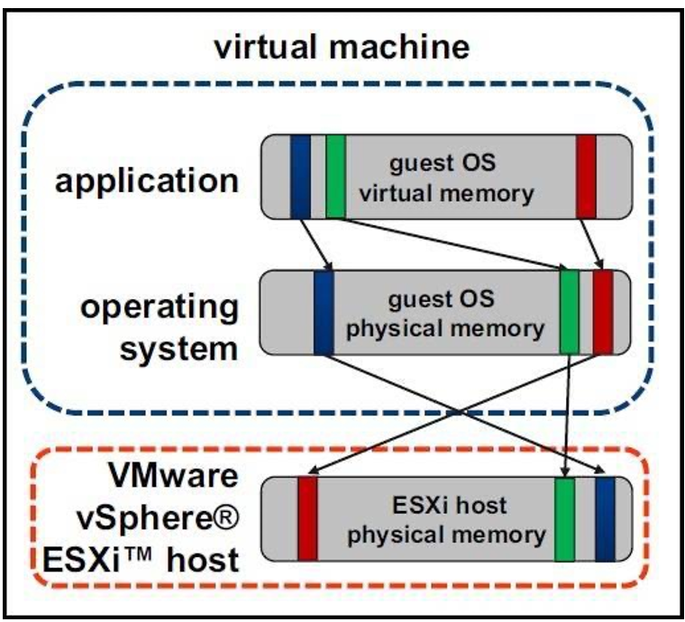
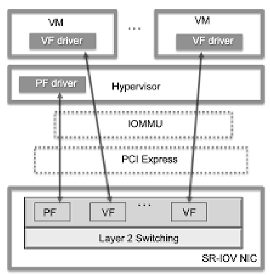
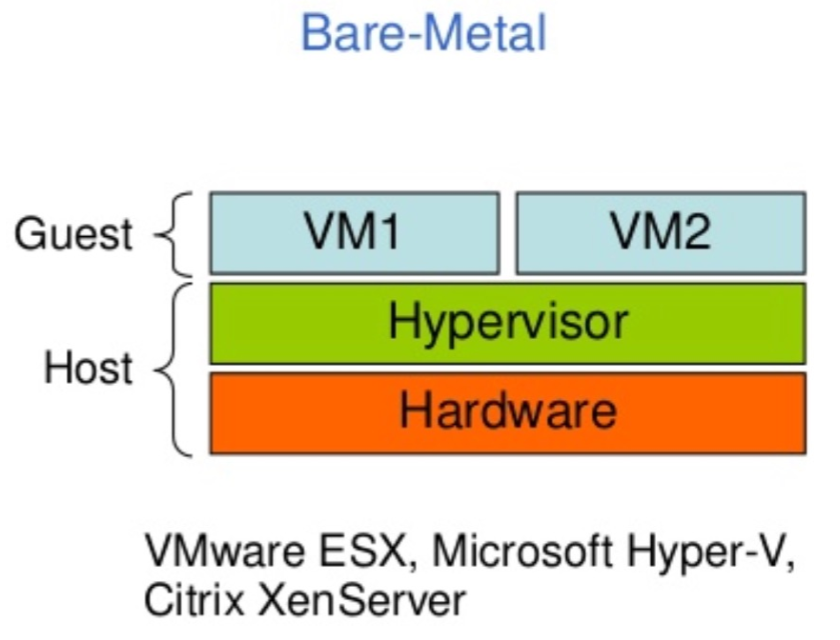
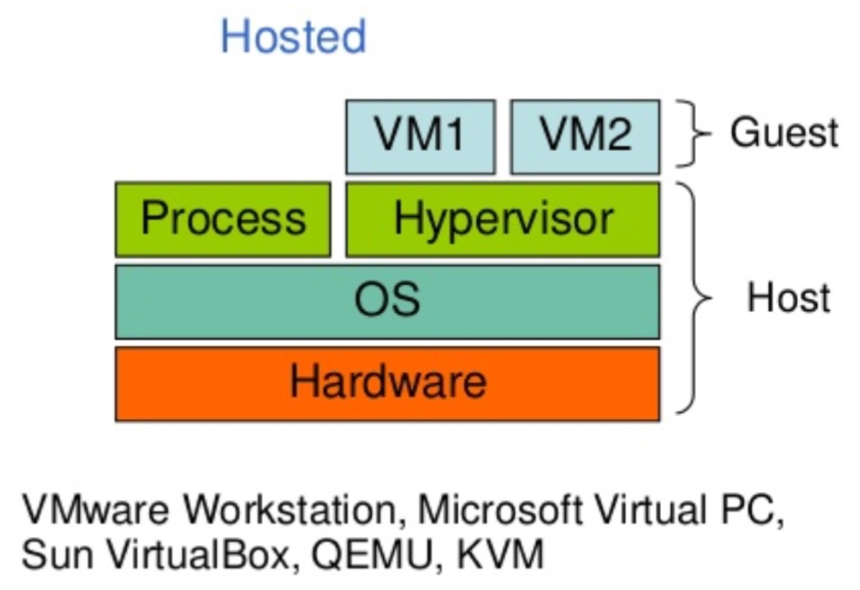
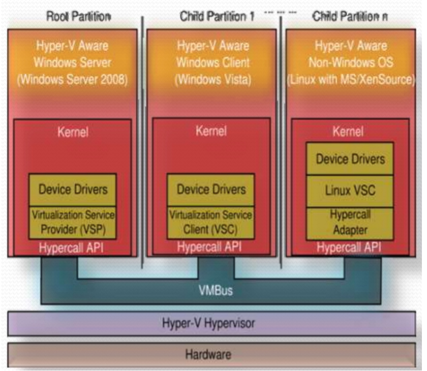
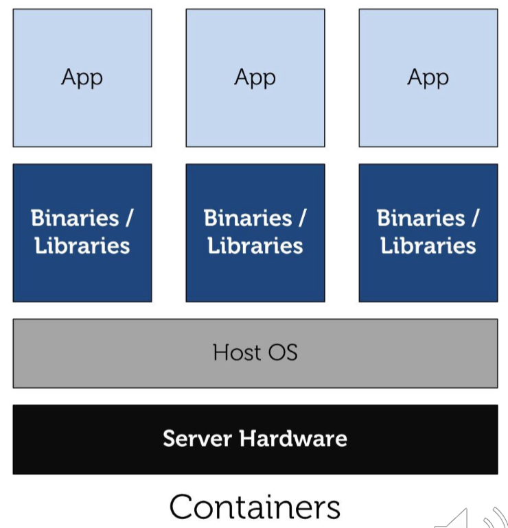

## Il Punto di Partenza: l'Architettura del Calcolatore

Dagli anni '40 i calcolatori hanno cinque componenti classici: **dispositivi di input**, di **output**, di **memorizzazione** (volatile come la RAM, permanente come dischi e flash), **datapath** e **unità di controllo**, che insieme formano il processore. Oggi si aggiunge la **rete**.

La **CPU** carica i programmi dallo storage alla RAM ed esegue in sequenza le istruzioni, che appartengono a un **Instruction Set**. Il **sistema operativo** è un programma speciale che controlla l'hardware e gestisce il ciclo di vita dei processi. Grazie al time-sharing della CPU, più processi girano in modo concorrente.

La parte fondamentale per capire la virtualizzazione è che esistono **quattro interfacce**:

| # | Interfaccia | Chi la usa |
| --- | --- | --- |
| 1 | **Istruzioni non privilegiate** (generali) | Qualsiasi programma |
| 2 | **Istruzioni privilegiate** | Il sistema operativo |
| 3 | **System call** | Le applicazioni, per parlare con il sistema operativo |
| 4 | **API** | Il programmatore, come endpoint di alto livello che possono sfruttare le system call |

## Emulazione e Virtualizzazione

L'**emulazione** è una tecnica in cui un sistema (*host*) imita hardware e instruction set di un sistema **diverso** (*guest*): traduce le istruzioni del guest in istruzioni eseguibili dall'host, ricreando in software il comportamento originale.

La **virtualizzazione** crea istanze logiche e astratte di risorse fisiche. Un **hypervisor** partiziona l'hardware e crea più **macchine virtuali (VM)** isolate: ogni VM esegue il proprio sistema operativo credendo di avere hardware dedicato, ma le risorse sono condivise.

| Aspetto | Virtualizzazione | Emulazione |
| --- | --- | --- |
| **Architettura** | Stessa ISA (x86 su x86) | ISA diversa (ARM su x86) |
| **Prestazioni** | Quasi native | Molto più lente |
| **Traduzione** | Minima o assente | Totale |
| **Uso** | Consolidamento server, cloud | Conservare sistemi legacy, test multipiattaforma |
| **Esempi** | VMware ESXi, KVM, Hyper-V | QEMU in emulazione completa, DOSBox, emulatori di console |

:::note[Breve storia]
La virtualizzazione nasce nel **1966** con IBM CP-40 sui mainframe. Nel **1985** AT&T 6300+ (Olivetti) con Simultask esegue DOS e Unix insieme. Negli anni '90-2000 riemerge sui PC con VMware e VirtualBox, fino a diventare il fondamento del cloud.
:::

### VM di Sistema e VM di Processo

Una **Process Virtual Machine** (o *managed runtime*) virtualizza solo ciò che serve a una singola applicazione, con astrazione a livello applicativo, indipendenza dalla piattaforma, gestione della memoria e bytecode. La JVM è l'esempio classico.

:::caution[Ambito del corso]
Nel corso si considerano **solo le System Virtual Machine**, che virtualizzano un intero sistema hardware.
:::

## L'Hypervisor

:::tip[Definizione]
L'**Hypervisor** o **Virtual Machine Monitor (VMM)** è il software che crea e gestisce le VM astraendo e partizionando l'hardware fisico. Sfrutta le funzioni di virtualizzazione delle CPU moderne (Intel VT-x, AMD-V) e condivide le risorse in modo che ogni VM le veda come dedicate.
:::

Le risorse da condividere sono quattro: **CPU, memoria, storage e rete**.

## Virtualizzazione della CPU

Le CPU moderne definiscono livelli di protezione, gli **anelli** (*rings*), da **Ring 0** (massimo privilegio) a **Ring 3** (minimo). Il kernel di un sistema operativo si aspetta di stare in Ring 0 per eseguire istruzioni privilegiate direttamente sull'hardware.

Ecco il problema: se il guest OS girasse davvero in Ring 0, controllerebbe l'hardware reale e potrebbe interferire con le altre VM. L'hypervisor deve quindi **intercettare** queste istruzioni. Le soluzioni storiche sono tre:

| Tecnica | Come funziona |
| --- | --- |
| **Trap-and-emulate** | Il guest gira in modalità non privilegiata. Quando tenta un'istruzione privilegiata, la CPU genera una **trap** che passa il controllo all'hypervisor, il quale emula l'istruzione in modo sicuro |
| **Binary translation** | L'hypervisor analizza e riscrive a runtime il codice del guest, sostituendo le istruzioni problematiche. È la soluzione di VMware per x86 prima del supporto hardware |
| **Hardware-assisted** (Intel VT-x, AMD-V) | La CPU ha una nuova modalità: l'hypervisor sta in **root mode**, il guest in **non-root mode** e crede di essere in Ring 0. La trap è automatica |

Il supporto hardware offre anche context switch efficiente tra guest e host, supporto alla memoria e virtualizzazione dell'I/O (Intel VT-d, AMD IOMMU).

## Virtualizzazione della Memoria

Il guest OS gestisce le proprie tabelle delle pagine, credendo di possedere la memoria fisica. In realtà ci sono **due traduzioni**:

| Tecnica | Come funziona | Costo |
| --- | --- | --- |
| **Shadow Page Tables** | L'hypervisor mantiene copie sincronizzate delle tabelle del guest, che traducono direttamente da virtuale-guest a fisico-host | Overhead alto |
| **Hardware-Assisted** (EPT Intel, NPT AMD) | Un secondo livello di traduzione è fatto dall'hardware | Overhead ridotto |

Queste tecnologie hanno reso possibile la virtualizzazione scalabile nei data center.

## Virtualizzazione dell'I/O

| Tecnica | Come funziona | Compromesso |
| --- | --- | --- |
| **Device emulation** | L'hypervisor emula i dispositivi hardware | Molto portabile, ma lenta |
| **Driver paravirtualizzati** (VirtIO) | Il guest comunica direttamente con l'hypervisor su interfacce ottimizzate | Prestazioni migliori |
| **SR-IOV** (assegnazione diretta) | Partiziona un dispositivo PCI in funzioni virtuali assegnate alle VM | Prestazioni quasi native, ma meno flessibilità e limiti alla migrazione |

## Virtualizzazione della Rete

La **network virtualization** astrae le risorse di rete fisiche in reti logiche definite via software (**SDN**, *Software-Defined Networking*). Più reti virtuali isolate convivono sulla stessa infrastruttura, abilitando il multi-tenancy.

- I **virtual switch** (Linux bridge, Open vSwitch) collegano VM o container dentro ogni host, come se fossero attaccati a uno switch vero.
- Le **overlay network** (VXLAN, tunnel GRE) collegano questi switch tra host diversi, con una topologia logica indipendente dalla rete fisica.

I benefici sono isolamento forte, programmabilità, provisioning elastico e gestione semplificata.

## I Benefici della Virtualizzazione

- **Vista unificata** delle risorse fisiche, anche su macchine diverse.
- **Gestione centralizzata** di hardware e software.
- **Isolamento del carico**, con tre effetti: **sicurezza** (le istruzioni restano confinate nella VM), **affidabilità** (un guasto software non tocca le altre VM) e **controllo delle prestazioni**.
- **Consolidamento**: più VM su un sistema fisico riducono il **TCO** (*Total Cost of Ownership*, stima di tutti i costi diretti e indiretti lungo la vita del sistema).
- **Migrazione facile**: il guest può essere sospeso, spostato e ripreso. Migliora manutenzione, prestazioni e tolleranza ai guasti. Lo stato di una VM comprende disco, file di configurazione e immagine della RAM.
- **Ridondanza** semplice, perché gli elementi virtuali si copiano facilmente.

## Tassonomia degli Hypervisor

| | Bare-Metal | Hosted |
| --- | --- | --- |
| **Dove sta** | Direttamente sull'hardware | Sopra un sistema operativo host |
| **Natura** | Un sistema operativo leggero | Un'applicazione tra le altre |
| **Vantaggi** | Migliori prestazioni di I/O | Facile da installare, host e guest non modificati, gira su molti computer |
| **Svantaggi** | Difficile da installare e configurare, dipende dall'hardware | Degrado delle prestazioni |
| **Esempi** | VMware ESX, Microsoft Hyper-V, Citrix XenServer | VMware Workstation, VirtualBox, QEMU |

:::caution[Slide 24: KVM]
La slide elenca KVM tra gli hosted. La classificazione è discussa: KVM è un modulo del kernel Linux, che trasforma Linux stesso in hypervisor, e molti lo considerano bare-metal. Se capita in una domanda, attieniti a quanto dice la slide, ma sappi che non è una distinzione netta.
:::

## Tecniche di Virtualizzazione

Le slide le dividono in **software** (full virtualization, paravirtualization, OS-level) e **hardware-assisted**, cioè il supporto hardware che full e para possono sfruttare per migliorare le prestazioni.

### Full Virtualization

Fornisce alle VM una riproduzione completa dell'hardware sottostante. **Il guest OS non va modificato** e non sa di essere virtualizzato. L'hypervisor traduce dinamicamente le istruzioni privilegiate con la **binary translation**, mentre quelle non privilegiate sono eseguite direttamente.

:::caution[Slide 26: "emulazione" ha due significati]
La slide parla di *full emulation* dell'hardware. Non confonderla con l'[emulazione](#emulazione-e-virtualizzazione) vista sopra, che riguarda ISA **diverse**: qui l'ISA è la stessa, e le istruzioni non privilegiate girano direttamente.
:::

### Paravirtualizzazione

Il guest OS **viene modificato** per sapere di essere virtualizzato. Invece di emulare l'hardware, usa chiamate speciali verso l'hypervisor, le **hypercall**. Il risultato è un aumento delle prestazioni e una migliore integrazione di mouse, tastiera e schermo. I **driver paravirtualizzati** (VirtIO) sostituiscono la lenta emulazione dei dispositivi.

Lo schema mostra Hyper-V: i sistemi guest "consapevoli" comunicano con l'hypervisor tramite Hypercall API e VMBus.

### OS-Level Virtualization

È la **containerizzazione**: il sistema operativo host fornisce più ambienti di esecuzione isolati, i **container**, invece di emulare macchine intere. **Il kernel è uno solo, condiviso** da tutti i container. Ogni container è un insieme di processi isolati, con la propria vista di filesystem, tabella dei processi, stack di rete e quote di risorse.

| | Full | Para | OS-level |
| --- | --- | --- | --- |
| **Guest modificato** | No | Sì | Non c'è un guest OS |
| **Sa di essere virtualizzato** | No | Sì | Vede un sistema isolato |
| **Kernel** | Uno per VM | Uno per VM | Uno condiviso |
| **Esempi** | VMware | Xen, VirtIO | Docker, LXD |

I container sono l'argomento del [laboratorio](../../laboratorio/01-docker-introduzione/).

## Autotest

**1.** Che differenza c'è tra emulazione e virtualizzazione?

Soluzione

L'emulazione imita un'**ISA diversa** traducendo tutte le istruzioni, ed è lenta. La virtualizzazione lavora sulla **stessa ISA**, con traduzione minima e prestazioni quasi native.

**2.** Perché un sistema operativo guest non può stare davvero in Ring 0?

Soluzione

Perché avrebbe il controllo diretto dell'hardware e potrebbe interferire con l'hypervisor e le altre VM, rompendo l'isolamento.

**3.** Come funziona il trap-and-emulate?

Soluzione

Il guest gira in modalità meno privilegiata. Quando esegue un'istruzione privilegiata, la CPU genera una trap, il controllo passa all'hypervisor, che emula l'istruzione in modo sicuro e fa riprendere la VM.

**4.** Qual è la differenza fra full virtualization e paravirtualization?

Soluzione

Nella **full** il guest non è modificato e non sa di essere virtualizzato: le istruzioni privilegiate vengono tradotte. Nella **para** il guest è modificato e collabora con l'hypervisor tramite hypercall, con prestazioni migliori.

**5.** Qual è la differenza fondamentale fra VM e container?

Soluzione

Ogni VM ha il proprio sistema operativo e kernel sopra un hypervisor. I container condividono il kernel dell'host: sono processi isolati, quindi molto più leggeri ma con un isolamento meno forte.

**6.** Perché le Shadow Page Tables sono costose, e cosa le ha sostituite?

Soluzione

L'hypervisor deve tenere sincronizzate le sue copie con le tabelle del guest. Le hanno sostituite EPT (Intel) e NPT (AMD), con un secondo livello di traduzione in hardware.

**7.** SR-IOV offre prestazioni quasi native. Perché non si usa sempre?

Soluzione

Perché riduce la flessibilità e limita la migrazione delle VM, essendo legato al dispositivo fisico.

## Glossario

- **ISA** - Instruction Set Architecture, l'insieme di istruzioni di un processore.
- **Emulazione** - Riproduzione software di un sistema con ISA diversa.
- **Hypervisor / VMM** - Software che crea e gestisce le macchine virtuali.
- **Ring** - Livello di protezione della CPU, da 0 (massimo privilegio) a 3.
- **Trap-and-emulate** - Intercettazione ed emulazione delle istruzioni privilegiate.
- **Binary translation** - Riscrittura a runtime del codice del guest.
- **EPT / NPT** - Traduzione degli indirizzi a due livelli in hardware.
- **VirtIO** - Standard per dispositivi di I/O paravirtualizzati.
- **SR-IOV** - Partizione di un dispositivo PCI per assegnarlo direttamente alle VM.
- **SDN** - Reti logiche definite via software.
- **VXLAN** - Tecnologia di overlay network.
- **Hypercall** - Chiamata diretta del guest all'hypervisor.
- **TCO** - Costo totale di possesso.
- **Consolidamento** - Accorpamento di più VM su meno macchine fisiche.
