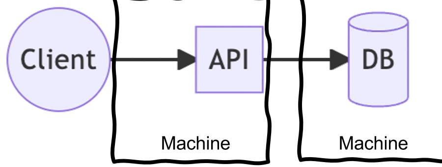
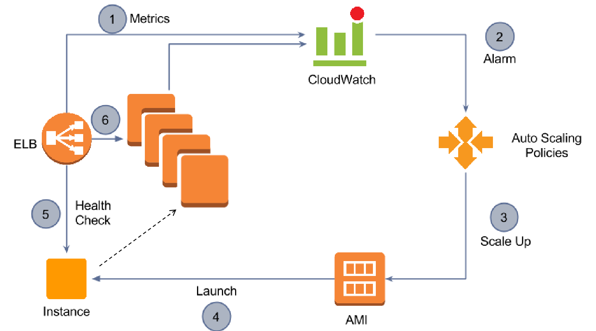
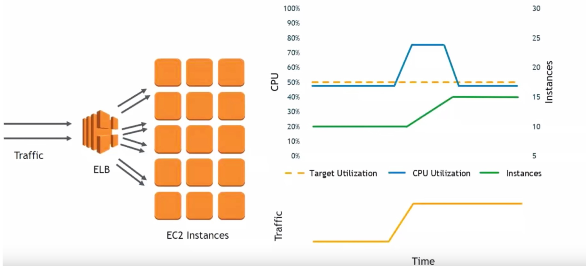

## From Monolith to Layered Architecture

In **traditional monolithic deployments**, the application's database, API and business logic coexist on a **single physical or virtual server**. As the user base grows, the system's ability to maintain a consistent **QoS deteriorates**.

The only available strategy is **vertical scaling**: increasing the resources of a single machine (CPU, RAM, storage). This:

- Introduces a **single point of failure**.
- Quickly becomes **economically inefficient**, due to the **nonlinear growth of hardware costs**: a 16 TB SSD is more than twice as expensive as an 8 TB one.

This limitation paved the way for cloud architectures, where scalability and resilience come from **distributed resources** rather than hardware upgrades.

In modern architectures, applications are organized in **layers** that separate **stateless** components from **stateful** ones:

| | Stateless | Stateful |
| --- | --- | --- |
| **Examples** | Web servers, APIs | Databases, persistent storage |
| **How it scales** | **Horizontally**, by replicating instances across machines | Requires **specialized handling** to preserve data consistency and durability |
| **Typical bottleneck** | **CPU-bound** | **I/O and storage** |

:::tip[Takeaway]
Stateless and stateful workloads should be **designed, deployed and scaled independently**.
:::

## Load Balancing

In horizontally scaled systems, a **load balancer** acts as the **single entry point** for all client requests, distributing traffic among multiple application instances. Its goal is to **optimize resource utilization, minimize response time and ensure high availability**.

| Algorithm | How it chooses |
| --- | --- |
| **Round Robin (RR)** | Sequentially forwards each request to the **next available node** |
| **Least Used (LU)** | Selects the node with the **lowest current load** |

Modern cloud load balancers continuously perform **health checks** and cooperate with other services to dynamically adjust the number of active instances.

:::tip[Takeaway]
Load balancing enables **elasticity and resilience**.
:::

## Auto Scaling Groups

Usually multiple copies of a service run simultaneously. End users see **only one interface**, but behind it many **identical VMs** (EC2 instances) run, each handling a share of the requests. Managing groups of instances can be cumbersome: EC2 provides **Auto Scaling groups**, defined with a **minimum and maximum number** of identical instances, useful to control a fleet that handles a variable load.

:::tip[Definition]
An **Auto Scaling group** is a collection of EC2 instances that **share the same characteristics** (homogeneous VMs) and are treated as **one logical grouping** for scaling and management.
:::

Auto Scaling groups automatically:

- **Scale** the number of instances (**horizontal scaling**), or
- **Maintain a fixed number** of instances (failure recovery, **fleet management**).

A group contains instances from the **same region**, possibly from **one or more Availability Zones**.

### Launch Configuration

Every Auto Scaling group is associated with a **launch configuration**, which **describes an instance** of the group with the parameters needed to create new instances.

- Only **one** launch configuration can be attached to a group at a time.
- A new or updated configuration can be introduced: **future instances** use it, **existing instances are not affected**.
- When scaling down, Auto Scaling **first terminates instances with an older launch configuration**.

:::note[Beyond the slides]
AWS has since replaced launch configurations with **launch templates**, which play the same role with more features. For the exam use the slides' term, but current documentation uses the new one.
:::

## The Auto Scaling Service

**Auto Scaling** is a web service that **launches or terminates EC2 instances automatically** based on:

1. **User-defined policies**, e.g. "launch an additional instance whenever the average CPU usage exceeds 80% for ten minutes".
2. **Schedules**, e.g. "terminate half of the instances over the weekend".
3. **Health checks**.

It guarantees that the number of running instances:

- **Increases seamlessly** during demand spikes.
- **Decreases automatically** during demand lulls.
- **Stays the same** in case of failures.

### The Auto Scaling Ecosystem

| Service | Role |
| --- | --- |
| **CloudWatch (CW)** | Monitoring over EC2: CPU load average, disk I/O rate, network I/O rate |
| **Elastic Load Balancer (ELB)** | Distributes traffic across EC2 instances, in one AZ or across several AZs of a region. Performs **periodic health checks** and **stops sending traffic to unhealthy instances**. Health information is collected by CloudWatch |
| **Auto Scaling** | Uses CloudWatch data to **scale out** (add instances) and **scale in** (shut down instances) over an Auto Scaling group. Usually responds to triggers on CPU/memory utilization and latency, implementing a **policy** |

### The Auto Scaling Loop

1. ELB and the instances send **metrics** to CloudWatch.
2. A metric crosses its threshold and the **alarm** fires.
3. The alarm triggers a **policy** that decides to scale.
4. A new instance is **launched** from the AMI.
5. ELB runs a **health check** on the new instance.
6. If healthy, the instance joins the group and **receives traffic**.

## Health Checks

:::tip[Definition]
A **health check** is a **periodic test** of the operational status of each instance in an Auto Scaling group. It typically invokes a **predefined endpoint** or uses a built-in **monitoring probe** to verify that the instance responds correctly and within acceptable thresholds.
:::

When an instance fails a health check, due to degraded performance or unresponsiveness, Auto Scaling **automatically terminates it and launches a replacement**. The group stays consistent, available and **self-healing**, without manual intervention.

:::tip[Takeaway]
Health checks implement an **autonomous feedback loop** that maintains reliability and fault tolerance.
:::

## Triggers, Alarms and Policies

A **trigger** defines the condition under which an Auto Scaling action is executed. It combines two elements:

- A **CloudWatch Alarm**, which monitors a chosen metric (CPU utilization, latency, network throughput) and detects when it crosses a threshold.
- An **Auto Scaling Policy**, which specifies the **corrective action** (launch or terminate instances) when the alarm changes state.

### CloudWatch Alarm

An object that **watches over a single metric** and changes state depending on its value. When an alarm changes state, one or more actions are triggered. To create one, specify **the metric**, **the threshold values** and **the number of evaluation periods**.

| State | Meaning |
| --- | --- |
| **OK** | The metric is within the defined threshold |
| **ALARM** | The metric is outside the defined threshold |
| **INSUFFICIENT_DATA** | The metric is not available, or there is not enough data to set the state to OK |

An action is invoked when an alarm **changes state and remains in that state for several periods**.

### Auto Scaling Policy

A policy defines the scaling action a group performs when an alarm changes state: **how and by how much** capacity changes, e.g. a fixed number of instances or a percentage.

| Policy type | How it works |
| --- | --- |
| **Simple scaling** | Single rule and fixed adjustment |
| **Step scaling** | Multiple thresholds with proportional actions |
| **Target tracking scaling** | Continuous feedback around a target metric |
| **Scheduled scaling** | Time-based capacity adjustments |

:::tip[Takeaway]
Policies encapsulate the **control rules** that translate monitoring signals into automated resource reconfiguration.
:::

## Auto Scaling Scenarios

**Fleet management** ensures that the instances are performing as designed. ELB and CW monitor the health of each instance, and if one terminates unexpectedly, the termination is detected and a replacement is launched. Three main functions:

- Monitoring the health of running instances.
- Automatically replacing unhealthy instances.
- Balancing traffic across Availability Zones.

**Scheduled scaling**: a time-based plan, for predictable load. Specify the **date and time** of execution, and the **minimum, maximum and desired** capacity.

**Dynamic scaling**: for unpredictable load. Create policies for both **scaling up and scaling down**, plus a **cooldown**. Using **spot instances** can be a good idea. Two possible approaches: **step scaling** and **target tracking**.

### Target Tracking Example: CPU at 50%

In target tracking, the **desired value** of a metric (e.g. average CPU utilization) is specified as a target, and Auto Scaling adjusts the number of instances to keep the metric close to it. With a target of **50%**:

- When average CPU rises **above 50%**, Auto Scaling **launches** instances to reduce load.
- When it drops **below 50%**, Auto Scaling **terminates** instances to reduce cost.

The metric is monitored continuously through CloudWatch. Unlike traditional threshold-based scaling, **no separate up/down alarms are needed**: the feedback loop is **managed internally by AWS**.

In the chart the workload increases, CPU goes above the target, instances go from 10 to 15 and CPU returns to 50%.

## Cooldown

:::tip[Definition]
A **cooldown period** is a configurable interval following a scaling activity during which Auto Scaling **temporarily suspends additional scaling actions**. It lets the system **stabilize** and the metrics **reflect the impact** of the previous adjustment.
:::

Without a cooldown, consecutive scaling events could occur before the system reaches equilibrium, leading to **oscillations (thrashing)** and unnecessary resource churn.

:::tip[Takeaway]
The cooldown ensures **dynamic stability** of reactive elasticity by **preventing premature scaling actions**.
:::

:::note[Why it matters]
A VM takes minutes to boot. If CPU stays high in the meantime, without a cooldown the system would start more VMs, then too many, then terminate them and start over.
:::

## Instance Distribution Across Zones

Auto Scaling attempts to **distribute instances evenly** between the AZs enabled for the group, launching new instances in the **AZ with the fewest instances**. If that fails, it tries the other zones until it succeeds. Some operations can make a group **unbalanced**, and **rebalancing** activities can take place.

## Self-Test

**1.** Why is vertical scaling of a monolith not enough?

Solution

It introduces a single point of failure and becomes economically inefficient, because hardware costs grow nonlinearly.

**2.** Which three services are involved in Auto Scaling, and what does each do?

Solution

**CloudWatch** monitors, **ELB** distributes traffic and runs health checks, **Auto Scaling** adds or removes instances implementing the policies.

**3.** What are the states of a CloudWatch Alarm?

Solution

OK, ALARM and INSUFFICIENT_DATA.

**4.** What happens when an instance fails a health check?

Solution

Auto Scaling terminates it and launches a replacement. Meanwhile ELB stops sending it traffic.

**5.** What is the difference between step scaling and target tracking?

Solution

**Step scaling** uses multiple thresholds with proportional actions. **Target tracking** only needs a target value: the feedback loop is managed by AWS, with no separate up/down alarms.

**6.** What is the cooldown for?

Solution

It suspends further scaling until the metrics reflect the previous change, avoiding oscillations (thrashing).

**7.** Can the instances of an Auto Scaling group be in different regions?

Solution

No: they must be in the same region, possibly in different AZs.

**8.** Which strategies fit an online shop with a peak every Friday evening, and a site hit by viral news?

Solution

For the predictable peak, **scheduled scaling**. For unpredictable ones, **dynamic scaling** with target tracking or step scaling, plus a cooldown.

**9.** When a launch configuration is updated, what happens to existing instances?

Solution

Nothing: only future instances use it. When scaling in, instances with the older configuration are terminated first.

## Glossary

- **Stateless / Stateful** - Component without or with state to preserve.
- **Load balancer** - Single entry point that distributes requests among instances.
- **Auto Scaling group** - Homogeneous instances managed as one logical group.
- **Launch configuration** - Description of the instances of a group.
- **CloudWatch** - AWS monitoring service.
- **Health check** - Periodic test of an instance's status.
- **Trigger** - CloudWatch alarm plus scaling policy.
- **Target tracking** - Scaling that keeps a metric close to a target value.
- **Cooldown** - Pause after a scaling activity.
- **Thrashing** - Continuous oscillation between scale-out and scale-in.
- **Fleet management** - Keeping the instance fleet healthy.
