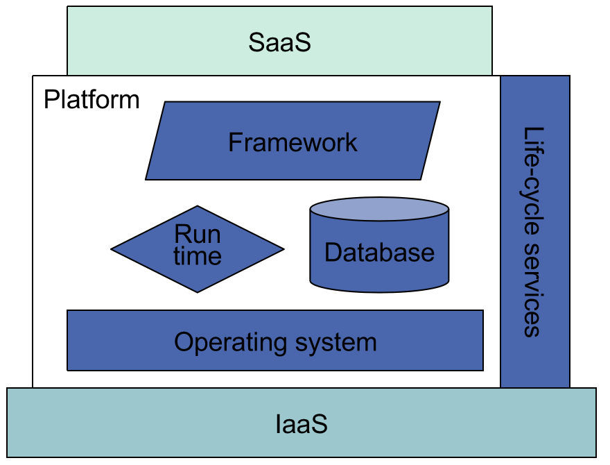
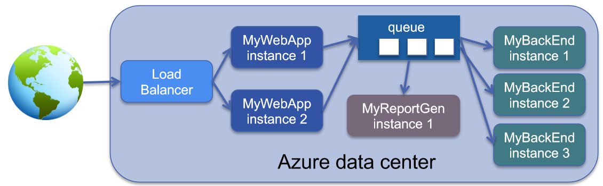
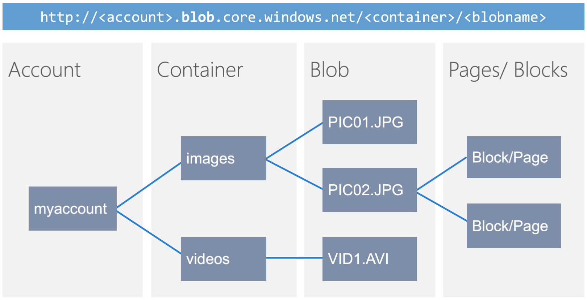

## Platform as a Service: Recap

**PaaS** is an **integrated environment** that supports the **development, running and management** of cloud-based applications:

- Oriented to **software development and operations**, with proper design tools, middleware and APIs.
- Offers **key services** (data storage, caching, mail).
- Typically supports a **set of programming languages** (Python, Java, C#, Scala).
- The user deploys applications onto the cloud infrastructure, and **does not manage or control the underlying cloud**, but has control over the deployed applications and possibly the hosting environment configuration.

The **main services** belonging to PaaS are:

- Application **development and execution** services.
- Integrated **lifecycle** services.
- **Workload management** services.
- **Data management** services.

The enabling technique is the **runtime environment**, and the provided service is the **programming IDE** (see [Introduction](../01-introduzione-al-cloud/#paas---platform-as-a-service)).

:::tip[In one line]
**PaaS = Development-execution platform + services.** It sits between IaaS (below) and SaaS (above): operating system, runtime, database, framework and life-cycle services.
:::

## The Shift Introduced by PaaS

**Traditional development issues.** Creating a traditional development environment means:

- Acquiring servers.
- Installing and configuring operating systems, runtime environments and databases.
- Creating and configuring a source control repository (configuration management) like Git.
- Moving or copying existing code.
- Deploying, testing and running the code.

The **challenge** is building a **proper replica of the operation environment**.

**The shift introduced by PaaS:**

- Developers **do not need to care about installation, configuration and operation** of servers, runtime and databases. They focus on development and on managing **versions and configuration** of the application.
- They are supported by:
    - **Development services**: build, test, software repositories.
    - **Run-time services**: containers/sandboxes for running and scaling applications.
- They can **test workload spikes** by letting the application **self-acquire new resources**, possibly released automatically when no longer needed. Different test workload patterns can be generated.
- The application life-cycle can be made **"agile"**, with **continuous development and deployment**:
    - Deployment is **faster and safer**.
    - The state of software becomes **more visible** to the organization.
    - Collaboration increases, even in a dispersed/global team.
    - Developers and testers interact with the **same hosted application and runtime as the operators**.

:::tip[Goals]
Make the workflow **repeatable, reliable, predictable and fast** (low cycle time).
:::

## Azure: Web Roles and Worker Roles

**Azure App Service** provides a **fully managed PaaS environment** for deploying and running web applications. Applications execute inside **isolated sandboxes**, where developers focus on **application logic** rather than managing servers or operating systems. There are two execution roles.

| | Web Role | Worker Role |
| --- | --- | --- |
| **Tier** | **Frontend** | **Backend** |
| **Purpose** | User-facing logic, processes **HTTP(S) requests** and exposes HTTP endpoints | **Asynchronous or long-running** workloads, decoupled from direct user interaction |
| **Environment** | A **managed IIS** (Internet Information Services) environment, preconfigured by Azure | An isolated, managed VM provisioned and monitored by Azure |
| **Gets work from** | Azure's **load balancer** | A **queue or service bus**, with tasks generated by Web Roles or other services |
| **Examples** | Web applications in ASP.NET, Java, Python, PHP, Node.js | Data transformation, batch computation, integration tasks |
| **Scaling** | Scaled out dynamically on demand (CPU usage, request rate) | **Independently of Web Roles** |
| **State** | **Stateless by design**: state is externalized (Azure Storage, Redis, SQL Database) | **Stateless**: state in external storage (Blob, Table, SQL Database) |

:::tip[In essence]
- The **Web Role** is the **frontend tier** of a PaaS application: an automatically managed web-hosting environment that hides infrastructure complexity while keeping scalability and resilience.
- The **Worker Role** is the **backend execution tier**: it processes queued or event-driven workloads while Azure manages infrastructure, scaling and availability.
:::

In the example, a **load balancer** distributes traffic between web role instances (MyWebApp), which put tasks in a **queue**. Backend instances (MyBackEnd) and a report generator take them from there. Communication between web and worker roles is typically handled through a **message queue** or a **service bus (pub-sub)**. **The queue decouples the back-end from the rest**: the two sides can scale and fail independently.

### More on Roles

- Both roles run inside **Azure Cloud Services**, composed of one or more VMs that are **not directly exposed to the user**: the platform abstracts and orchestrates them as PaaS components.
- You do not manage the VM's OS, networking or runtime: **Azure takes care of deployment, patching, scaling, fault recovery and load balancing**.
- What you deploy is your **role package**: an application bundle with your **code, configuration, security and startup tasks**. Azure's **fabric controller** places it into a VM instance.

:::caution[Why roles must be stateless]
The VM **can be recycled or replaced by the platform at any time** (for updates or scaling), which is why roles must be **stateless** and store persistent data **externally**. It is the same reasoning as [ephemeral EC2 instances](../04-amazon-aws/#ephemeral-resources).
:::

:::caution[Slides 12-14 vs 15: where do roles live?]
Slides 12-14 place the roles in *Azure App Service*, slide 15 in *Azure Cloud Services*. The second is correct: web and worker roles are the model of **Cloud Services**, an older Azure service. For the exam, what matters is the **concept** of role: a stateless frontend and backend, separated by a queue.
:::

## Auto Scaling and Throttling

### Azure Auto Scaling Application Block

A component that enables **automatic adjustment of deployed instances** based on scaling policies: it **scales out** (adds instances) or **scales in** (removes instances) in response to workload changes, for performance stability and cost efficiency.

| Scaling rules | Purpose |
| --- | --- |
| **Constraint rules** | Lower or upper **bounds** on the number of instances of a role |
| **Reactive rules** | Dynamically trigger scaling actions in response to **monitored metrics** (CPU usage, queue length, request rate) |

Related mechanisms:

- **Scaling Groups**: multiple roles share common scaling logic and thresholds.
- **Throttling Actions**: temporarily limit workload intensity **when scaling cannot keep up**.
- **Stabilizer (Cooldown Period)**: prevents frequent up/down oscillations by enforcing a minimum time between scaling actions, typically **20 minutes**.

### Throttling

:::tip[Definition]
**Throttling** is a **protective mechanism** that **limits the rate** at which clients or workloads can consume resources **when system capacity is under stress**. It keeps the system **stable** and serving legitimate requests, preventing overload or resource exhaustion.
:::

Key concepts:

- **Rate limits / quotas**: a maximum number of operations per time window (requests per second, calls per minute).
- **Rejecting or delaying excess requests**: once limits are hit, requests are refused (e.g. **HTTP 429**) or queued/delayed.
- **Graceful degradation**: nonessential operations are slowed or disabled to **preserve core functionality**.
- **Combining with auto-scaling**: throttling acts as a **buffer until scaling completes**. Once new capacity is available, normal rates resume.
- **Per-tenant / per-user limits**: in a multi-tenant system, throttling prevents one user from **monopolizing** shared resources.

Example of rejecting: an overloaded web role may throttle its users by only allowing **100 at a time**. This improves performance and can prevent the system from crashing during busy times.

## Persistent Data and Azure Storage

| Type | What it is | Notes |
| --- | --- | --- |
| **Blobs** | Named files with **metadata** | Binary Large Objects. A **Distributed File Service**: each blob is distributed among multiple servers and **replicated at least 3 times**. **Only one level of folders**, called **containers** |
| **Tables** | Lightly structured storage: entities with properties | **Not an RDBMS**, no relationships. **NoSQL key-value** with flexible schema. Up to 255 properties and 1 MB per entity. **Strongly consistent** |
| **Queues** | Messages | **Reliable storage and delivery** of messages |
| **SQL Azure** | **SQL Server in the cloud** | No administrative overhead, shared or dedicated hardware, **99.99% availability**, automatic patching and backups, pay-as-you-grow, familiar development model |
| **Cosmos DB** | Fully managed, schema-free document database | **Multi-model NoSQL**: key-value, graph, column-family, document. Automatic indexing, **under 10 ms latency** for reads and writes at the 99th percentile, worldwide |

A blob's structure is **account → container → blob → blocks or pages**, with URLs like `http://<account>.blob.core.windows.net/<container>/<blobname>`.

In **Tables**, every entity has three mandatory properties: **PartitionKey** and **RowKey**, the **only indexed properties**, which together **uniquely identify** the entity and define the **sort order**, and the **Timestamp**. The same RowKey can be used in different PartitionKeys. *Strongly consistent* means every reader sees the latest version of the data.

:::caution[Slide 26]
The slide writes *CosmoDB*: the correct name is **Cosmos DB**.
:::

## Remarks: Value and Issues of PaaS

**Business value**:

- **Reducing costs**: server, storage and network, maintenance of the platform, support personnel.
- **Improving speed, flexibility and agility**: fast time-to-market without huge upfront investment and planning, and support for expanding the investment as needed.

**Issues**:

- Adopting **tools not supported** by the PaaS can be a problem.
- The **PaaS lock-in problem**: it is hard to leave the provider. Ways to limit it:
    1. Use only clouds that offer **standard programming and execution frameworks**.
    2. Rely on attempts by PaaS providers to **standardize APIs** (see **Cloud Foundry**).
    3. Develop approaches that support **multi-cloud** development, deployment and operation.

## Self-Test

**1.** What is the difference between a web role and a worker role?

Solution

The **web role** is the frontend tier: it runs in managed IIS, processes HTTP(S) requests and sits behind the load balancer. The **worker role** is the backend tier: it runs asynchronous or long-running workloads, usually taken from a queue or service bus.

**2.** Why is there a queue between web roles and worker roles?

Solution

To **decouple** them: the two tiers scale independently, and a spike or failure in the backend does not block the frontend.

**3.** Why must roles be stateless?

Solution

Because the platform can recycle or replace the VM at any time, for updates or scaling. Persistent data goes to external storage.

**4.** What is the difference between auto scaling and throttling?

Solution

**Auto scaling** increases capacity. **Throttling** limits demand when capacity is not enough, acting as a buffer until new capacity arrives.

**5.** Which HTTP status code indicates a request rejected by throttling?

Solution

429 (Too Many Requests).

**6.** What is PaaS lock-in, and how can it be limited?

Solution

The dependence on one provider, which makes leaving it hard. It is limited by using standard frameworks, standardized APIs such as Cloud Foundry, and multi-cloud approaches.

**7.** What are the mandatory properties of an Azure Table entity?

Solution

PartitionKey, RowKey and Timestamp. PartitionKey and RowKey are the only indexed properties.

**8.** What are the two types of scaling rules in the Azure Auto Scaling Application Block?

Solution

Constraint rules (lower and upper bounds on instances) and reactive rules (scaling in response to metrics).

## Glossary

- **Web Role** - Frontend tier of a PaaS application.
- **Worker Role** - Backend tier for asynchronous workloads.
- **Role package** - Bundle with code, configuration, security and startup tasks.
- **Fabric controller** - Azure component that places role packages into VMs.
- **Service Bus** - Azure publish-subscribe messaging.
- **Constraint rule / Reactive rule** - Bound rules and metric-driven rules.
- **Stabilizer** - Cooldown in Azure auto scaling.
- **Throttling** - Limiting resource consumption under stress.
- **Graceful degradation** - Slowing or disabling nonessential features.
- **PaaS lock-in** - Dependence on a single provider.
- **Blob** - Binary Large Object.
