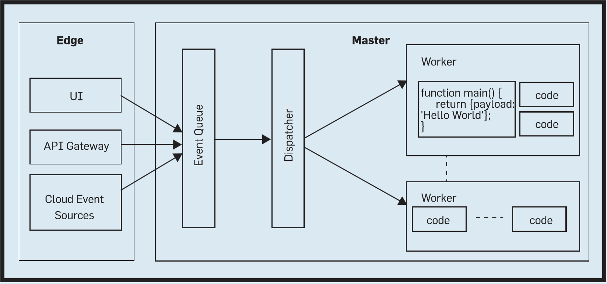

:::note[Source]
This page summarizes the paper *The Rise of Serverless Computing* (Castro, Ishakian, Muthusamy, Slominski, Communications of the ACM, December 2019), listed as study material for Topic 01. There are no slides: definitions and terms come from the paper. Some market figures date back to that year.
:::

## The Problem

The cloud made **pay-as-you-go** and **elasticity** popular, but the **burden of scaling stayed with developers**, who often over-provision to handle peaks. The result is a large gap between the resources paid for (rented VMs) and those actually used.

Serverless aims to fulfil the original promise of the cloud as a **utility**: pay only for what you use, without managing anything.

## Definition

:::tip[Definition]
**Serverless computing** is a platform that **hides server usage from developers** and **runs code on-demand**, **automatically scaled** and **billed only for the time the code is running**.
:::

The name does not mean there are no servers, but that developers **do not need to worry about them**: provisioning, monitoring, maintenance, scalability and fault tolerance are taken care of by the provider.

The definition captures the **two key features**:

- **Cost**: billed **only for what is running** (pay-as-you-go). You do not pay for idle servers, nor for the overhead of creating and destroying them. Billing uses **fine-grained time units**, like hundreds of milliseconds. This is **"scaling to zero"**.
- **Elasticity**: scaling **from zero to "infinity"**. Developers do not write autoscaling policies: the provider starts more parallel executions when demand grows.

### Function as a Service

:::tip[Definition]
**FaaS** is a serverless platform where the unit of computation is a **function**, executed in response to **triggers** such as events or HTTP requests.
:::

The most natural way to use serverless is to provide a **piece of code (function)** to be executed. Functions run for a **limited time** (at most minutes) and have **no persistent state**, because they may be restarted at any time. These two constraints make it easy for the provider to run and scale them. If state is needed, external services are used.

Serverless and FaaS are often used **interchangeably**, but serverless is broader: **FaaS is the most popular type** of serverless computing.

The paper also quotes **Paul Johnston** (co-founder of ServerlessDays): a solution is serverless if it **costs nothing when no one is using it**, excluding stored data.

## Comparison with Other Models

Serverless can be seen as an **evolution of PaaS**: it takes away the user's control over hosting, in exchange for simpler scaling and more attractive billing.

| | IaaS | 1st Gen PaaS | FaaS | BaaS/SaaS |
| --- | --- | --- | --- | --- |
| **Expertise required** | High | Medium | Low | Low |
| **Developer control / customization** | High | Medium | Low | Very low |
| **Scaling / cost** | High expertise to build and tune auto-scaling rules | High expertise to build and tune auto-scaling rules | Auto-scaling to the requested load, pay only when running (**scale to zero**) | Hidden from users, limits based on pricing and QoS |
| **Unit of work deployed** | Low-level infrastructure building blocks (VMs, network, storage) | Packaged code deployed and running as a service | **One function execution** | App-specific extensions |
| **Granularity of billing** | Minutes to hours per resource, years for discounts | Minutes to hours per resource, years for discounts | **Hundreds of milliseconds** of execution time | Subscription by number of users, billed in months |

:::caution[Serverless is not a free quota]
A **free monthly usage quota** is something else: it is counted even if the application is not used (e.g. Google App Engine Standard priced in "instance hours"). Serverless means that if the code is not running, you pay nothing.
:::

**BaaS** (*Backend as a Service*), or MBaaS for mobile, offers ready-made backend functions, such as push notifications. It is similar to serverless, but user code was typically limited to that application domain (e.g. mobile use cases).

## FaaS Architecture

The core of a FaaS platform is an **event processing system**:



The flow of an event:

1. An event arrives from a UI, an API gateway or cloud event sources.
2. The platform **validates** it: authentication, authorization and resource limits.
3. The event is put in a **queue**.
4. The **dispatcher** assigns it to a **worker**, which allocates a container, copies the function code into it and runs it.
5. The platform collects logs, makes the response available, and stops and deallocates idle instances.

**Containers** are usually used to isolate functions of different users.

### Cold Start

Creating, starting and destroying a container for every invocation is expensive and adds latency: this is the **cold start problem**. It is mitigated with:

- **Warm containers**: already instantiated, reused for the same user.
- **Stem cell containers**: a pool of containers already started but not yet assigned.
- **Caching** of commonly used libraries on workers, since downloading them slows down startup.

There is an underlying tension: **scaling to zero causes cold starts**.

### Resources and Programming Model

The only resource usually configurable is **memory**: CPU and other resources are allocated proportionally.

The model is based on two primitives:

| Primitive | Meaning |
| --- | --- |
| **Action** | A **stateless function** that runs arbitrary code. It can be invoked synchronously or asynchronously |
| **Trigger** | A class of events from various sources |

An event can trigger several functions in parallel, and the result of a function can trigger another in sequence. A typical function receives a dictionary (JSON) and a *context* object with the execution environment, and returns a dictionary.

```javascript
function main(params, context) {
    return { payload: 'Hello, ' + params.name + ' from ' + params.place };
}
```

Functions depend on an **ecosystem** of provider services, such as storage and machine learning. The function scales, but the underlying storage must ensure its own reliability and QoS.

## When It Pays Off

The economic advantage is greatest for **bursty workloads**: elasticity is delegated to the platform and, above all, when the system is idle the cost is **zero**.

### Use Cases

| Use case | Example | Idea |
| --- | --- | --- |
| **Event processing** | Netflix: uploading a video to S3 triggers functions that split and transcode it in parallel | Stateless, **idempotent** functions: on failure they can be re-executed without side effects |
| **API composition** | A mobile app that calls geolocation, weather and translation APIs | A function acts as aggregator, reducing client code |
| **Map-Reduce style analytics** | PyWren on AWS Lambda | Highly parallel workloads, using S3 for storage |
| **Multi-tenant cloud services** | A Cloud Guru: each user in its own security context | Isolation and scalability with little code |

:::caution[The serverless anti-pattern]
A function that calls one API after another, waiting for each response, **pays for the waiting time** while idle on I/O: this is a **serverless anti-pattern**. The fix is to wrap each call in a function and **chain them in a sequence**, a composition that behaves like a single function. Tools like AWS Step Functions handle complex orchestrations, possibly at additional cost.
:::

If a workload cannot be split into small units, batch systems are better. If it tolerates restarts, [spot instances](../04-amazon-aws/#ec2-pricing) are a good alternative.

## Challenges and Limits

- **Programming models and tooling**: functions are many and short, so debugging and finding bottlenecks is hard. Traditional tools that need server access do not apply. Recovery semantics (*at-least-once*, *at-most-once*) and support for refactoring and rollback are needed.
- **Lack of standards and vendor lock-in**: the area is new and changing quickly. Meanwhile, frameworks compatible with multiple providers are used.

## Research Opportunities

- **System level**: reducing cold starts while keeping scale to zero, and asking whether containers are the right abstraction, or whether e.g. **unikernels** are needed.
- **Legacy code**: automatically splitting it into smaller units.
- **Stateful serverless**: whether it is possible without losing scalability and fault tolerance.
- **SLAs**: hard to guarantee, because the application depends on services outside the platform.
- **Serverless at the edge**: events often originate at the edge of the network, with IoT and mobile devices. There, cost may be defined differently, e.g. energy matters more than speed.

## Self-Test

**1.** Define serverless computing and give its two key features.

<details>
<summary>Solution</summary>

A platform that hides server usage from developers and runs code on demand, automatically scaled and billed only for the time the code is running. The key features are **cost** (pay-as-you-go, scaling to zero) and automatic **elasticity**.

</details>

**2.** What is the difference between serverless and FaaS?

<details>
<summary>Solution</summary>

Serverless is the general paradigm. FaaS is its most popular type, with the function as the unit of computation.

</details>

**3.** Why are FaaS functions stateless and short-lived?

<details>
<summary>Solution</summary>

So that the provider can allocate servers when needed, stop them at the end and restart a function at any time: the platform stays easy to scale.

</details>

**4.** What is the cold start problem, and how is it mitigated?

<details>
<summary>Solution</summary>

The latency of creating a container for a new invocation. It is mitigated with warm containers, pools of stem cell containers and library caching.

</details>

**5.** Why is a function that orchestrates sequential API calls an anti-pattern?

<details>
<summary>Solution</summary>

Because you pay for the time the function waits on I/O. Better one function per call, chained in a sequence.

</details>

**6.** How does FaaS differ from 1st generation PaaS?

<details>
<summary>Solution</summary>

It removes the user's control over hosting. It scales automatically down to zero, bills in hundreds of milliseconds and needs no auto-scaling rules.

</details>

**7.** For which workloads is serverless most convenient?

<details>
<summary>Solution</summary>

**Bursty**, intermittent workloads, because idle periods cost nothing. With sustained demand, reserved VMs or clusters may be cheaper.

</details>

## Glossary

- **Serverless** - Model where servers are hidden and only execution is billed.
- **FaaS** - Function as a Service, serverless with functions as the unit of computation.
- **BaaS** - Backend as a Service, ready-made backend functions.
- **Scaling to zero** - No active resources, and no cost, when there is no work.
- **Action / Trigger** - Stateless function and the event class that activates it.
- **Cold start** - Startup latency of a function without a ready container.
- **Warm container** - Already started, reusable container.
- **Stem cell container** - Pre-started container not yet assigned.
- **Idempotent** - Can be executed several times with the same effect.
- **Bursty** - Workload made of short, irregular peaks.
- **Unikernel** - Minimal image with an application and only the OS parts it needs.
