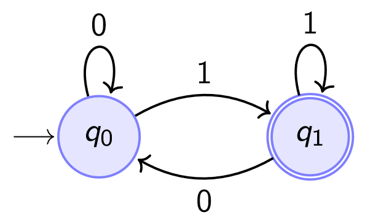
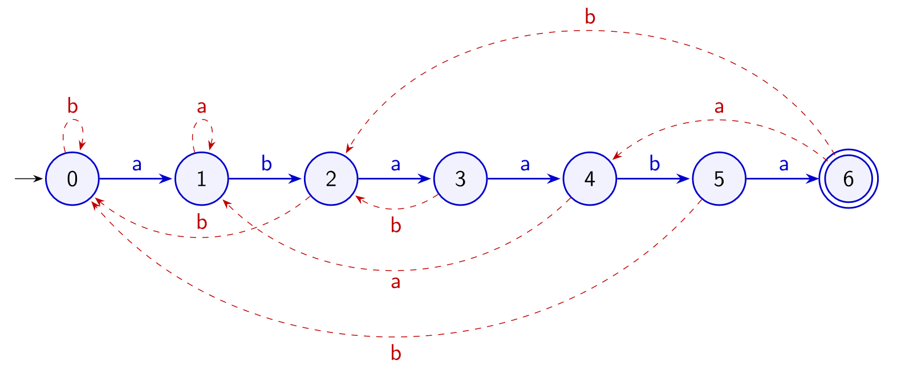

## Cos'è un Automa a Stati Finiti

Un **automa** è un modello di calcolo che **riconosce un linguaggio**, cioè un insieme (tipicamente infinito) di stringhe che godono di una certa proprietà. Riceve in input una stringa e risponde sì o no: la stringa appartiene al linguaggio oppure no.

Un **Automa a Stati Finiti (ASF)** è un automa che riconosce un **linguaggio regolare**. L'idea è che l'automa legge l'input un simbolo alla volta, e l'unica memoria che ha è lo **stato** in cui si trova, scelto da un insieme finito.

## Definizione Formale

:::tip[Definizione]
Un **Automa a Stati Finiti** è una quintupla:

$$
ASF := (Q, \Sigma, \delta, q_0, F)
$$
:::

| Componente | Significato |
| --- | --- |
| $Q$ | Insieme **finito** degli stati |
| $\Sigma$ | **Alfabeto** di input |
| $\delta : Q \times \Sigma \to Q$ | **Funzione di transizione** |
| $q_0 \in Q$ | **Stato iniziale** |
| $F \subseteq Q$ | Insieme degli stati **accettanti** (o finali) |

La funzione $\delta$ dice, dato lo stato corrente e il simbolo letto, in quale stato spostarsi. Una stringa è **accettata** se, partendo da $q_0$ e leggendola tutta, l'automa si ferma in uno stato di $F$.

## Esempio: Stringhe che Terminano con 1

Costruiamo un ASF che riconosce le stringhe su $\Sigma = \{0, 1\}$ che terminano con `1`:

- $Q = \{q_0, q_1\}$
- $q_0$ è lo stato iniziale
- $F = \{q_1\}$

La funzione di transizione si può scrivere come tabella:

| Stato | $\delta(\cdot, 0)$ | $\delta(\cdot, 1)$ |
| --- | --- | --- |
| $q_0$ | $q_0$ | $q_1$ |
| $q_1$ | $q_0$ | $q_1$ |

:::note[Esempio di esecuzione]
Con $S$ = `100101` la sequenza degli stati è:

$$
q_0 \xrightarrow{1} q_1 \xrightarrow{0} q_0 \xrightarrow{0} q_0 \xrightarrow{1} q_1 \xrightarrow{0} q_0 \xrightarrow{1} q_1
$$

La lettura finisce in $q_1 \in F$, quindi la stringa è accettata.
:::

Vale la pena notare **cosa ricorda** ogni stato: $q_1$ significa "l'ultimo simbolo letto è 1", $q_0$ significa il contrario. Non serve ricordare altro. Lo stesso ragionamento è la chiave per usare un automa nella ricerca di un pattern.

## Dall'Automa alla Ricerca di un Pattern

Possiamo usare un ASF per la ricerca esatta di un pattern $P$ di lunghezza $m$ definito su un alfabeto $\Sigma$. L'idea è **costruire un automa a partire dal pattern**, in modo che ogni stato ricordi **quanta parte del pattern è stata appena letta**:

| Componente | Definizione per $P$ |
| --- | --- |
| $\Sigma$ | Alfabeto di definizione di $P$ (può contenere anche simboli che in $P$ non compaiono) |
| $Q$ | $\{0, 1, 2, \dots, m-1, m\}$ |
| $\delta$ | $Q \times \Sigma \to Q$, definita qui sotto |
| Stato iniziale | $0$ |
| $F$ | $\{m\}$, l'unico stato accettante |

Lo stato $j$ significa: *"gli ultimi $j$ simboli letti sono i primi $j$ simboli di $P$"*. Lo stato $m$ significa quindi che abbiamo appena letto tutto il pattern. La transizione $\delta$ **segue il pattern, oppure torna a una posizione di prefisso del pattern**.

:::note[Collegamento con l'esempio precedente]
Un automa così riconosce le stringhe che **terminano con $P$**. L'automa "termina con 1" visto sopra è proprio l'ASF del pattern $P$ = `1`: basta rinominare $q_0$ in $0$ e $q_1$ in $1$.
:::

### Come Definire la Transizione

Siamo nello stato $i$ e leggiamo il simbolo $\sigma$. Ci sono due casi:

1. **Match**: se $\sigma$ è il simbolo $P[i+1]$, avanzo allo stato successivo $i + 1$.
2. **Mismatch**: altrimenti salto a uno stato $k$, dove $k$ è la **lunghezza massima di un suffisso di $P[1:i]\sigma$ che coincide con un prefisso di $P$**.

Perché nel secondo caso non si torna semplicemente allo stato 0? Perché una parte di quanto letto potrebbe essere l'inizio di una nuova occorrenza, e non vogliamo perderla.

:::note[Esempio]
Con $P$ = `acacbac`, nello stato 4 abbiamo letto `acac`. Leggiamo `a`, ma il pattern voleva `b`. Tornare a 0 sarebbe un errore: la stringa letta è `acaca`, e il suo suffisso `aca` è un prefisso di $P$. Quindi si salta allo stato 3.
:::

Il concetto che formalizza "il più lungo suffisso che è anche prefisso" è il **bordo**.

## Il Bordo

:::tip[Definizione]
Il **Bordo** $B(X)$ è il più lungo prefisso **proprio** di $X$ che occorre anche come suffisso di $X$.
:::

"Proprio" significa diverso da $X$: senza questa condizione la risposta sarebbe sempre $X$ stessa, perché ogni stringa è prefisso e suffisso di se stessa.

| $X$ | $B(X)$ | Osservazione |
| --- | --- | --- |
| `baaccbbaac` | `baac` | Compare all'inizio e alla fine |
| `aaaccbbaac` | $\varepsilon$ | Nessun prefisso non vuoto è anche suffisso |
| `abababa` | `ababa` | Prefisso e suffisso si possono **sovrapporre** |
| `aaaaaaaa` | `aaaaaaa` | Lunghezza $\lvert X \rvert - 1$, il massimo possibile |
| `a` | $\varepsilon$ | L'unico prefisso non vuoto è $X$, che non è proprio |

La **concatenazione** di $X$ con il simbolo $s$ si scrive $Xs$: se $X$ = `baca` e $s$ = `d`, allora $Xs$ = `bacad`.

## La Funzione di Transizione

La funzione $\delta(j, s)$ indica lo stato raggiunto a partire dallo stato $j$ dopo aver letto il simbolo $s$:

$$
\delta : \{0, 1, \dots, m\} \times \Sigma \to \{0, 1, \dots, m\}
$$

Ci sono due casi fondamentali.

**1. Transizione allo stato successivo** $j + 1$ attraverso il simbolo corretto di $P$:

$$
j < m \;\wedge\; P[j+1] = s \;\Longrightarrow\; \delta(j, s) = j + 1
$$

**2. Transizione a uno stato precedente** $k \le j$ per mezzo del simbolo $s$:

$$
j = m \;\vee\; P[j+1] \ne s \;\Longrightarrow\; \delta(j, s) = \lvert B(P[:j]s) \rvert = k
$$

:::tip[In una riga]
Si legge così: **se posso avanzare avanzo, altrimenti prendo la lunghezza del bordo di ciò che ho letto più il nuovo simbolo.**
:::

Tre osservazioni:

- Il caso $j = m$ è sempre un "mismatch", perché $P[m+1]$ non esiste. Dopo un'occorrenza completa l'automa non si ferma: riparte dal bordo, e così trova anche le occorrenze **sovrapposte**.
- Dallo stato 0 si arriva allo stato 0 con qualsiasi simbolo $s \ne P[1]$. Si arriva allo stato 1 solo se $s = P[1]$.
- Il bordo fa esattamente ciò che chiedevamo. Il suffisso cercato è un prefisso di $P$ ma, essendo in mismatch, non può essere tutta la stringa $P[:j]s$. È quindi un prefisso **proprio** di $P[:j]s$ che ne è anche suffisso, cioè un bordo.

:::caution[Slide 7-8: k < i oppure k ≤ j?]
Le slide 7 e 8 scrivono $k < i$, la slide 10 scrive $k \le j$. Quella corretta è la seconda: si può **restare nello stesso stato**. Con $P$ = `acacbac` vale $\delta(1, a) = 1$, perché `aa` ha bordo `a`. Nel disegno degli automi questi sono gli anelli sugli stati.
:::

### Esempi di Transizione

Con il pattern $P$ = `acacbabbaabac` (lunghezza $m = 13$):

| Transizione | Caso | Calcolo |
| --- | --- | --- |
| $\delta(6, b) = 7$ | Avanzamento | Il 7° carattere di $P$ è `b` |
| $\delta(0, a) = 1$ | Avanzamento | Il 1° carattere di $P$ è `a` |
| $\delta(6, c) = 2$ | Raccordo | $\lvert B(P[:6]c) \rvert = \lvert B(\texttt{acacbac}) \rvert = \lvert \texttt{ac} \rvert = 2$ |
| $\delta(0, c) = 0$ | Raccordo | $\lvert B(P[:0]c) \rvert = \lvert B(\varepsilon c) \rvert = \lvert B(\texttt{c}) \rvert = 0$ |
| $\delta(13, a) = 3$ | Raccordo | $\lvert B(P[:13]a) \rvert = \lvert B(\texttt{acacbabbaabaca}) \rvert = \lvert \texttt{aca} \rvert = 3$ |

## Costruire la Tabella a Mano

Questo è l'esercizio tipico. Per ogni stato $j$ e ogni simbolo $s$:

1. Se $s = P[j+1]$, scrivi $j + 1$.
2. Altrimenti, scrivi la stringa $P[:j]s$ e cercane il bordo: il risultato è la sua lunghezza.

Vediamolo con $P$ = `acacbac`, $\Sigma = \{a, b, c\}$, $m = 7$:

| Stato $j$ | $\delta(j, a)$ | $\delta(j, b)$ | $\delta(j, c)$ |
| --- | --- | --- | --- |
| **0** | 1 | 0 | 0 |
| **1** | 1 | 0 | 2 |
| **2** | 3 | 0 | 0 |
| **3** | 1 | 0 | 4 |
| **4** | 3 | 5 | 0 |
| **5** | 6 | 0 | 0 |
| **6** | 1 | 0 | 7 |
| **7** | 3 | 0 | 0 |

Controlliamo due righe. Nello **stato 4** ho letto `acac`:

- Con `a`: `acaca` ha bordo `aca`, quindi vado in 3.
- Con `b`: è il simbolo atteso, avanzo in 5.
- Con `c`: `acacc` ha bordo $\varepsilon$, quindi vado in 0.

Nello **stato 7** ho letto tutto il pattern, quindi ogni simbolo è un mismatch:

- Con `a`: `acacbaca` ha bordo `aca`, quindi vado in 3.
- Con `b`: `acacbacb` ha bordo $\varepsilon$, quindi vado in 0.
- Con `c`: `acacbacc` ha bordo $\varepsilon$, quindi vado in 0.

### Simboli che Non Compaiono nel Pattern

Cosa succede se aggiungiamo all'alfabeto un carattere assente dal pattern? Con lo stesso $P$ = `acacbac`, ma $\Sigma = \{a, b, c, d\}$, la tabella resta uguale con in più la colonna $\delta(j, d)$, che vale **0 per ogni stato**.

Il motivo è immediato: qualsiasi suffisso di $P[:j]d$ non vuoto termina con `d`, quindi non può essere un prefisso di $P$. Leggere un simbolo estraneo azzera tutto. L'alfabeto non cambia il comportamento dell'automa sui simboli di $P$, ma fa crescere la tabella.

## L'Automa come Grafo

La stessa funzione si può disegnare come grafo. Per il pattern $P$ = `abaaba` su $\Sigma = \{a, b\}$:

- Le **frecce blu** sono le transizioni di match/progresso ($j \to j + 1$).
- Le **frecce rosse tratteggiate** sono le transizioni per mismatch.

| Stato $j$ | $\delta(j, a)$ | $\delta(j, b)$ |
| --- | --- | --- |
| **0** | 1 | 0 |
| **1** | 1 | 2 |
| **2** | 3 | 0 |
| **3** | 4 | 2 |
| **4** | 1 | 5 |
| **5** | 6 | 0 |
| **6** | 4 | 2 |

Ogni stato ha una freccia uscente per ogni simbolo dell'alfabeto, quindi il grafo ha $(m + 1) \cdot \lvert \Sigma \rvert = 14$ archi: 6 blu e 8 rossi.

Le due frecce che escono dallo stato finale mostrano bene la gestione delle sovrapposizioni. Da 6, leggendo `a` si ottiene `abaabaa`, che ha bordo `abaa`, quindi si va in 4. Leggendo `b` si ottiene `abaabab`, che ha bordo `ab`, quindi si va in 2.

## Autotest

**1.** Calcola il bordo di `abcab`, `aaba`, `abcabcab`, `abcd` e `ababab`.

Soluzione

| $X$ | $B(X)$ |
| --- | --- |
| `abcab` | `ab` |
| `aaba` | `a` |
| `abcabcab` | `abcab` |
| `abcd` | $\varepsilon$ |
| `ababab` | `abab` |

**2.** Costruisci la tabella di $\delta$ per $P$ = `aab` su $\Sigma = \{a, b\}$.

Soluzione

| Stato $j$ | $\delta(j, a)$ | $\delta(j, b)$ |
| --- | --- | --- |
| **0** | 1 | 0 |
| **1** | 2 | 0 |
| **2** | 2 | 3 |
| **3** | 1 | 0 |

Nello stato 2 con `a` si ha `aaa`, con bordo `aa`: si resta in 2.

**3.** Costruisci la tabella di $\delta$ per $P$ = `abab` su $\Sigma = \{a, b\}$.

Soluzione

| Stato $j$ | $\delta(j, a)$ | $\delta(j, b)$ |
| --- | --- | --- |
| **0** | 1 | 0 |
| **1** | 1 | 2 |
| **2** | 3 | 0 |
| **3** | 1 | 4 |
| **4** | 3 | 0 |

**4.** Perché nel caso di mismatch la funzione usa il bordo di $P[:j]s$ e non il bordo di $P[:j]$?

Soluzione

Perché lo stato deve descrivere ciò che è stato letto **fino al nuovo simbolo compreso**: il suffisso che ci interessa deve terminare con $s$. Il bordo di $P[:j]$ ignorerebbe l'ultimo simbolo letto.

**5.** Perché nella definizione di bordo il prefisso deve essere proprio?

Soluzione

Perché ogni stringa è prefisso e suffisso di se stessa: senza il vincolo $B(X)$ sarebbe sempre $X$ e il concetto non darebbe alcuna informazione.

**6.** Quanto spazio occupa la tabella di $\delta$ rispetto a $m$ e $\lvert \Sigma \rvert$?

Soluzione

Ha $m + 1$ righe e $\lvert \Sigma \rvert$ colonne, quindi $\Theta(m \lvert \Sigma \rvert)$ celle.

## Glossario

- **Automa** - Modello di calcolo che riconosce un linguaggio.
- **Linguaggio** - Insieme di stringhe che godono di una certa proprietà.
- **Automa a Stati Finiti (ASF)** - Automa con un numero finito di stati, che riconosce un linguaggio regolare.
- **Funzione di transizione ($\delta$)** - Dati stato e simbolo letto, restituisce lo stato successivo.
- **Stato accettante** - Stato in cui la stringa letta fa parte del linguaggio. Nell'automa di un pattern è solo lo stato $m$.
- **Prefisso proprio** - Prefisso di una stringa diverso dalla stringa stessa.
- **Bordo ($B(X)$)** - Il più lungo prefisso proprio di $X$ che ne è anche suffisso.
- **Raccordo** - Transizione di mismatch, che porta allo stato $\lvert B(P[:j]s) \rvert$.
